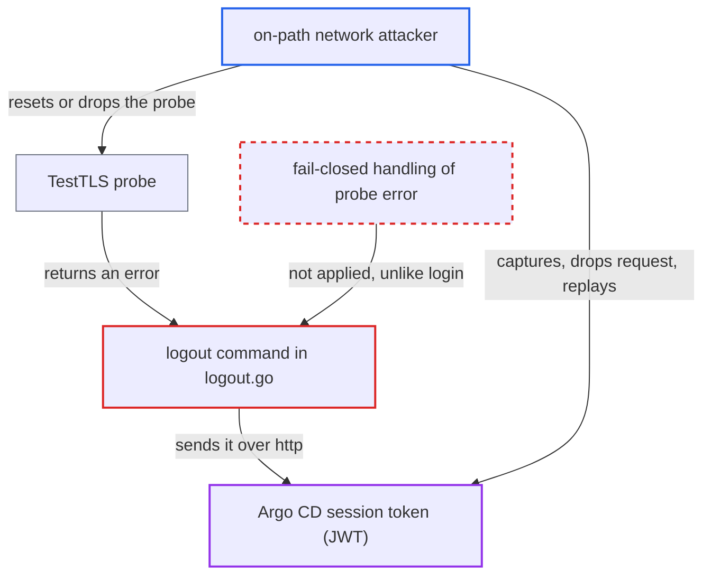

# argocd logout silently downgrades to HTTP and sends the session token in cleartext when the TLS probe fails

| Field | Value |
|---|---|
| ID | `find_018aPsQwyfEvzGFLJR616THG` |
| Severity | **Critical** |
| Status | open |
| CWE | CWE-319 — Cleartext transmission |
| Created | 2026-10-27T21:14:04.829397Z |
| Claude Security | https://claude.ai/security/findings/find_018aPsQwyfEvzGFLJR616THG |

## Description

A network attacker between an `argocd` CLI user and the server can steal the user's Argo CD session token when the user runs `argocd logout`. The attacker must make the TLS probe fail, or the context must be a `--grpc-web-root-path` one, where the probe always fails. In `logout.go`, any error from `grpc_util.TestTLS` switches the command to plain HTTP without asking, so the token goes out in cleartext.

1. **network attacker** makes the TLS probe fail. `TestTLS` returns an error when both its TLS and plaintext gRPC dials fail, for example after a connection reset, a drop or a timeout. ([`util/grpc/grpc.go:90-135`](https://github.com/cx-benchmark/argo-cd/blob/b7bc418289a96130340ea79964c4491b416c14f2/util/grpc/grpc.go#L90-L135))
2. **the command `argocd logout`** treats the probe error as permission for plaintext. It only logs a warning and sets `clientOpts.PlainText = true`, with no prompt, unlike the branch for a probe that reports no TLS. ([`cmd/argocd/commands/logout.go:54-57`](https://github.com/cx-benchmark/argo-cd/blob/b7bc418289a96130340ea79964c4491b416c14f2/cmd/argocd/commands/logout.go#L54-L57))
3. **the command `argocd logout`** builds an `http` URL from the context name. The scheme becomes `http` because `PlainText` is set, and the host is the context name, not the context's stored `server`. ([`cmd/argocd/commands/logout.go:75-79`](https://github.com/cx-benchmark/argo-cd/blob/b7bc418289a96130340ea79964c4491b416c14f2/cmd/argocd/commands/logout.go#L75-L79))
4. **the function `revokeServerToken`** sends the session token over unencrypted HTTP. It POSTs the JWT as the `argocd.token` cookie to `<scheme>://<hostName>/auth/logout`, which is port 80 when the name has no port. ([`cmd/argocd/commands/logout.go:113-137`](https://github.com/cx-benchmark/argo-cd/blob/b7bc418289a96130340ea79964c4491b416c14f2/cmd/argocd/commands/logout.go#L113-L137))
5. **network attacker** captures the request, drops it, and replays the token. The CLI deletes the token locally whatever the server answers, so a dropped request leaves the token valid on the server until it expires.

## Assessment

The attacker sits on the network path between a CLI user and argocd-server and needs no credentials. They reset or drop the gRPC/TLS probe so that `TestTLS` errors. Alternatively, the user's context was created with `--grpc-web-root-path`. Its default name is `server/rootPath`, so the probe dials `host/path:443`, which can never resolve. Every logout from such a context then goes to `http://host/path/auth/logout`. Other probe failures include a timeout, a proxy that does not speak gRPC/HTTP2, or an undialable address. The victim only runs the routine `argocd logout <ctx>`, and prompts are off by default. The attacker then answers or drops the port-80 request and replays the token against the real server. In the default install, plain HTTP that reaches argocd-server is 307-redirected to HTTPS and the Go client follows it. A purely passive observer therefore usually gets a token that is about to be revoked.

Impact: The attacker holds the victim's Argo CD identity and RBAC rights until the token expires. For a typical admin CLI login, that means full read and modify control over applications, projects and settings, including deleting them. If the attacker only watches and the request reaches the server, the token is usually revoked through the redirect.

Subsequent-system impact: With an admin or deploy-capable token, the attacker can create or sync Applications that the application-controller applies to managed clusters with its cluster credentials. This reaches workloads and secrets on those target clusters, as far as the victim's RBAC allows.

## Recommendation

(1) `logout.go:54-57` treats any failed TLS probe as consent to use plaintext. The bearer token can then be sent unencrypted without the user knowing. `argocd login` aborts on the same error at `login.go:98-99`.

Fix criteria: A probe error never switches the revocation request to plaintext by itself. The CLI either skips remote revocation and says so, or requires explicit user confirmation or an explicit `--plaintext`. Test: with the TLS port unreachable, or with a root-path context, `argocd logout` sends no `http://` request carrying the token unless plaintext was explicitly chosen.

(2) `revokeServerToken` takes the host from the context name instead of the context's stored `server`. It also ignores that context's stored `plain-text`, `insecure`, root-path and certificate settings (`logout.go:75-79,117`).

Fix criteria: The revocation request goes to the server address recorded for the context. It honours that context's recorded TLS settings. The token is then only sent to the endpoint and over the transport it was issued for.

## Evidence

**https://github.com/cx-benchmark/argo-cd**

- [`cmd/argocd/commands/logout.go:54-57`](https://github.com/cx-benchmark/argo-cd/blob/b7bc418289a96130340ea79964c4491b416c14f2/cmd/argocd/commands/logout.go#L54-L57)
- [`cmd/argocd/commands/logout.go:75-79`](https://github.com/cx-benchmark/argo-cd/blob/b7bc418289a96130340ea79964c4491b416c14f2/cmd/argocd/commands/logout.go#L75-L79)
- [`cmd/argocd/commands/logout.go:113-137`](https://github.com/cx-benchmark/argo-cd/blob/b7bc418289a96130340ea79964c4491b416c14f2/cmd/argocd/commands/logout.go#L113-L137)
- [`util/grpc/grpc.go:90-135`](https://github.com/cx-benchmark/argo-cd/blob/b7bc418289a96130340ea79964c4491b416c14f2/util/grpc/grpc.go#L90-L135)
- [`cmd/argocd/commands/login.go:151-156`](https://github.com/cx-benchmark/argo-cd/blob/b7bc418289a96130340ea79964c4491b416c14f2/cmd/argocd/commands/login.go#L151-L156)
- [`cmd/argocd/commands/login.go:96-99`](https://github.com/cx-benchmark/argo-cd/blob/b7bc418289a96130340ea79964c4491b416c14f2/cmd/argocd/commands/login.go#L96-L99)

