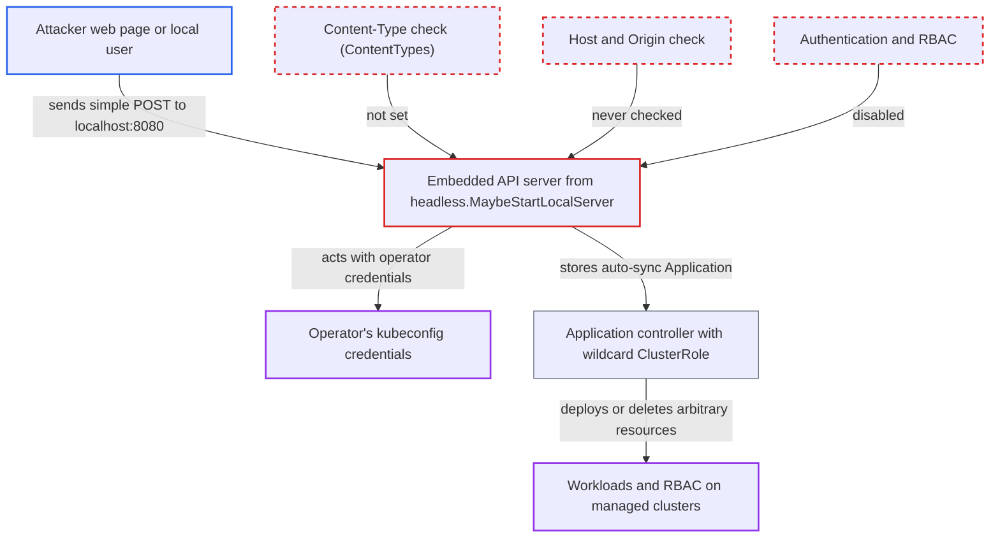

# Core-mode/admin dashboard local API server runs unauthenticated with no CSRF, Host or Origin checks

| Field | Value |
|---|---|
| ID | `find_01XUAXErTch2BTdf7oHmWmwK` |
| Severity | **Critical** |
| Status | open |
| CWE | CWE-306 — Missing authentication |
| Created | 2026-10-27T21:19:46.289741Z |
| Claude Security | https://claude.ai/security/findings/find_01XUAXErTch2BTdf7oHmWmwK |

## Description

A web page the operator visits, or any other local user, can control the Argo CD API that `argocd admin dashboard` and core-mode CLI commands start on the operator's machine. It can create Applications that deploy arbitrary resources across the cluster. The embedded server turns off authentication and RBAC, sets no `ContentTypes`, and checks no `Host` or `Origin`.

1. **operator** starts `argocd admin dashboard`. The command forces core mode and keeps the local API server running on the default `localhost:8080` until the operator stops it. ([`cmd/argocd/commands/admin/dashboard.go:40-48`](https://github.com/cx-benchmark/argo-cd/blob/b7bc418289a96130340ea79964c4491b416c14f2/cmd/argocd/commands/admin/dashboard.go#L40-L48))
2. **embedded API server** starts with authentication and RBAC disabled. The server is built with `DisableAuth: true` and `Insecure: true` on the operator's kubeconfig clientsets, and no per-session token, Host allow-list or Origin check is configured. ([`cmd/argocd/commands/headless/headless.go:274-290`](https://github.com/cx-benchmark/argo-cd/blob/b7bc418289a96130340ea79964c4491b416c14f2/cmd/argocd/commands/headless/headless.go#L274-L290))
3. **attacker's web page** sends a cross-site `text/plain` POST to `http://localhost:8080/api/v1/applications?validate=false`. The body is an Application with automated sync. A `text/plain` POST is a simple request, so the browser sends it without a CORS preflight.
4. **embedded API server** accepts the request without any Content-Type check. `ContentTypes` is empty, so the server skips Content-Type enforcement on `/api/` and only logs a CSRF warning. ([`server/server.go:1282-1286`](https://github.com/cx-benchmark/argo-cd/blob/b7bc418289a96130340ea79964c4491b416c14f2/server/server.go#L1282-L1286))
5. **gateway marshaler** parses the `text/plain` body as JSON. `MIMEWildcard` maps to `JSONMarshaler`, and grpc-gateway falls back to the wildcard for an unregistered Content-Type. ([`server/server.go:1250`](https://github.com/cx-benchmark/argo-cd/blob/b7bc418289a96130340ea79964c4491b416c14f2/server/server.go#L1250))
6. **handler `Create`** stores the Application with the operator's credentials. `Authenticate` returns success at once and the enforcer is disabled, so nothing stops the call. `validate` can also be switched off from the query string. ([`server/application/application.go:350-393`](https://github.com/cx-benchmark/argo-cd/blob/b7bc418289a96130340ea79964c4491b416c14f2/server/application/application.go#L350-L393))
7. **application controller** syncs the injected Application onto the cluster. The default AppProject allows any source, destination and cluster-scoped kind, and in `core-install.yaml` the controller has a `*/*/*` ClusterRole. ([`manifests/core-install.yaml:34152-34169`](https://github.com/cx-benchmark/argo-cd/blob/b7bc418289a96130340ea79964c4491b416c14f2/manifests/core-install.yaml#L34152-L34169))

## Assessment

The operator must be running `argocd admin dashboard`, which listens on the documented `http://localhost:8080` for as long as the UI session lasts, and must visit a page the attacker controls during that time. The browser must also not block requests from public sites to loopback. The attacker page sends a no-preflight `text/plain` POST, so it needs no credentials. With DNS rebinding, the page can also read API responses, because no `Host` or `Origin` check exists. Any other local user or process can call the port directly. Ordinary core-mode CLI commands have the same weaknesses, but they listen on a random port only while the command runs.

Impact: The attacker gets unrestricted Argo CD API control with the operator's kubeconfig. They can create, sync and delete Applications, and add clusters and repositories. With rebinding they can also read Applications, projects, settings and logs. An injected Application can run a pod in the `argocd` namespace that mounts the cluster and repository credential secrets.

Subsequent-system impact: The in-cluster application controller is cluster-admin in `core-install.yaml` and reconciles injected Applications onto destination clusters. The attacker can therefore deploy arbitrary workloads and RBAC, or delete existing ones, on the managed clusters.

## Recommendation

(1) `headless.MaybeStartLocalServer` disables authentication and RBAC and relies only on a loopback bind. Any local process, or any web page in the operator's browser, can drive the API with the operator's Kubernetes credentials.

Fix criteria: The embedded server accepts only requests from the invoking CLI or dashboard session, for example by requiring a per-process secret that other local users and cross-site pages cannot learn. A request to `http://localhost:8080/api/v1/applications` without that secret is rejected. The CLI and dashboard keep working.

(2) The core-mode server never sets `ContentTypes` and never checks `Host` or `Origin`. Cross-site simple POSTs are executed, and DNS-rebound pages can read responses.

Fix criteria: Non-GET `/api/` requests require `application/json` (or an equivalent non-simple header). Requests whose `Host` is not a loopback name or address, or whose `Origin` is cross-site, are rejected. A `text/plain` POST and a request with a foreign `Host` both fail against `admin dashboard`.

## Evidence

**https://github.com/cx-benchmark/argo-cd**

- [`cmd/argocd/commands/headless/headless.go:274-290`](https://github.com/cx-benchmark/argo-cd/blob/b7bc418289a96130340ea79964c4491b416c14f2/cmd/argocd/commands/headless/headless.go#L274-L290)
- [`server/server.go:1282-1286`](https://github.com/cx-benchmark/argo-cd/blob/b7bc418289a96130340ea79964c4491b416c14f2/server/server.go#L1282-L1286)
- [`server/server.go:1250`](https://github.com/cx-benchmark/argo-cd/blob/b7bc418289a96130340ea79964c4491b416c14f2/server/server.go#L1250)
- [`cmd/argocd-server/commands/argocd_server.go:330`](https://github.com/cx-benchmark/argo-cd/blob/b7bc418289a96130340ea79964c4491b416c14f2/cmd/argocd-server/commands/argocd_server.go#L330)
- [`server/server.go:1623-1630`](https://github.com/cx-benchmark/argo-cd/blob/b7bc418289a96130340ea79964c4491b416c14f2/server/server.go#L1623-L1630)
- [`server/server.go:364`](https://github.com/cx-benchmark/argo-cd/blob/b7bc418289a96130340ea79964c4491b416c14f2/server/server.go#L364)
- [`server/server.go:1227-1242`](https://github.com/cx-benchmark/argo-cd/blob/b7bc418289a96130340ea79964c4491b416c14f2/server/server.go#L1227-L1242)
- [`cmd/argocd/commands/admin/dashboard.go:40-48`](https://github.com/cx-benchmark/argo-cd/blob/b7bc418289a96130340ea79964c4491b416c14f2/cmd/argocd/commands/admin/dashboard.go#L40-L48)
- [`server/application/application.go:350-393`](https://github.com/cx-benchmark/argo-cd/blob/b7bc418289a96130340ea79964c4491b416c14f2/server/application/application.go#L350-L393)
- [`server/server.go:303-311`](https://github.com/cx-benchmark/argo-cd/blob/b7bc418289a96130340ea79964c4491b416c14f2/server/server.go#L303-L311)
- [`manifests/core-install.yaml:34152-34169`](https://github.com/cx-benchmark/argo-cd/blob/b7bc418289a96130340ea79964c4491b416c14f2/manifests/core-install.yaml#L34152-L34169)

