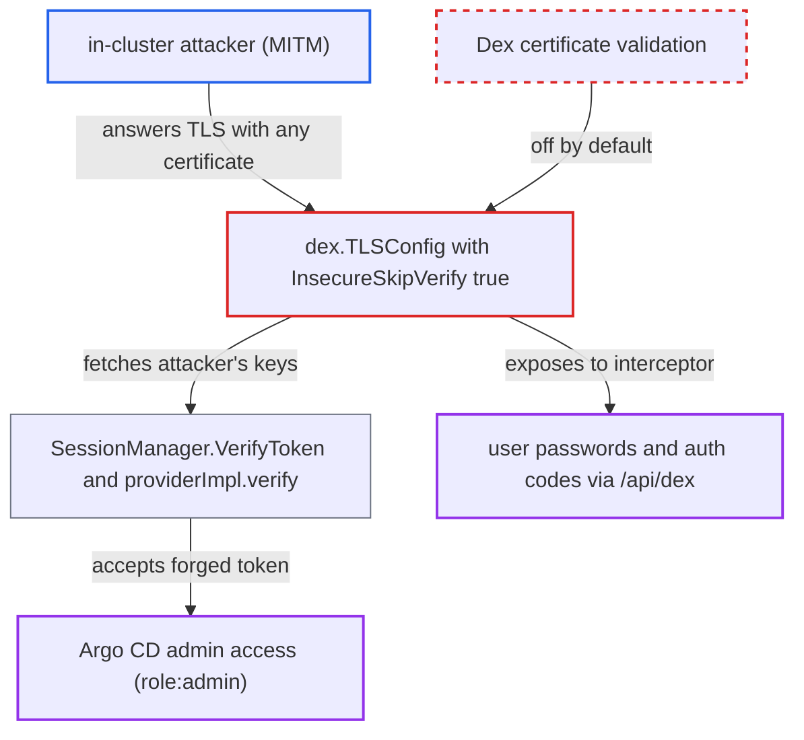

# Default non-validating TLS to Dex lets an in-cluster MITM forge SSO identities

| Field | Value |
|---|---|
| ID | `find_011xq33DFQ84g9A7cPr7HXDD` |
| Severity | **Critical** |
| Status | open |
| CWE | CWE-295 — Improper certificate validation |
| Created | 2026-10-27T21:18:28.563476Z |
| Claude Security | https://claude.ai/security/findings/find_011xq33DFQ84g9A7cPr7HXDD |

## Description

An attacker who controls a workload inside the cluster and can intercept traffic between `argocd-server` and `argocd-dex-server:5556` can forge SSO identities, including `admin`, and take full control of Argo CD. This needs Dex SSO configured (`dex.config` in `argocd-cm`) and the default `--dex-server-strict-tls` of `false`. `dex.TLSConfig` sets `InsecureSkipVerify: true` unless strict mode is on, so any certificate is accepted.

1. **operator** leaves `--dex-server-strict-tls` at its default and configures Dex SSO. The flag defaults to `false`, so no certificate check is made when `argocd-server` talks to Dex. ([`cmd/argocd-server/commands/argocd_server.go:198-218`](https://github.com/cx-benchmark/argo-cd/blob/b7bc418289a96130340ea79964c4491b416c14f2/cmd/argocd-server/commands/argocd_server.go#L198-L218))
2. **`dex.TLSConfig`** returns a TLS config with `InsecureSkipVerify: true`. Only strict mode checks the CA and pins the Dex certificate, so otherwise any certificate is accepted. ([`util/dex/dex.go:29-48`](https://github.com/cx-benchmark/argo-cd/blob/b7bc418289a96130340ea79964c4491b416c14f2/util/dex/dex.go#L29-L48))
3. **in-cluster attacker** intercepts the connection to `argocd-dex-server:5556` and answers with any certificate. The report gives ARP/IPv6-RA spoofing on a bridge CNI or a hijacked Service IP as example ways to get this position.
4. **attacker** sends `argocd-server` an ID token with `iss=<url>/api/dex`, `aud=argo-cd` and `sub=admin`. `VerifyToken` sends any token whose `iss` is not `argocd` to the OIDC provider that uses the non-validating client. ([`util/session/sessionmanager.go:597-653`](https://github.com/cx-benchmark/argo-cd/blob/b7bc418289a96130340ea79964c4491b416c14f2/util/session/sessionmanager.go#L597-L653))
5. **`providerImpl.verify`** re-runs discovery and JWKS download through the attacker after the signature check fails. The attacker serves a discovery document and a key set holding their own key, and the cached provider is replaced. ([`util/oidc/provider.go:163-204`](https://github.com/cx-benchmark/argo-cd/blob/b7bc418289a96130340ea79964c4491b416c14f2/util/oidc/provider.go#L163-L204))
6. **`argocd-server`** accepts the forged token and treats the caller as `admin`. The built-in rule `g, admin, role:admin` makes `sub: admin` an administrator. ([`assets/builtin-policy.csv:54`](https://github.com/cx-benchmark/argo-cd/blob/b7bc418289a96130340ea79964c4491b416c14f2/assets/builtin-policy.csv#L54))

## Assessment

The attacker controls a workload in the cluster and can intercept traffic from `argocd-server` to `argocd-dex-server`, for example by ARP/IPv6-RA spoofing on a bridge CNI or a hijacked Service IP. Dex SSO must be configured through `dex.config` in `argocd-cm`. The operator must not have enabled strict mode, which is the default. The attacker needs no Argo CD credentials and no victim action. Interception only has to happen when the forged token is presented, because verification re-runs discovery on a signature failure. The attacker can also capture traffic on the other Dex exchanges: the authorization-code exchange in `HandleCallback` and the `/api/dex` reverse proxy.

Impact: The attacker can act as any SSO identity, including `admin` through the built-in `role:admin` rule. That gives full read and write control of Argo CD: applications, projects, repository and cluster settings, and deletion of resources. The attacker also captures user passwords sent through `/api/dex` and authorization codes.

Subsequent-system impact: As `role:admin`, the attacker can create and sync Applications to every registered destination cluster using Argo CD's stored cluster credentials. This lets them deploy arbitrary workloads and change or delete resources on those separate clusters.

## Recommendation

The connection from `argocd-server` to Dex does not authenticate the peer by default, because `InsecureSkipVerify: true` is used when `--dex-server-strict-tls` is false. This covers discovery, JWKS, token exchange and the `/api/dex` reverse proxy, so the source of all SSO signing keys is unauthenticated.

Fix criteria: In the shipped default configuration, `argocd-server` authenticates the Dex endpoint (validated CA or pinned key) before trusting discovery, JWKS, token responses or proxied traffic. Skipping verification is an explicit opt-in that is logged. A test with an endpoint presenting an unexpected certificate on the Dex address shows that discovery and JWKS fetches, the code exchange and `/api/dex` proxying all fail. The same test shows that a token signed by that endpoint's key is rejected.

## Evidence

**https://github.com/cx-benchmark/argo-cd**

- [`util/dex/dex.go:29-48`](https://github.com/cx-benchmark/argo-cd/blob/b7bc418289a96130340ea79964c4491b416c14f2/util/dex/dex.go#L29-L48)
- [`cmd/argocd-server/commands/argocd_server.go:198-218`](https://github.com/cx-benchmark/argo-cd/blob/b7bc418289a96130340ea79964c4491b416c14f2/cmd/argocd-server/commands/argocd_server.go#L198-L218)
- [`util/session/sessionmanager.go:171-177`](https://github.com/cx-benchmark/argo-cd/blob/b7bc418289a96130340ea79964c4491b416c14f2/util/session/sessionmanager.go#L171-L177)
- [`util/session/sessionmanager.go:597-653`](https://github.com/cx-benchmark/argo-cd/blob/b7bc418289a96130340ea79964c4491b416c14f2/util/session/sessionmanager.go#L597-L653)
- [`util/oidc/provider.go:163-204`](https://github.com/cx-benchmark/argo-cd/blob/b7bc418289a96130340ea79964c4491b416c14f2/util/oidc/provider.go#L163-L204)
- [`util/oidc/oidc.go:264-270`](https://github.com/cx-benchmark/argo-cd/blob/b7bc418289a96130340ea79964c4491b416c14f2/util/oidc/oidc.go#L264-L270)
- [`util/dex/dex.go:90-94`](https://github.com/cx-benchmark/argo-cd/blob/b7bc418289a96130340ea79964c4491b416c14f2/util/dex/dex.go#L90-L94)
- [`assets/builtin-policy.csv:54`](https://github.com/cx-benchmark/argo-cd/blob/b7bc418289a96130340ea79964c4491b416c14f2/assets/builtin-policy.csv#L54)

