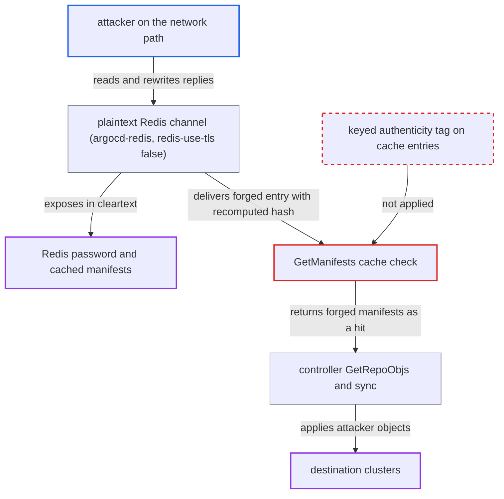

# Default plaintext Redis channel lets an in-cluster MITM poison cached manifests that get deployed

| Field | Value |
|---|---|
| ID | `find_019BVyn3imhaRy8EkcghZANf` |
| Severity | **Critical** |
| Status | open |
| CWE | CWE-319 — Cleartext transmission |
| Created | 2026-10-27T21:28:59.798248Z |
| Claude Security | https://claude.ai/security/findings/find_019BVyn3imhaRy8EkcghZANf |

## Description

An attacker who can intercept traffic between an Argo CD component and `argocd-redis` can replace cached manifests with their own, and the controller then deploys them to destination clusters. They can also read the Redis password and cached manifests, or crash a component. No Argo CD credentials are needed. The cause is that `--redis-use-tls` defaults to `false`, and `GetManifests` trusts an unkeyed FNV hash that the attacker can recompute.

1. **attacker** gets on the network path between an Argo CD component and `argocd-redis`. The report gives examples: a compromised in-cluster workload or node doing ARP or IPv6-RA spoofing on a bridge CNI, or a node on the traffic path.
2. **Argo CD components** connect to Redis over plain TCP by default. `--redis-use-tls` defaults to `false` and the TLS config is built only `if redisUseTLS`, so `buildRedisClient` passes a nil `TLSConfig`. ([`util/cache/cache.go:253-306`](https://github.com/cx-benchmark/argo-cd/blob/b7bc418289a96130340ea79964c4491b416c14f2/util/cache/cache.go#L253-L306))
3. **shipped `argocd-redis` Deployment** serves plain TCP on 6379 with only `--requirepass`. It has no TLS port or certificates, so the default install cannot use TLS unless the operator reconfigures it, and the AUTH password and every cache value cross the network in cleartext. ([`manifests/base/redis/argocd-redis-deployment.yaml:46-59`](https://github.com/cx-benchmark/argo-cd/blob/b7bc418289a96130340ea79964c4491b416c14f2/manifests/base/redis/argocd-redis-deployment.yaml#L46-L59))
4. **attacker** rewrites the reply to the repo-server's `GET mfst|...` with their own manifests and a recomputed hash. `generateCacheEntryHash` is an unkeyed FNV-64a over the entry's own JSON, so the attacker can compute a valid value. ([`reposerver/cache/cache.go:630-647`](https://github.com/cx-benchmark/argo-cd/blob/b7bc418289a96130340ea79964c4491b416c14f2/reposerver/cache/cache.go#L630-L647))
5. **`GetManifests`** accepts the forged entry as a cache hit. It checks the entry only against the hash carried inside it, with no keyed MAC or other authenticity check. ([`reposerver/cache/cache.go:397-428`](https://github.com/cx-benchmark/argo-cd/blob/b7bc418289a96130340ea79964c4491b416c14f2/reposerver/cache/cache.go#L397-L428))
6. **`runRepoOperation`** returns the cached manifests without cloning, rendering or checking source integrity. On a cache hit it returns early, so the forged manifests are the whole result that `getManifestCacheEntry` hands back as the `GenerateManifest` answer. ([`reposerver/repository/repository.go:396-399`](https://github.com/cx-benchmark/argo-cd/blob/b7bc418289a96130340ea79964c4491b416c14f2/reposerver/repository/repository.go#L396-L399))
7. **controller `GetRepoObjs`** unmarshals the forged manifests into target objects, then diffs and syncs them. On the next reconcile, auto-sync applies the attacker's objects to the destination cluster using the controller's stored cluster credentials. ([`controller/state.go:395-430`](https://github.com/cx-benchmark/argo-cd/blob/b7bc418289a96130340ea79964c4491b416c14f2/controller/state.go#L395-L430))

## Assessment

The attacker must be on the network path between an Argo CD component and `argocd-redis`. Examples are a compromised in-cluster workload or node, using ARP or IPv6-RA spoofing on a bridge CNI, or a node on the traffic path. No Argo CD credentials are needed. The default configuration is enough: a Redis shared between instances or a leaked password is not needed and is not claimed. Besides forging manifests, the attacker can forge `git-refs` and the resource trees shown in the UI, and can send a small tampered gzip reply that expands without bound.

Impact: For any application whose cache traffic the attacker intercepts, the attacker decides which manifests the controller treats as desired state. The attacker also learns the Redis AUTH password and the cached rendered manifests, which the docs say may contain plugin-injected secrets. A tampered reply can exhaust memory and crash the repo-server, controller or API server.

Subsequent-system impact: The controller applies the attacker's Kubernetes objects to destination clusters using its stored cluster credentials. This is limited only by what the application's AppProject permits. In the `default` project that means arbitrary workloads that can read, change or delete resources on those clusters.

## Recommendation

(1) The default connection between Argo CD components and Redis has no encryption and no server authentication. `--redis-use-tls` is `false` and the shipped Redis does not serve TLS. The AUTH secret and the cache entries that drive deployment can be read and changed by anyone on the path.

Fix criteria: In the shipped default install, Redis traffic is encrypted and the server is authenticated with verified TLS, or the install otherwise guarantees confidentiality and integrity. Plaintext is an explicit opt-in. A packet capture shows neither the password nor manifests. An interposer presenting an untrusted certificate is refused.

(2) Cached manifests are accepted on an unkeyed FNV checksum that anyone can recompute, so a tampered or injected entry is treated as authentic.

Fix criteria: Entries that drive deployment carry an authenticity tag keyed by a secret that never crosses the Redis channel, or are re-derived from a verified source. An entry written or rewritten without the key is treated as a cache miss.

(3) `redisCache.unmarshal` decompresses and decodes Redis values with no size bound.

Fix criteria: Decompressed size is capped and oversize values are rejected before allocation. A value that expands beyond the cap returns an error and does not exhaust memory.

## Evidence

**https://github.com/cx-benchmark/argo-cd**

- [`util/cache/cache.go:253-306`](https://github.com/cx-benchmark/argo-cd/blob/b7bc418289a96130340ea79964c4491b416c14f2/util/cache/cache.go#L253-L306)
- [`util/cache/cache.go:50-67`](https://github.com/cx-benchmark/argo-cd/blob/b7bc418289a96130340ea79964c4491b416c14f2/util/cache/cache.go#L50-L67)
- [`manifests/base/redis/argocd-redis-deployment.yaml:46-59`](https://github.com/cx-benchmark/argo-cd/blob/b7bc418289a96130340ea79964c4491b416c14f2/manifests/base/redis/argocd-redis-deployment.yaml#L46-L59)
- [`reposerver/cache/cache.go:397-428`](https://github.com/cx-benchmark/argo-cd/blob/b7bc418289a96130340ea79964c4491b416c14f2/reposerver/cache/cache.go#L397-L428)
- [`reposerver/cache/cache.go:630-647`](https://github.com/cx-benchmark/argo-cd/blob/b7bc418289a96130340ea79964c4491b416c14f2/reposerver/cache/cache.go#L630-L647)
- [`reposerver/repository/repository.go:396-399`](https://github.com/cx-benchmark/argo-cd/blob/b7bc418289a96130340ea79964c4491b416c14f2/reposerver/repository/repository.go#L396-L399)
- [`reposerver/repository/repository.go:1075-1160`](https://github.com/cx-benchmark/argo-cd/blob/b7bc418289a96130340ea79964c4491b416c14f2/reposerver/repository/repository.go#L1075-L1160)
- [`controller/state.go:395-430`](https://github.com/cx-benchmark/argo-cd/blob/b7bc418289a96130340ea79964c4491b416c14f2/controller/state.go#L395-L430)
- [`util/cache/redis.go:104-118`](https://github.com/cx-benchmark/argo-cd/blob/b7bc418289a96130340ea79964c4491b416c14f2/util/cache/redis.go#L104-L118)
- [`docs/operator-manual/security.md:41`](https://github.com/cx-benchmark/argo-cd/blob/b7bc418289a96130340ea79964c4491b416c14f2/docs/operator-manual/security.md#L41)

