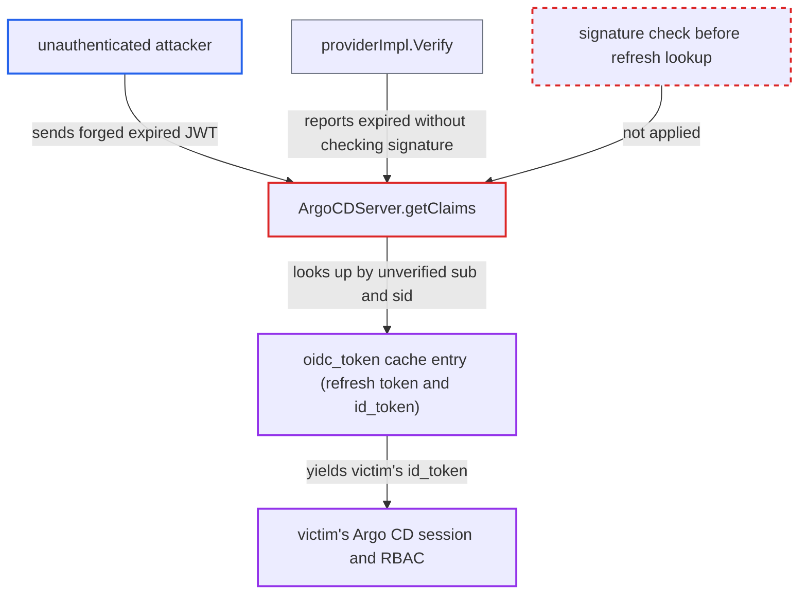

# Forged expired OIDC token triggers server-side refresh and hands out another user's session

| Field | Value |
|---|---|
| ID | `find_01NGgDBtCBE66WsMGgRANhvr` |
| Severity | **Critical** |
| Status | open |
| CWE | CWE-347 — Improper signature verification |
| Created | 2026-10-27T21:13:05.263269Z |
| Claude Security | https://claude.ai/security/findings/find_01NGgDBtCBE66WsMGgRANhvr |

## Description

An unauthenticated attacker can take over another user's Argo CD session, including an administrator's, and act with that user's full permissions. It needs an external `oidc.config`, a victim who logged in through the web within `UserSessionDuration`, and the victim's `sub` (plus `sid` if the IdP emits one). `ArgoCDServer.getClaims` reads `sub` and `sid` from a token whose signature was never verified, and uses them to fetch the victim's cached session.

1. **attacker** reads the public issuer and client ID. Both values come from `GET /api/v1/settings` or the IdP discovery document, so no login is needed.
2. **attacker** builds a JWT with the victim's `sub` and `sid` and sends it as `Authorization: Bearer`. The token has `iss` set to the issuer, `aud` set to the client ID, `exp` in the past or absent, a supported `alg` such as `RS256`, and any well-formed base64url signature.
3. **`providerImpl.Verify`** returns an expiry error without checking the signature. go-oidc checks issuer, audience and `exp` before `keySet.VerifySignature`, so the forged token is reported as `TokenExpiredError`. The report states this as an assumption about go-oidc v3.21.0, because the module source is not in the checkout. ([`util/oidc/provider.go:130-141`](https://github.com/cx-benchmark/argo-cd/blob/b7bc418289a96130340ea79964c4491b416c14f2/util/oidc/provider.go#L130-L141))
4. **`SessionManager.VerifyToken`** returns non-nil claims `{"iss":"sso"}` with the error. Non-nil claims on an expired token are what let `getClaims` enter its refresh branch. ([`util/session/sessionmanager.go:617-633`](https://github.com/cx-benchmark/argo-cd/blob/b7bc418289a96130340ea79964c4491b416c14f2/util/session/sessionmanager.go#L617-L633))
5. **`ArgoCDServer.getClaims`** re-parses the token with `ParseUnverified` and passes `sub` and `sid` to `CheckAndRefreshToken`. The values come from the attacker's unverified payload, so the attacker chooses whose session is looked up. ([`server/server.go:1681-1702`](https://github.com/cx-benchmark/argo-cd/blob/b7bc418289a96130340ea79964c4491b416c14f2/server/server.go#L1681-L1702))
6. **`GetUpdatedOidcTokenFromCache`** loads the `oidc_token__<sid>` entry and returns the victim's `id_token`, refreshing it first if needed. `HandleCallback` stored this entry at the victim's web login. If the cached access token has expired, it is refreshed with the stored refresh token. ([`util/oidc/oidc.go:756-822`](https://github.com/cx-benchmark/argo-cd/blob/b7bc418289a96130340ea79964c4491b416c14f2/util/oidc/oidc.go#L756-L822))
7. **`Authenticate`** adopts the victim's claims and returns the token as the `renew-token` header. `translateGrpcCookieHeader` turns this header into `Set-Cookie: argocd.token=...` on REST calls, so the attacker receives a valid session token for the victim. ([`server/server.go:1636-1642`](https://github.com/cx-benchmark/argo-cd/blob/b7bc418289a96130340ea79964c4491b416c14f2/server/server.go#L1636-L1642))

## Assessment

The attacker is an unauthenticated network client of argocd-server. The attack needs an external `oidc.config`. It also needs a victim who logged in through the web and is still inside `UserSessionDuration` (default 24h per the report), with a cached or refreshable token. The attacker must know the victim's `sub`, and `sid` when the IdP emits one. The attacker sends the forged token as `Authorization: Bearer` on any API call. Logout does not help the victim. `server/logout/logout.go` only revokes the presented token's `jti` and never deletes the `oidc_token_*` entry. A forged request that triggers a refresh therefore gets a new `jti` and keeps working after logout, as long as the stored refresh token is valid.

Impact: The attacker gets a valid, provider-signed ID token for the chosen user and acts with that user's full RBAC. Nothing limits which cached `sub` can be named. Targeting an administrator gives full control of Argo CD: Applications, Projects, repository and cluster credentials, and RBAC and settings changes.

Subsequent-system impact: With an administrator's session, the attacker can create or sync Applications that deploy arbitrary manifests to every managed cluster, using the cluster credentials Argo CD holds. That lets them run workloads in those clusters and read their secrets.

## Recommendation

(1) `getClaims` takes `sub` and `sid` from a token whose signature was never verified and uses them as the refresh-cache key. Attacker-written claims therefore grant access to a cached session.

Fix criteria: Before any refresh-cache lookup, the token's signature, issuer and audience verify against the provider's keys, with only the expiry check relaxed. `sub` and `sid` are taken from that verified result. A token with an invalid signature gets 401 and causes no cache access. Test: send an expired token with a bogus signature for a user who has a cached session. No `renew-token` or `Set-Cookie` is returned and the request is rejected.

(2) `SessionManager.VerifyToken` returns non-nil claims with the error for an expired token, and `providerImpl.Verify` passes go-oidc's `TokenExpiredError` through without checking the signature. Callers cannot tell an expired genuine token from an expired forged one.

Fix criteria: The verification layer never reports an expired result for a token whose signature has not been validated. It either verifies the signature with expiry skipped before calling the token expired, or returns a plain verification failure. A forged expired token looks the same to callers as any other invalid token.

(3) The `oidc_token__<sid>` cache holds the refresh token and ID token. It is keyed only by non-secret claim values and outlives logout, so anyone who can name a subject can redeem that subject's session.

Fix criteria: Cached refresh material is bound to a secret the client must prove, for example a value only present in the genuine token. It is removed on logout and when the ID token is revoked. After a user logs out, no request can obtain a refreshed token for that `sub` and `sid`.

## Evidence

**https://github.com/cx-benchmark/argo-cd**

- [`server/server.go:1681-1702`](https://github.com/cx-benchmark/argo-cd/blob/b7bc418289a96130340ea79964c4491b416c14f2/server/server.go#L1681-L1702)
- [`util/oidc/oidc.go:722-753`](https://github.com/cx-benchmark/argo-cd/blob/b7bc418289a96130340ea79964c4491b416c14f2/util/oidc/oidc.go#L722-L753)
- [`util/oidc/oidc.go:756-822`](https://github.com/cx-benchmark/argo-cd/blob/b7bc418289a96130340ea79964c4491b416c14f2/util/oidc/oidc.go#L756-L822)
- [`util/session/sessionmanager.go:617-633`](https://github.com/cx-benchmark/argo-cd/blob/b7bc418289a96130340ea79964c4491b416c14f2/util/session/sessionmanager.go#L617-L633)
- [`util/oidc/provider.go:130-141`](https://github.com/cx-benchmark/argo-cd/blob/b7bc418289a96130340ea79964c4491b416c14f2/util/oidc/provider.go#L130-L141)
- [`server/server.go:1636-1642`](https://github.com/cx-benchmark/argo-cd/blob/b7bc418289a96130340ea79964c4491b416c14f2/server/server.go#L1636-L1642)
- [`util/oidc/oidc.go:612-643`](https://github.com/cx-benchmark/argo-cd/blob/b7bc418289a96130340ea79964c4491b416c14f2/util/oidc/oidc.go#L612-L643)

