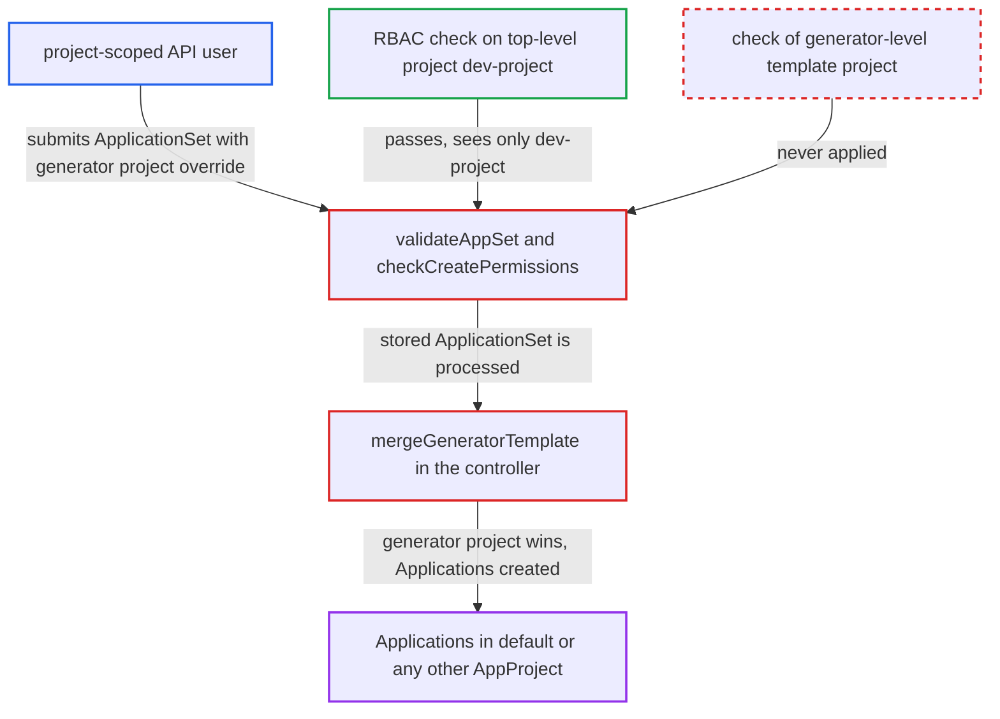

# Generator-level template project overrides RBAC-checked ApplicationSet project

| Field | Value |
|---|---|
| ID | `find_01Wxhi3WGyceijx8ufbgsLm4` |
| Severity | **Critical** |
| Status | open |
| CWE | CWE-863 — Incorrect authorization |
| Created | 2026-10-27T21:10:24.697603Z |
| Claude Security | https://claude.ai/security/findings/find_01Wxhi3WGyceijx8ufbgsLm4 |

## Description

A user who may create ApplicationSets only in one project, such as `dev-project`, can make Argo CD create Applications in any other project, including `default`. Those Applications can deploy the attacker's manifests to the in-cluster destination and to other registered clusters. The attacker needs only the `applicationsets, create, dev-project/*` right. The API checks RBAC against `spec.template.spec.project`, but the controller lets a generator's own `template.spec.project` override it.

1. **attacker** submits an ApplicationSet with two different projects. The top-level `spec.template.spec.project` is `dev-project`, and `spec.generators[0].list.template.spec.project` is a literal `default`. The attacker also supplies their own `repoURL`, `destination` and automated `syncPolicy`.
2. **the validator `validateAppSet`** inspects only the top-level template project. It rejects a templated value in that one field. It never looks at the `template` carried by each generator. ([`server/applicationset/applicationset.go:545-560`](https://github.com/cx-benchmark/argo-cd/blob/b7bc418289a96130340ea79964c4491b416c14f2/server/applicationset/applicationset.go#L545-L560))
3. **the function `checkCreatePermissions`** checks `applicationsets/create` on the RBAC name from the top-level project. `RBACName` is built from `Spec.Template.Spec.GetProject()`, so the check sees only `dev-project`, and the request passes. ([`server/applicationset/applicationset.go:563-576`](https://github.com/cx-benchmark/argo-cd/blob/b7bc418289a96130340ea79964c4491b416c14f2/server/applicationset/applicationset.go#L563-L576))
4. **the function `mergeGeneratorTemplate`** merges the generator template over the top-level template. `mergo.Merge` does not override, so a non-empty project in the generator template wins over the top-level one. ([`applicationset/generators/generator_spec_processor.go:165-172`](https://github.com/cx-benchmark/argo-cd/blob/b7bc418289a96130340ea79964c4491b416c14f2/applicationset/generators/generator_spec_processor.go#L165-L172))
5. **the controller check `validateGeneratedApplications`** accepts the generated Applications. It only checks that the project named in each Application exists. It does not compare that project with the one RBAC was checked against. ([`applicationset/controllers/applicationset_controller.go:618-636`](https://github.com/cx-benchmark/argo-cd/blob/b7bc418289a96130340ea79964c4491b416c14f2/applicationset/controllers/applicationset_controller.go#L618-L636))
6. **the ApplicationSet controller** creates the Applications in `default` and auto-syncs them. They are created in the control-plane namespace. By default, `default` allows any source repo, any destination and all cluster-scoped kinds.

## Assessment

The attacker is an authenticated API user whose only relevant right is `applicationsets, create, dev-project/*`. They call `ApplicationSetService.Create` over gRPC, REST or with `argocd appset create`. The report says `updateAppSet` and the `Generate` endpoint use the same checks. No victim takes part. The generator kinds that carry a `template` include List, Git, Clusters, SCMProvider, PullRequest, Matrix, Merge, Plugin, Oci and ClusterDecisionResource. Only the `templatePatch` path pins the project, so it is not a way around the check.

Impact: The attacker gets Applications under any AppProject, and the project and RBAC boundary is lost. With the default `default` project, Argo CD deploys the attacker's manifests to the in-cluster destination, including the `argocd` namespace. They could, for example, rewrite `argocd-rbac-cm` or read `argocd-secret` and cluster and repo secrets through deployed workloads.

Subsequent-system impact: The application controller syncs the attacker's manifests to every cluster registered with Argo CD, using the cluster credentials it holds. The attacker can create, change or delete workloads on those clusters and read their secrets.

## Recommendation

(1) The API server enforces RBAC on the project from `spec.template.spec.project` only. The controller lets each generator's `template.spec.project` override it through `mergeGeneratorTemplate`, so the enforced project and the effective project differ.

Fix criteria: On Create and Update, including upsert and the `Generate` endpoint, every project an ApplicationSet can produce is covered by the caller's `applicationsets` RBAC. This holds for all generator kinds, including matrix and merge templates. A generator-level `template.spec.project` that is templated or differs from the top-level project is either rejected or checked against RBAC. Submitting an ApplicationSet with a differing generator-template project as a project-scoped user is refused.

(2) The ApplicationSet controller trusts whatever project appears in the generated Application. `validateGeneratedApplications` checks only that the project exists, so it gives no defense in depth.

Fix criteria: The controller treats the top-level `spec.template.spec.project` as authoritative. It refuses generated Applications whose project differs, unless an explicit privileged, administrator-only setting opts in. A stored ApplicationSet with a generator-template project override does not produce Applications in the other project.

## Evidence

**https://github.com/cx-benchmark/argo-cd**

- [`server/applicationset/applicationset.go:545-560`](https://github.com/cx-benchmark/argo-cd/blob/b7bc418289a96130340ea79964c4491b416c14f2/server/applicationset/applicationset.go#L545-L560)
- [`server/applicationset/applicationset.go:563-576`](https://github.com/cx-benchmark/argo-cd/blob/b7bc418289a96130340ea79964c4491b416c14f2/server/applicationset/applicationset.go#L563-L576)
- [`pkg/apis/application/v1alpha1/applicationset_types.go:61-64`](https://github.com/cx-benchmark/argo-cd/blob/b7bc418289a96130340ea79964c4491b416c14f2/pkg/apis/application/v1alpha1/applicationset_types.go#L61-L64)
- [`applicationset/generators/generator_spec_processor.go:165-172`](https://github.com/cx-benchmark/argo-cd/blob/b7bc418289a96130340ea79964c4491b416c14f2/applicationset/generators/generator_spec_processor.go#L165-L172)
- [`applicationset/controllers/applicationset_controller.go:618-636`](https://github.com/cx-benchmark/argo-cd/blob/b7bc418289a96130340ea79964c4491b416c14f2/applicationset/controllers/applicationset_controller.go#L618-L636)
- [`applicationset/controllers/template/patch.go:39-41`](https://github.com/cx-benchmark/argo-cd/blob/b7bc418289a96130340ea79964c4491b416c14f2/applicationset/controllers/template/patch.go#L39-L41)
- [`docs/operator-manual/rbac.md:276-288`](https://github.com/cx-benchmark/argo-cd/blob/b7bc418289a96130340ea79964c4491b416c14f2/docs/operator-manual/rbac.md#L276-L288)

