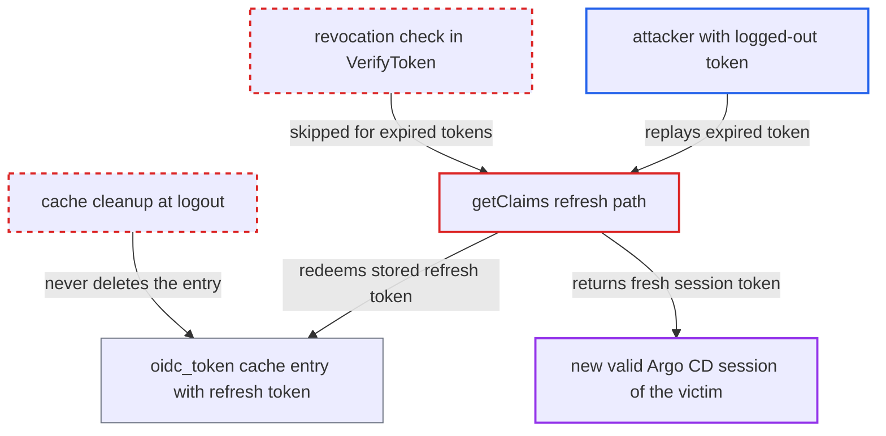

# Logout leaves the server-side OIDC refresh cache, so a logged-out SSO token can be revived after expiry

| Field | Value |
|---|---|
| ID | `find_01TFJkNmCuHUa75caerQBD2S` |
| Severity | **Critical** |
| Status | open |
| CWE | CWE-613 — Insufficient session expiration |
| Created | 2026-10-27T21:23:57.059295Z |
| Claude Security | https://claude.ai/security/findings/find_01TFJkNmCuHUa75caerQBD2S |

## Description

An attacker who holds a copy of a victim's web SSO ID token can get a new valid Argo CD session after the victim has logged out, with all of the victim's RBAC rights. This needs an external `oidc.config` with refresh tokens, an IdP that returns an `id_token` on refresh, and no IdP-side revocation. Logout in `server/logout/logout.go` revokes only the token's `jti` and leaves the cached refresh token, which `getClaims` uses to refresh expired tokens.

1. **victim** logs out through `/auth/logout`. The logout handler revokes only the presented token's `jti` (or `at_hash`) for `time.Until(exp)` and deletes nothing else. ([`server/logout/logout.go:112-131`](https://github.com/cx-benchmark/argo-cd/blob/b7bc418289a96130340ea79964c4491b416c14f2/server/logout/logout.go#L112-L131))
2. **server cache** keeps the login's refresh material. `ClientApp.HandleCallback` stored the full encrypted `oauth2.Token` under `oidc_token__<sid>` for the rest of `users.session.duration` (24h by default), and logout never removes it. ([`util/oidc/oidc.go:630-643`](https://github.com/cx-benchmark/argo-cd/blob/b7bc418289a96130340ea79964c4491b416c14f2/util/oidc/oidc.go#L630-L643))
3. **attacker** replays the logged-out token after its `exp` has passed. On `TokenExpiredError`, `SessionManager.VerifyToken` returns the dummy claims `{"iss":"sso"}` before it reaches the revoked-token check, so the revoked `jti` is never looked at. ([`util/session/sessionmanager.go:617-646`](https://github.com/cx-benchmark/argo-cd/blob/b7bc418289a96130340ea79964c4491b416c14f2/util/session/sessionmanager.go#L617-L646))
4. **the function `getClaims`** reads `sub` and `sid` from the unverified token and calls `CheckAndRefreshToken`. The non-nil dummy claims from the expired token unlock this refresh branch. ([`server/server.go:1681-1701`](https://github.com/cx-benchmark/argo-cd/blob/b7bc418289a96130340ea79964c4491b416c14f2/server/server.go#L1681-L1701))
5. **the function `GetUpdatedOidcTokenFromCache`** redeems the stored refresh token. Once the cached access token has expired, it loads the surviving cache entry, refreshes it and rewrites the cache. ([`util/oidc/oidc.go:722-822`](https://github.com/cx-benchmark/argo-cd/blob/b7bc418289a96130340ea79964c4491b416c14f2/util/oidc/oidc.go#L722-L822))
6. **the function `getClaims`** adopts the refreshed token as the caller's identity and returns it. The new ID token has a `jti` that was never revoked. The attacker receives it as the `renew-token` header or the `argocd.token` cookie. ([`server/server.go:1681-1701`](https://github.com/cx-benchmark/argo-cd/blob/b7bc418289a96130340ea79964c4491b416c14f2/server/server.go#L1681-L1701))

## Assessment

The attacker has a copy of a victim's web SSO ID token, for example from a leaked cookie, a HAR file, a log or a shared machine. The victim logs out, then the token's `exp` and the cached access token's expiry pass. The attacker then sends the token as a bearer token or cookie on any API call. This requires an external `oidc.config` with refresh tokens, an IdP that returns an `id_token` on refresh, and no IdP-side revocation. If the IdP emits no `sid`, the cache key is `oidc_token__` and is shared by all of that user's web logins. A later re-login by the victim overwrites it, and the old logged-out token then resolves to the victim's newest session. The report assumes that `ReuseTokenSourceWithExpiry` in `golang.org/x/oauth2` v0.37.0 does a refresh-token grant once the access token has expired. The module source was not in the checkout.

Impact: The attacker regains a valid Argo CD session with all of the victim's RBAC rights, up to an administrator's. It lasts until `SessionStart + UserSessionDuration` (24h by default) and can be renewed repeatedly within that window. Against an admin victim, the attacker can read, modify and delete applications, projects, and repository and cluster settings.

## Recommendation

(1) Logout revokes only the presented token's identifier. The server-side OIDC token cache (refresh token and `id_token`, keyed by `sub`/`sid`) stays in place and can still mint new tokens, so the session is not really ended.

Fix criteria: After a user logs out, no cached OIDC refresh material for that session can be used. A logged-out token, expired or not, fails authentication and does not trigger a refresh. Test: log out, let the ID token and access token expire, then replay the old token. The response must be Unauthenticated, with no `renew-token` or `Set-Cookie`. Where possible, the refresh token is also revoked at the IdP.

(2) The refresh path in `getClaims` honours an expired token without checking whether that token or its session was revoked. `VerifyToken` returns before the revocation lookup.

Fix criteria: Before any refresh-cache lookup, a token whose identifier or session has been revoked is rejected. An expired token can lead to a refresh only if it has not been revoked.

## Evidence

**https://github.com/cx-benchmark/argo-cd**

- [`server/logout/logout.go:112-131`](https://github.com/cx-benchmark/argo-cd/blob/b7bc418289a96130340ea79964c4491b416c14f2/server/logout/logout.go#L112-L131)
- [`server/server.go:1681-1701`](https://github.com/cx-benchmark/argo-cd/blob/b7bc418289a96130340ea79964c4491b416c14f2/server/server.go#L1681-L1701)
- [`util/session/sessionmanager.go:617-646`](https://github.com/cx-benchmark/argo-cd/blob/b7bc418289a96130340ea79964c4491b416c14f2/util/session/sessionmanager.go#L617-L646)
- [`util/oidc/oidc.go:630-643`](https://github.com/cx-benchmark/argo-cd/blob/b7bc418289a96130340ea79964c4491b416c14f2/util/oidc/oidc.go#L630-L643)
- [`util/oidc/oidc.go:722-822`](https://github.com/cx-benchmark/argo-cd/blob/b7bc418289a96130340ea79964c4491b416c14f2/util/oidc/oidc.go#L722-L822)

