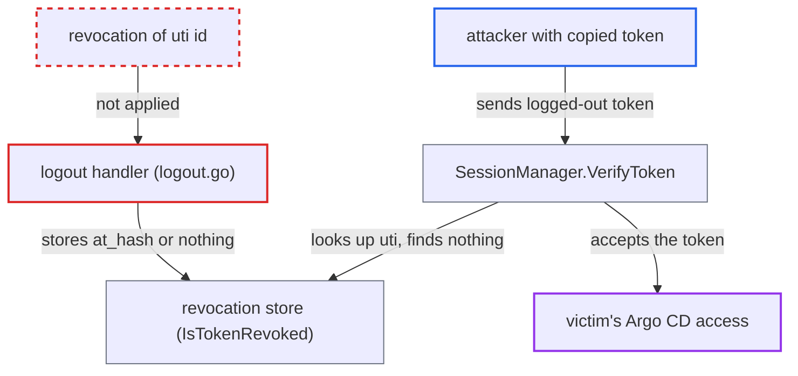

# Logout revokes a different token id than verification checks for Entra ID (uti) tokens

| Field | Value |
|---|---|
| ID | `find_013cGEoCxyZicw6vsq895RBC` |
| Severity | **Critical** |
| Status | open |
| CWE | CWE-613 — Insufficient session expiration |
| Created | 2026-10-27T21:23:57.002345Z |
| Claude Security | https://claude.ai/security/findings/find_013cGEoCxyZicw6vsq895RBC |

## Description

Someone who holds a copy of an Argo CD SSO token can keep using it after the user logs out, until the token's `exp`. This affects deployments that use Microsoft Entra ID through the direct `oidc.config` integration. The logout handler and `SessionManager.VerifyToken` compute the revocation id differently, and logout never reads the `uti` claim.

1. **attacker** obtains a copy of the victim's Argo CD SSO token. The report gives a leaked cookie or bearer token as an example; the token is the raw ID token that the OIDC callback stored in the `argocd.token` cookie. ([`util/oidc/oidc.go:591-646`](https://github.com/cx-benchmark/argo-cd/blob/b7bc418289a96130340ea79964c4491b416c14f2/util/oidc/oidc.go#L591-L646))
2. **victim** logs out through the UI or `argocd logout`. This calls `/auth/logout`, which is the routine logout meant to end the session.
3. **logout handler** revokes the wrong id, or none. It derives the id from `jti`, then `at_hash`, and never reads `uti`. It stores `revoked-token|<at_hash>`, or skips revocation when the token has no `at_hash`. ([`server/logout/logout.go:112-131`](https://github.com/cx-benchmark/argo-cd/blob/b7bc418289a96130340ea79964c4491b416c14f2/server/logout/logout.go#L112-L131))
4. **revocation store** holds only the exact id it was given. `RevokeToken(id)` stores one key and `IsTokenRevoked` looks up one key, and nothing maps `at_hash` to `uti`. ([`util/session/state.go:145-160`](https://github.com/cx-benchmark/argo-cd/blob/b7bc418289a96130340ea79964c4491b416c14f2/util/session/state.go#L145-L160))
5. **`SessionManager.VerifyToken`** checks revocation under the `uti` id. `tokenUniqueID` returns `jti`, else `uti`, and an Entra token has no `jti`. So it looks up `<uti>`, which was never revoked, and the result is false. ([`util/session/sessionmanager.go:635-646`](https://github.com/cx-benchmark/argo-cd/blob/b7bc418289a96130340ea79964c4491b416c14f2/util/session/sessionmanager.go#L635-L646))
6. **attacker** keeps sending the token as a cookie or `Authorization: Bearer` header. `getClaims` authenticates each API request through `VerifyToken`, so the token is accepted for API, gRPC and UI calls until `exp`. ([`server/server.go:1679-1705`](https://github.com/cx-benchmark/argo-cd/blob/b7bc418289a96130340ea79964c4491b416c14f2/server/server.go#L1679-L1705))

## Assessment

The deployment uses Microsoft Entra ID through the direct `oidc.config` integration. The attacker has a copy of a victim's Argo CD SSO token, for example a leaked cookie or bearer token. The victim then logs out normally, and no other action by the victim is needed. Dex-brokered logins (no `jti` or `uti`, `at_hash` present) and IdPs that emit `jti` are not affected.

Impact: The token holder keeps the victim's full RBAC permissions in Argo CD after logout, until the token's `exp`. For an admin victim this means read and write access to all applications, projects, clusters and repositories. The server-side revocation that the documentation promises does not work for this IdP.

## Recommendation

Logout derives the revocation id as `jti`, else `at_hash`. Verification derives it as `jti`, else `uti`, else `at_hash`. For Entra tokens that carry `uti` but no `jti`, the stored id and the checked id differ.

Fix criteria: Logout and verification compute the revocation id with the same function, so the id stored at logout equals the id checked by `VerifyToken` for every accepted SSO token. Test with an Entra-style token (`uti`, no `jti`): after logout the same token must be rejected as revoked.

## Evidence

**https://github.com/cx-benchmark/argo-cd**

- [`server/logout/logout.go:112-131`](https://github.com/cx-benchmark/argo-cd/blob/b7bc418289a96130340ea79964c4491b416c14f2/server/logout/logout.go#L112-L131)
- [`util/session/sessionmanager.go:635-646`](https://github.com/cx-benchmark/argo-cd/blob/b7bc418289a96130340ea79964c4491b416c14f2/util/session/sessionmanager.go#L635-L646)
- [`util/session/sessionmanager.go:657-667`](https://github.com/cx-benchmark/argo-cd/blob/b7bc418289a96130340ea79964c4491b416c14f2/util/session/sessionmanager.go#L657-L667)
- [`util/oidc/oidc.go:591-646`](https://github.com/cx-benchmark/argo-cd/blob/b7bc418289a96130340ea79964c4491b416c14f2/util/oidc/oidc.go#L591-L646)
- [`server/server.go:1679-1705`](https://github.com/cx-benchmark/argo-cd/blob/b7bc418289a96130340ea79964c4491b416c14f2/server/server.go#L1679-L1705)
- [`util/session/state.go:145-160`](https://github.com/cx-benchmark/argo-cd/blob/b7bc418289a96130340ea79964c4491b416c14f2/util/session/state.go#L145-L160)

