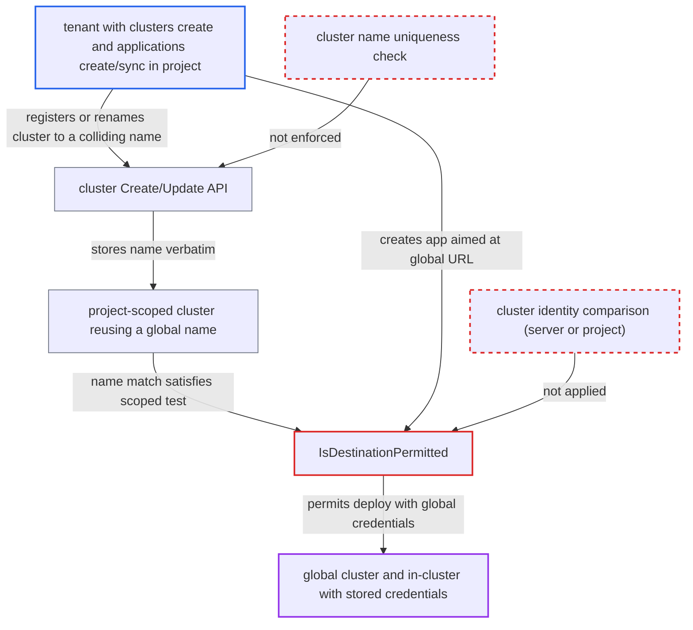

# permitOnlyProjectScopedClusters bypassed by a project-scoped cluster that reuses a global cluster's name

| Field | Value |
|---|---|
| ID | `find_01TCTqssPfCFiWR2YmkwASUH` |
| Severity | **Critical** |
| Status | open |
| CWE | CWE-863 — Incorrect authorization |
| Created | 2026-10-27T21:20:59.384115Z |
| Claude Security | https://claude.ai/security/findings/find_01TCTqssPfCFiWR2YmkwASUH |

## Description

A tenant who can create project-scoped clusters can deploy their own manifests to a global cluster that the project was meant to exclude. This includes the control-plane cluster `in-cluster`, and it happens even when `permitOnlyProjectScopedClusters` is true. The attacker needs the `clusters, create` (or update) and `applications, create/sync` permissions in a project whose `destinations` also match the global cluster. `IsDestinationPermitted` accepts a destination when a scoped cluster merely shares its name.

1. **tenant** registers a project-scoped cluster named after a global cluster. `Create` checks only `clusters, create, <project>/<server>` and that the submitted server answers the version call, then passes the caller-chosen `name` through unchecked. The local cluster is always named `in-cluster`, so no lookup is needed. ([`server/cluster/cluster.go:144-160`](https://github.com/cx-benchmark/argo-cd/blob/b7bc418289a96130340ea79964c4491b416c14f2/server/cluster/cluster.go#L144-L160))
2. **tenant** may instead rename an existing scoped cluster to the colliding name. `Update` with `updatedFields: ["name"]` is allowed under the same project-level RBAC. ([`server/cluster/cluster.go:297-325`](https://github.com/cx-benchmark/argo-cd/blob/b7bc418289a96130340ea79964c4491b416c14f2/server/cluster/cluster.go#L297-L325))
3. **`CreateCluster`** stores the cluster without a name uniqueness check. It derives the secret name from the server URL only and keeps the name as given, so two clusters can share a name. ([`util/db/cluster.go:107-147`](https://github.com/cx-benchmark/argo-cd/blob/b7bc418289a96130340ea79964c4491b416c14f2/util/db/cluster.go#L107-L147))
4. **tenant** creates an Application in the project whose `destination.server` is the global cluster's URL. For the local cluster this is `https://kubernetes.default.svc`, which resolves to the synthetic cluster named `in-cluster`. ([`util/db/cluster.go:247-276`](https://github.com/cx-benchmark/argo-cd/blob/b7bc418289a96130340ea79964c4491b416c14f2/util/db/cluster.go#L247-L276))
5. **`IsDestinationPermitted`** accepts the destination because a scoped cluster has the same `Name`. It matches on `cluster.Name == dst.Name || cluster.Server == dst.Server`, so the name alone passes, although the resolved cluster is not scoped to the project. ([`pkg/apis/application/v1alpha1/app_project_types.go:487-501`](https://github.com/cx-benchmark/argo-cd/blob/b7bc418289a96130340ea79964c4491b416c14f2/pkg/apis/application/v1alpha1/app_project_types.go#L487-L501))
6. **`ValidatePermissions` and `validateSyncPermissions`** call the same check at app create or update, at refresh and at sync. The same flawed check runs on every path, so no later check stops the sync. ([`util/argo/argo.go:786-806`](https://github.com/cx-benchmark/argo-cd/blob/b7bc418289a96130340ea79964c4491b416c14f2/util/argo/argo.go#L786-L806))
7. **the controller** syncs the tenant's manifests using the global cluster's credentials. It uses the admin-registered credentials, or its own service account for `in-cluster`. ([`controller/sync.go:244-258`](https://github.com/cx-benchmark/argo-cd/blob/b7bc418289a96130340ea79964c4491b416c14f2/controller/sync.go#L244-L258))

## Assessment

The attacker is a tenant with `applications, create/sync` in a project P and the documented self-service rule `clusters, create` (or update) on `P/*`. P sets `permitOnlyProjectScopedClusters: true`, and its `destinations` also match a global cluster. This is the setup the flag is meant to restrict. The tenant posts to `/api/v1/clusters` with `project: P`, a `name` of `in-cluster` or another global cluster's name, and a server they control that answers `/version`. Other global names are visible to them through `clusters, get`. Renaming an existing scoped cluster is a second way in. The tenant then creates and syncs an Application in P with `destination.server` set to `https://kubernetes.default.svc` or the global cluster's URL.

Impact: The tenant gets Argo CD to apply their manifests to the control-plane cluster with the controller's own cluster-admin service account. Where P's namespace pattern admits `argocd` (for example `*`), they can read `argocd-secret` and every cluster and repo secret, or disrupt Argo CD. The namespace and kind allow-lists of P still apply.

Subsequent-system impact: Any admin-registered global cluster whose name the tenant reuses is also exposed. The controller deploys the tenant's workloads there with the admin's stored credentials, usually cluster-admin, in every namespace P's destinations allow. The tenant can read secrets in, modify and disrupt workloads on a cluster the project was configured to exclude.

## Recommendation

(1) `IsDestinationPermitted` treats a project-scoped cluster that shares the resolved destination's `Name` as proof that the destination is project-scoped. Names are not unique and are chosen by whoever may create or rename project-scoped clusters.

Fix criteria: The scoped-cluster test compares cluster identity: the resolved destination cluster is itself scoped to the project, by the same server URL or secret, or by `destCluster.Project == proj.Name`. A project with `permitOnlyProjectScopedClusters: true` and a scoped cluster named `in-cluster` on another server still rejects an Application whose destination resolves to `https://kubernetes.default.svc` or to any global cluster. This holds at app create, at refresh and at sync.

(2) Cluster create and update do not enforce unique cluster names across global and project-scoped clusters, and do not reserve `in-cluster`. Tenants can therefore create deliberate name collisions.

Fix criteria: Creating or renaming a cluster to a name already used by another cluster is refused. Using the reserved `in-cluster` name for a different server is refused too. Requests through the cluster API fail, and no secret is written.

## Evidence

**https://github.com/cx-benchmark/argo-cd**

- [`pkg/apis/application/v1alpha1/app_project_types.go:487-501`](https://github.com/cx-benchmark/argo-cd/blob/b7bc418289a96130340ea79964c4491b416c14f2/pkg/apis/application/v1alpha1/app_project_types.go#L487-L501)
- [`server/cluster/cluster.go:144-160`](https://github.com/cx-benchmark/argo-cd/blob/b7bc418289a96130340ea79964c4491b416c14f2/server/cluster/cluster.go#L144-L160)
- [`server/cluster/cluster.go:297-325`](https://github.com/cx-benchmark/argo-cd/blob/b7bc418289a96130340ea79964c4491b416c14f2/server/cluster/cluster.go#L297-L325)
- [`util/db/cluster.go:107-147`](https://github.com/cx-benchmark/argo-cd/blob/b7bc418289a96130340ea79964c4491b416c14f2/util/db/cluster.go#L107-L147)
- [`util/db/cluster.go:33-39`](https://github.com/cx-benchmark/argo-cd/blob/b7bc418289a96130340ea79964c4491b416c14f2/util/db/cluster.go#L33-L39)
- [`util/db/cluster.go:247-276`](https://github.com/cx-benchmark/argo-cd/blob/b7bc418289a96130340ea79964c4491b416c14f2/util/db/cluster.go#L247-L276)
- [`util/argo/argo.go:786-806`](https://github.com/cx-benchmark/argo-cd/blob/b7bc418289a96130340ea79964c4491b416c14f2/util/argo/argo.go#L786-L806)
- [`controller/sync.go:764-773`](https://github.com/cx-benchmark/argo-cd/blob/b7bc418289a96130340ea79964c4491b416c14f2/controller/sync.go#L764-L773)
- [`controller/sync.go:244-258`](https://github.com/cx-benchmark/argo-cd/blob/b7bc418289a96130340ea79964c4491b416c14f2/controller/sync.go#L244-L258)
- [`docs/user-guide/projects.md:458-478`](https://github.com/cx-benchmark/argo-cd/blob/b7bc418289a96130340ea79964c4491b416c14f2/docs/user-guide/projects.md#L458-L478)

