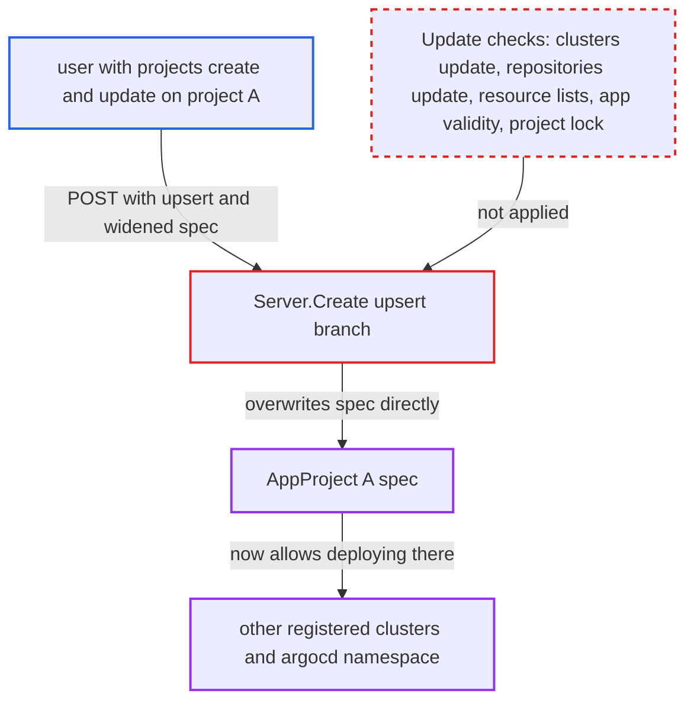

# Project create-with-upsert overwrites existing spec, skipping Update's cluster/repo authorization

| Field | Value |
|---|---|
| ID | `find_01HavP1NJ9vimYj1fNp3e8sj` |
| Severity | **Critical** |
| Status | open |
| CWE | CWE-863 — Improper Authorization |
| Created | 2026-10-27T21:11:05.753042Z |
| Claude Security | https://claude.ai/security/findings/find_01HavP1NJ9vimYj1fNp3e8sj |

## Description

A user who holds `projects, create` and `projects, update` on one existing project can widen that project's limits without any cluster or repository permission. They can allow any destination cluster and namespace, any source repository and any resource kind. That breaks the AppProject boundary the operator set. The cause is the upsert branch of `Server.Create`, which overwrites the existing spec without the checks `Server.Update` applies.

1. **attacker** sends `POST /api/v1/projects` with `upsert: true` for an existing project. The body carries a widened spec: destinations `*`/`*`, `sourceRepos: ["*"]` and a `clusterResourceWhitelist` of `*/*`, with blacklists removed.
2. **the handler `Server.Create`** hits `IsAlreadyExists` and checks only `projects, update` on the project name. The caller already holds `projects, create` and `projects, update`, so both checks pass. ([`server/project/project.go:272-289`](https://github.com/cx-benchmark/argo-cd/blob/b7bc418289a96130340ea79964c4491b416c14f2/server/project/project.go#L272-L289))
3. **the handler `Server.Create`** replaces `existing.Spec` with the caller's spec and writes it to the Kubernetes API. This happens at `project.go:284-288`, with no cluster or repository check, no resource-list check, no app-validity check and no project lock. ([`server/project/project.go:272-289`](https://github.com/cx-benchmark/argo-cd/blob/b7bc418289a96130340ea79964c4491b416c14f2/server/project/project.go#L272-L289))
4. **the handler `Server.Update`** would have required extra permissions for the same change. It demands `clusters, update` for changed destinations, `repositories, update` for changed sourceRepos, and `clusters, update` on all destinations when a resource white/blacklist changes. It also rejects changes that invalidate existing Applications. ([`server/project/project.go:389-411`](https://github.com/cx-benchmark/argo-cd/blob/b7bc418289a96130340ea79964c4491b416c14f2/server/project/project.go#L389-L411))
5. **attacker** creates and syncs an app in the widened project that targets any registered cluster. The project now allows every destination, repository and resource kind, so the app passes the project's limits.

## Assessment

The attacker is an authenticated user with `projects, create` and `projects, update` on an existing project A, for example through `projects, *, A`. They also need `applications, create/sync` in A. They need no `clusters, update` or `repositories, update` permission. They send `POST /api/v1/projects` with `upsert: true` and a widened spec for A. Afterwards they create and sync an app in A that targets any registered cluster. `Create` for a new name accepts any spec with only `projects, create`. That is a design property, so the gain here is limited to existing projects, which the caller could otherwise not widen without delete-and-recreate. Delete is blocked while apps exist.

Impact: The attacker rewrites the destination, source and resource-kind allowlists of project A. Apps in A can then deploy any kind, including cluster-scoped RBAC, into any namespace, including the in-cluster `argocd` namespace. There the controller's credentials can read cluster and repository credential Secrets or alter Argo CD itself.

Subsequent-system impact: Other clusters registered in Argo CD become valid destinations for project A. The controller applies the attacker's manifests there with its stored credentials, which are typically cluster-admin. The attacker can then read, modify and disrupt workloads on clusters the tenant was never granted.

## Recommendation

The upsert branch of `Server.Create` overwrites an existing AppProject's spec directly. It skips the cluster and repository authorization, the resource-list authorization, the app-validity checks and the project lock that `Server.Update` applies to every change of an existing project.

Fix criteria: Changing an existing project through create-with-upsert goes through the same authorization and validation as `Update`, under the project lock. A caller with only `projects, create|update` on A who upserts A with a new destination server, a new sourceRepo or a changed resource white/blacklist gets `permission denied: clusters, update, <server>` or `repositories, update, <url>`. The stored spec stays unchanged.

## Evidence

**https://github.com/cx-benchmark/argo-cd**

- [`server/project/project.go:272-289`](https://github.com/cx-benchmark/argo-cd/blob/b7bc418289a96130340ea79964c4491b416c14f2/server/project/project.go#L272-L289)
- [`server/project/project.go:389-411`](https://github.com/cx-benchmark/argo-cd/blob/b7bc418289a96130340ea79964c4491b416c14f2/server/project/project.go#L389-L411)
- [`server/project/project.go:422-463`](https://github.com/cx-benchmark/argo-cd/blob/b7bc418289a96130340ea79964c4491b416c14f2/server/project/project.go#L422-L463)
- [`server/cluster/cluster.go:173-174`](https://github.com/cx-benchmark/argo-cd/blob/b7bc418289a96130340ea79964c4491b416c14f2/server/cluster/cluster.go#L173-L174)

