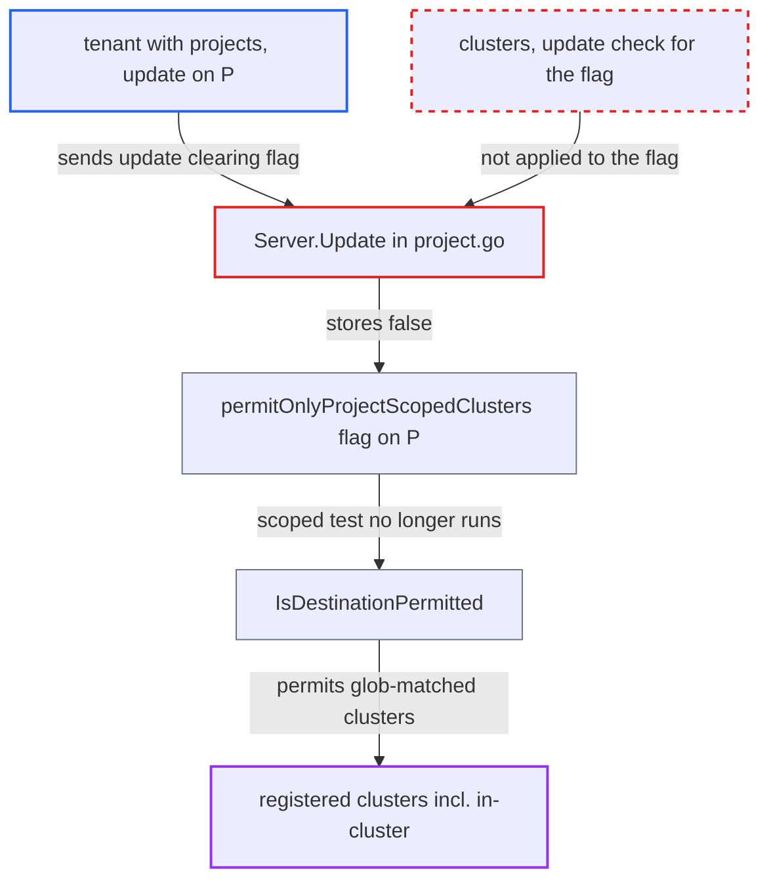

# Project Update lets projects/update holders clear permitOnlyProjectScopedClusters without cluster authorization

| Field | Value |
|---|---|
| ID | `find_01BFNmYNbUZ3mxcHoxG1Z48t` |
| Severity | **Critical** |
| Status | open |
| CWE | CWE-863 — Improper Authorization |
| Created | 2026-10-27T21:38:44.776637Z |
| Claude Security | https://claude.ai/security/findings/find_01BFNmYNbUZ3mxcHoxG1Z48t |

## Description

A tenant who holds only `projects, update` on a project can widen which clusters that project's Applications may deploy to, without the `clusters, update` permission that should be needed. This works when the operator uses broad destination globs together with `permitOnlyProjectScopedClusters: true`. `Server.Update` never compares that flag with the stored project, so setting it to `false` is saved with no cluster authorization check.

1. **attacker with `projects, update` on project P** sends a project update that sets `permitOnlyProjectScopedClusters` to `false`. The rest of the project is left unchanged, so no destination server or resource list differs from the stored project.
2. **the handler `Server.Update`** skips every `clusters, update` check. The guards only compare destination `server` strings and the four cluster/namespace resource lists, and the flag is not compared. ([`server/project/project.go:389-411`](https://github.com/cx-benchmark/argo-cd/blob/b7bc418289a96130340ea79964c4491b416c14f2/server/project/project.go#L389-L411))
3. **the handler `Server.Update`** stores the project exactly as sent. `validateProject` does not inspect the flag, and the app-validity loop only catches narrowing, so clearing the flag passes. ([`server/project/project.go:465`](https://github.com/cx-benchmark/argo-cd/blob/b7bc418289a96130340ea79964c4491b416c14f2/server/project/project.go#L465))
4. **`AppProject.IsDestinationPermitted`** permits every cluster matched by the destination globs. The project-scoped cluster test runs only while the flag is `true`, so once it is `false` any glob-matched registered cluster is allowed. ([`pkg/apis/application/v1alpha1/app_project_types.go:482-505`](https://github.com/cx-benchmark/argo-cd/blob/b7bc418289a96130340ea79964c4491b416c14f2/pkg/apis/application/v1alpha1/app_project_types.go#L482-L505))
5. **attacker** creates an Application in P that targets a glob-matched cluster. `ValidatePermissions` decides cluster access only through `proj.IsDestinationPermitted`, so the Application is accepted. ([`util/argo/argo.go:786-809`](https://github.com/cx-benchmark/argo-cd/blob/b7bc418289a96130340ea79964c4491b416c14f2/util/argo/argo.go#L786-L809))
6. **the controller** syncs the Application to that cluster with the stored cluster credentials. The per-resource check in `controller/sync.go` also uses `IsDestinationPermitted`, and the default-enabled `in-cluster` destination is reachable under a `*` server glob. ([`controller/sync.go:767`](https://github.com/cx-benchmark/argo-cd/blob/b7bc418289a96130340ea79964c4491b416c14f2/controller/sync.go#L767))

## Assessment

The attacker is an authenticated tenant who holds `projects, update` on project P. This also lets them edit P's roles and mint role tokens. They do not hold `clusters, update` on the shared clusters. The operator has set glob destinations together with `permitOnlyProjectScopedClusters: true`, which is the documented pattern. The attacker sends `PUT /api/v1/projects/P` with the flag set to `false`, then creates and syncs an Application in P that targets any glob-matched registered cluster.

Impact: P's Applications can target every cluster the destination globs match, including the default-enabled `in-cluster` control-plane cluster. If the namespace glob covers `argocd`, namespaced kinds can be synced there with the controller's credentials, for example a Pod running as the controller service account, or an overwrite of `argocd-cm`, `argocd-rbac-cm` or cluster secrets. The project's resource allow and deny lists still apply.

Subsequent-system impact: Other registered clusters that were never P's become deploy targets. The controller applies the attacker's manifests there with the stored credentials, which are typically cluster-admin. This allows arbitrary namespaced workloads such as privileged pods, which give code execution and data access on those clusters. Cluster-scoped kinds stay limited by P's cluster resource allow list.

## Recommendation

`Server.Update` decides whether cluster-level authorization is needed by diffing only destination servers and resource lists. `permitOnlyProjectScopedClusters` also controls which clusters the project can reach, but it is saved without any check.

Fix criteria: Changing `permitOnlyProjectScopedClusters` from `true` to `false`, or any other change that enlarges the clusters the project may reach, requires the same `clusters, update` authorization as the destination guard. To verify, take a project with `server: '*'` and the flag set, and update it to `false` with a token that holds only `projects, update`. The call returns PermissionDenied. The stored flag stays `true`. An Application targeting a non-project cluster is still rejected by `ValidatePermissions`.

## Evidence

**https://github.com/cx-benchmark/argo-cd**

- [`server/project/project.go:389-411`](https://github.com/cx-benchmark/argo-cd/blob/b7bc418289a96130340ea79964c4491b416c14f2/server/project/project.go#L389-L411)
- [`server/project/project.go:465`](https://github.com/cx-benchmark/argo-cd/blob/b7bc418289a96130340ea79964c4491b416c14f2/server/project/project.go#L465)
- [`pkg/apis/application/v1alpha1/app_project_types.go:482-505`](https://github.com/cx-benchmark/argo-cd/blob/b7bc418289a96130340ea79964c4491b416c14f2/pkg/apis/application/v1alpha1/app_project_types.go#L482-L505)
- [`util/argo/argo.go:786-809`](https://github.com/cx-benchmark/argo-cd/blob/b7bc418289a96130340ea79964c4491b416c14f2/util/argo/argo.go#L786-L809)
- [`controller/sync.go:767`](https://github.com/cx-benchmark/argo-cd/blob/b7bc418289a96130340ea79964c4491b416c14f2/controller/sync.go#L767)
- [`util/settings/settings.go:620-622`](https://github.com/cx-benchmark/argo-cd/blob/b7bc418289a96130340ea79964c4491b416c14f2/util/settings/settings.go#L620-L622)
- [`docs/user-guide/projects.md:466-478`](https://github.com/cx-benchmark/argo-cd/blob/b7bc418289a96130340ea79964c4491b416c14f2/docs/user-guide/projects.md#L466-L478)

