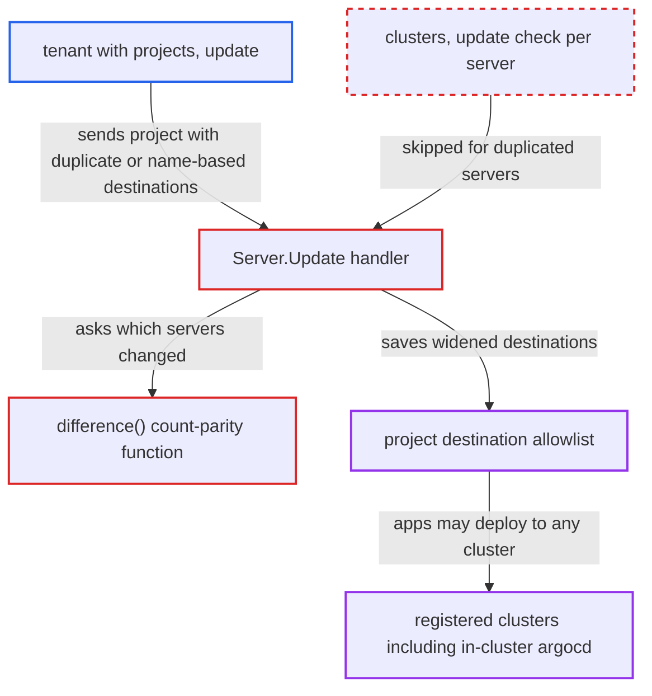

# Project update skips clusters-update check for duplicated or name-based destinations

| Field | Value |
|---|---|
| ID | `find_01Le2HJZqHr2xH1s4aD5m2kE` |
| Severity | **Critical** |
| Status | open |
| CWE | CWE-863 — Improper Authorization |
| Created | 2026-10-27T21:06:20.416603Z |
| Claude Security | https://claude.ai/security/findings/find_01Le2HJZqHr2xH1s4aD5m2kE |

## Description

A tenant who holds only `projects, update` on their project can widen its allowed destinations to any registered cluster and namespace, including the in-cluster one where Argo CD runs. They do this without `clusters, update` on those clusters. `difference()` in `server/project/util.go` counts how often a server appears instead of computing a set difference. A server listed twice, or any name-based destination, is therefore never checked by `Server.Update`.

1. **authenticated tenant** adds duplicate or name-based destinations to their project. The tenant lists the target server twice with different namespaces, or adds name-based entries. `ValidateProject` rejects only identical `server/namespace` pairs, so this is accepted. ([`pkg/apis/application/v1alpha1/app_project_types.go:189-213`](https://github.com/cx-benchmark/argo-cd/blob/b7bc418289a96130340ea79964c4491b416c14f2/pkg/apis/application/v1alpha1/app_project_types.go#L189-L213))
2. **the handler `Server.Update`** checks only `projects, update` and then asks `difference()` which servers changed. It requires `clusters, update, <server>` only for the servers `difference()` returns, and this is the only cluster-level check on destination changes. ([`server/project/project.go:389-393`](https://github.com/cx-benchmark/argo-cd/blob/b7bc418289a96130340ea79964c4491b416c14f2/server/project/project.go#L389-L393))
3. **the function `difference()`** drops every server that occurs an even number of times across the old and new destinations. It is `unique(append(new, old...))`, and `unique` keeps only strings that occur exactly once, so a server listed twice counts as unchanged. A server listed twice in the old spec can likewise be removed unchecked. ([`server/project/util.go:3-20`](https://github.com/cx-benchmark/argo-cd/blob/b7bc418289a96130340ea79964c4491b416c14f2/server/project/util.go#L3-L20))
4. **the method `DestinationClusters()`** reports every name-based destination as an empty string. It returns only `Server`, so the cluster name is never checked. Two or more name-based entries across the old and new specs cancel each other out in `unique`. ([`pkg/apis/application/v1alpha1/types.go:3757-3766`](https://github.com/cx-benchmark/argo-cd/blob/b7bc418289a96130340ea79964c4491b416c14f2/pkg/apis/application/v1alpha1/types.go#L3757-L3766))
5. **the handler `Server.Update`** saves the widened project spec. No `clusters, update` check ran for the added servers. The later loop rejects only narrowing that breaks existing apps, not widening. ([`server/project/project.go:389-393`](https://github.com/cx-benchmark/argo-cd/blob/b7bc418289a96130340ea79964c4491b416c14f2/server/project/project.go#L389-L393))
6. **authenticated tenant** creates and syncs an Application aimed at the newly allowed cluster. `IsDestinationPermitted` glob-matches a stored `server: "*"` or `name: "*"` entry, so app creation and the controller accept any registered cluster. The controller then applies the manifests with its own credentials. ([`pkg/apis/application/v1alpha1/app_project_types.go:483-526`](https://github.com/cx-benchmark/argo-cd/blob/b7bc418289a96130340ea79964c4491b416c14f2/pkg/apis/application/v1alpha1/app_project_types.go#L483-L526))

## Assessment

The attacker is an authenticated tenant with `projects, update, A` on their own project. They also need `projects, get` and `applications, create`/`sync` in A. They do not hold `clusters, update` on the target. They fetch project A with a GET and keep its current destinations. Then they add two entries for the target server with different namespaces, for example `{server:"*",namespace:"*"}` plus `{server:"*",namespace:"default"}`, or `https://kubernetes.default.svc` with two namespaces. A second route is to add name-based entries such as `{name:"*",namespace:"*"}` when the old and new specs together hold two or more name-based entries. They then send a `PUT /api/v1/projects/A`. A server listed twice in the old spec can also be removed without a check. Emptying a project whose servers are all duplicated passes the destination check too. In a project with no apps, that lets a cluster-resource whitelist change through unchecked. The white/blacklist guard checks every server in the new spec without parity, so duplicates do not bypass it. It checks nothing when the new spec has no destinations.

Impact: The tenant breaks the project boundary and lets their apps target every registered cluster and namespace, including the `argocd` namespace of the in-cluster destination. There the controller's credentials can, for example, create a RoleBinding to read the cluster and repo credential Secrets, or change Argo CD's own workloads. This is a full takeover of the control plane.

Subsequent-system impact: Other clusters registered in Argo CD are separate systems. Once the project permits them, the controller deploys the attacker's manifests there with its stored credentials, which are usually cluster-admin. The attacker can read secrets in, modify and disrupt workloads on clusters the tenant was never granted.

## Recommendation

(1) `difference()` in `server/project/util.go` computes count parity over the concatenated old and new lists, not a set difference. A server listed an even number of times is treated as unchanged, so the `clusters, update` check is skipped.

Fix criteria: Every distinct server in the new destinations but not the old, and every distinct server in the old but not the new, is checked against `clusters, update`, however many entries mention it. An update by a user with only `projects, update` that adds `{server:X,ns:a}` and `{server:X,ns:b}` for a new X fails with `permission denied: clusters, update, X`. Removing a server listed twice fails the same way.

(2) `AppProjectSpec.DestinationClusters()` drops `Destination.Name`, so name-based destinations are never identified to the RBAC check. They all collapse to the empty string, which then cancels out in the parity test.

Fix criteria: Name-based destinations are identified, either by resolving the name to its cluster or by checking a name-keyed identity. This applies both in the add/remove check and in the white/blacklist guard. Adding `{name: X}` or `{name: "*"}` without `clusters, update` on X (or `*`) is denied, even when the project already holds other name-based destinations.

## Evidence

**https://github.com/cx-benchmark/argo-cd**

- [`server/project/util.go:3-20`](https://github.com/cx-benchmark/argo-cd/blob/b7bc418289a96130340ea79964c4491b416c14f2/server/project/util.go#L3-L20)
- [`server/project/project.go:389-393`](https://github.com/cx-benchmark/argo-cd/blob/b7bc418289a96130340ea79964c4491b416c14f2/server/project/project.go#L389-L393)
- [`pkg/apis/application/v1alpha1/types.go:3757-3766`](https://github.com/cx-benchmark/argo-cd/blob/b7bc418289a96130340ea79964c4491b416c14f2/pkg/apis/application/v1alpha1/types.go#L3757-L3766)
- [`pkg/apis/application/v1alpha1/app_project_types.go:189-213`](https://github.com/cx-benchmark/argo-cd/blob/b7bc418289a96130340ea79964c4491b416c14f2/pkg/apis/application/v1alpha1/app_project_types.go#L189-L213)
- [`pkg/apis/application/v1alpha1/app_project_types.go:483-526`](https://github.com/cx-benchmark/argo-cd/blob/b7bc418289a96130340ea79964c4491b416c14f2/pkg/apis/application/v1alpha1/app_project_types.go#L483-L526)

