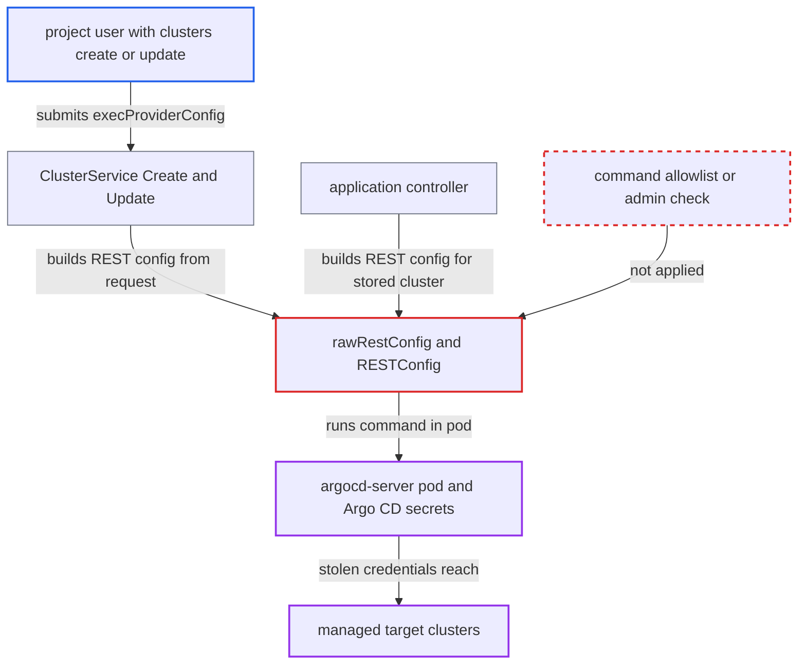

# Project-scoped cluster creators get arbitrary command execution via execProviderConfig

| Field | Value |
|---|---|
| ID | `find_016TsWaoHWR4sTH7m6afcxwA` |
| Severity | **Critical** |
| Status | open |
| CWE | CWE-78 — OS command injection |
| Created | 2026-10-27T21:12:27.397267Z |
| Claude Security | https://claude.ai/security/findings/find_016TsWaoHWR4sTH7m6afcxwA |

## Description

A signed-in Argo CD user with a project role that allows `clusters, create` or `clusters, update` can run any command inside the `argocd-server` pod. The pod's service account can read every secret in the Argo CD namespace. The cause is that `rawRestConfig` copies `execProviderConfig` from the request into the client-go exec plugin without an allowlist or an administrator check.

1. **attacker with a project role** obtains `clusters, create` or `clusters, update` on a project. Operators may already grant this under the self-service model. Otherwise a holder of `projects, update` can add the policy to a project role, because `clusters` is project-scoped and `server/project/project.go` does not gate role changes. ([`util/rbac/rbac.go:114-121`](https://github.com/cx-benchmark/argo-cd/blob/b7bc418289a96130340ea79964c4491b416c14f2/util/rbac/rbac.go#L114-L121))
2. **attacker** sends a cluster create request with a malicious `execProviderConfig`. The request sets `command` to `/bin/sh` with `args` of `-c` and a payload, and uses any `server` other than `https://kubernetes.default.svc`. ([`server/cluster/cluster.go:144-157`](https://github.com/cx-benchmark/argo-cd/blob/b7bc418289a96130340ea79964c4491b416c14f2/server/cluster/cluster.go#L144-L157))
3. **the handler `Create`** passes the RBAC check and builds a REST config from the untrusted cluster. It enforces only `clusters, create` on `<project>/<server>`, then calls `c.RESTConfig()` before anything is validated or stored. ([`server/cluster/cluster.go:144-157`](https://github.com/cx-benchmark/argo-cd/blob/b7bc418289a96130340ea79964c4491b416c14f2/server/cluster/cluster.go#L144-L157))
4. **`rawRestConfig`** copies `Command`, `Args`, `Env` and `APIVersion` into an `api.ExecConfig`. Nothing limits which binary can be named, and no privilege check applies. ([`pkg/apis/application/v1alpha1/types.go:4340-4373`](https://github.com/cx-benchmark/argo-cd/blob/b7bc418289a96130340ea79964c4491b416c14f2/pkg/apis/application/v1alpha1/types.go#L4340-L4373))
5. **`RESTConfig()`** wires the exec config into the HTTP transport through `SetK8SConfigDefaults`. client-go then installs its exec credential authenticator, which starts the command on the first request. ([`pkg/apis/application/v1alpha1/types.go:4412-4423`](https://github.com/cx-benchmark/argo-cd/blob/b7bc418289a96130340ea79964c4491b416c14f2/pkg/apis/application/v1alpha1/types.go#L4412-L4423))
6. **`GetServerVersion`** makes a discovery request that triggers the command. The exec round tripper runs the command before it connects to the attacker-chosen `server`, so the payload runs even if that URL is unreachable. ([`gitops-engine/pkg/utils/kube/ctl.go:359-369`](https://github.com/cx-benchmark/argo-cd/blob/b7bc418289a96130340ea79964c4491b416c14f2/gitops-engine/pkg/utils/kube/ctl.go#L359-L369))
7. **application controller** runs the same command later when an Application in the project targets the stored cluster. The controller builds its cluster cache from `cluster.RESTConfig()`, and project-scoped clusters are implicitly allowed destinations. ([`controller/cache/cache.go:540-543`](https://github.com/cx-benchmark/argo-cd/blob/b7bc418289a96130340ea79964c4491b416c14f2/controller/cache/cache.go#L540-L543))

## Assessment

The attacker is an authenticated Argo CD user whose project role holds `clusters, create` or `clusters, update` on `<project>/*`. This is the permission the project self-service docs tell administrators to grant. A user with `projects, update` on a project can also add that policy to a project role. The attacker calls `ClusterService.Create` (gRPC or `POST /api/v1/clusters`) with their project, any `server` and a malicious `execProviderConfig`. `Update` follows the same path for a cluster the caller may update. The only exception is `server: https://kubernetes.default.svc`, which ignores the exec config. The shipped Ubuntu-based image contains `/bin/sh`. The report assumes `argocd-server` is reachable by the tenant.

Impact: The attacker runs arbitrary commands as the `argocd-server` process, and later in the application controller once an Application targets the cluster. From there they can read, change and delete every Secret in the Argo CD namespace. That includes cluster and repository credentials and `argocd-secret`, which holds the JWT signing key and admin password hash. They can forge admin sessions, alter any Application or disrupt the control plane.

Subsequent-system impact: The stolen cluster secrets are what Argo CD uses to deploy to every managed target cluster, typically with cluster-admin rights. The controller pod also usually has cluster-admin on the control-plane cluster. The attacker can deploy or delete arbitrary workloads on all of them.

## Recommendation

(1) `rawRestConfig` accepts any `execProviderConfig.command`, `args` and `env` from a cluster that non-admin API users may create or update. A tenant-level permission therefore becomes code execution in `argocd-server` and the controller.

Fix criteria: A cluster definition from a caller who is not a global cluster administrator cannot make an arbitrary binary run. Either `execProviderConfig` (and `awsAuthConfig`) is rejected for project-scoped or API-created clusters unless the caller holds an explicit global privilege, or `command` is limited to a fixed allowlist of shipped credential helpers such as `argocd-k8s-auth` with validated subcommands. `ClusterService.Create` and `Update` with `execProviderConfig.command: /bin/sh` is refused for a project-role token. No process is spawned in `argocd-server` or the controller.

(2) `Create` and `Update` in `server/cluster` test the connection with `RESTConfig()` and `GetServerVersion` on untrusted input before validating the authentication mechanism. The connectivity check runs the exec plugin as a side effect.

Fix criteria: The cluster `config` (authentication mechanism and allowed commands) is validated before any REST config is built or the server is contacted. The connectivity test never runs an attacker-selected binary. An invalid or unauthorized `execProviderConfig` is rejected and no process is spawned.

(3) The docs present project-scoped `clusters, create` as a safe developer self-service permission. In the code it is equivalent to code execution in the control plane.

Fix criteria: Until the code restricts exec providers, the RBAC and project-scoped-cluster docs state that `clusters, create` and `clusters, update` grant code execution in `argocd-server` and the controller. They also state that the permission must only be given to fully trusted users.

## Evidence

**https://github.com/cx-benchmark/argo-cd**

- [`pkg/apis/application/v1alpha1/types.go:4340-4373`](https://github.com/cx-benchmark/argo-cd/blob/b7bc418289a96130340ea79964c4491b416c14f2/pkg/apis/application/v1alpha1/types.go#L4340-L4373)
- [`pkg/apis/application/v1alpha1/types.go:4412-4423`](https://github.com/cx-benchmark/argo-cd/blob/b7bc418289a96130340ea79964c4491b416c14f2/pkg/apis/application/v1alpha1/types.go#L4412-L4423)
- [`server/cluster/cluster.go:144-157`](https://github.com/cx-benchmark/argo-cd/blob/b7bc418289a96130340ea79964c4491b416c14f2/server/cluster/cluster.go#L144-L157)
- [`server/cluster/cluster.go:297-329`](https://github.com/cx-benchmark/argo-cd/blob/b7bc418289a96130340ea79964c4491b416c14f2/server/cluster/cluster.go#L297-L329)
- [`gitops-engine/pkg/utils/kube/ctl.go:359-369`](https://github.com/cx-benchmark/argo-cd/blob/b7bc418289a96130340ea79964c4491b416c14f2/gitops-engine/pkg/utils/kube/ctl.go#L359-L369)
- [`util/rbac/rbac.go:114-121`](https://github.com/cx-benchmark/argo-cd/blob/b7bc418289a96130340ea79964c4491b416c14f2/util/rbac/rbac.go#L114-L121)
- [`controller/cache/cache.go:540-543`](https://github.com/cx-benchmark/argo-cd/blob/b7bc418289a96130340ea79964c4491b416c14f2/controller/cache/cache.go#L540-L543)
- [`manifests/base/server/argocd-server-role.yaml:10-21`](https://github.com/cx-benchmark/argo-cd/blob/b7bc418289a96130340ea79964c4491b416c14f2/manifests/base/server/argocd-server-role.yaml#L10-L21)
- [`docs/user-guide/projects.md:376-441`](https://github.com/cx-benchmark/argo-cd/blob/b7bc418289a96130340ea79964c4491b416c14f2/docs/user-guide/projects.md#L376-L441)

