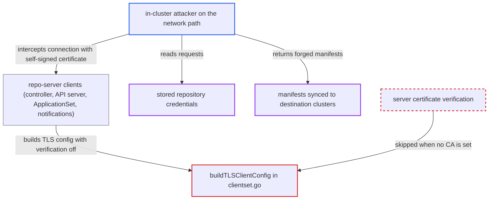

# Repo-server clients accept any TLS certificate by default; in-cluster MITM steals credentials, injects manifests

| Field | Value |
|---|---|
| ID | `find_01Ek1PCg2fj45hzBaBcwmxm2` |
| Severity | **Critical** |
| Status | open |
| CWE | CWE-295 — Improper certificate validation |
| Created | 2026-10-27T21:37:15.065914Z |
| Claude Security | https://claude.ai/security/findings/find_01Ek1PCg2fj45hzBaBcwmxm2 |

## Description

An attacker who can intercept traffic inside the cluster can steal stored repository credentials and feed Argo CD forged manifests. This affects the application controller, API server, ApplicationSet controller and notifications controller. It needs an on-path position to the repo-server, but no Argo CD login. The cause is `buildTLSClientConfig`, which sets `InsecureSkipVerify = true` when no CA is configured, and that is the default.

1. **attacker** gets on the network path to `argocd-repo-server:8081`. The report names ARP/IPv6-RA spoofing on a bridge CNI, a node on the path, or a hijacked Service endpoint as examples; no Argo CD credentials are needed.
2. **Argo CD component** dials the repo-server through `NewConnection`. This one shared transport is used by all four components and uses `credentials.NewTLS(buildTLSClientConfig(...))` unless plaintext is chosen. ([`reposerver/apiclient/clientset.go:113-145`](https://github.com/cx-benchmark/argo-cd/blob/b7bc418289a96130340ea79964c4491b416c14f2/reposerver/apiclient/clientset.go#L113-L145))
3. **`buildTLSClientConfig`** accepts any certificate the attacker presents. It sets `InsecureSkipVerify = true` when `StrictValidation` is false and no CA pool is set, and nothing else checks the server's identity. By default `--repo-server-ca-cert-path` is empty and `--repo-server-strict-tls` is `false`. ([`reposerver/apiclient/clientset.go:164-172`](https://github.com/cx-benchmark/argo-cd/blob/b7bc418289a96130340ea79964c4491b416c14f2/reposerver/apiclient/clientset.go#L164-L172))
4. **attacker** answers the TLS handshake with a self-signed certificate and reads the `ManifestRequest`. The request carries `Repo`, `Repos` and `HelmRepoCreds`, which include fields such as `Password`, `SSHPrivateKey`, `TLSClientCertKey`, `GithubAppPrivateKey`, `GCPServiceAccountKey`, `BearerToken` and Azure client secrets. ([`controller/state.go:389-433`](https://github.com/cx-benchmark/argo-cd/blob/b7bc418289a96130340ea79964c4491b416c14f2/controller/state.go#L389-L433))
5. **attacker** returns forged manifests and a forged verification result. The controller uses `manifestInfo.Manifests` as the target state, diffs it and syncs it to the destination cluster, and it trusts the reported signature-verification result. ([`controller/state.go:389-433`](https://github.com/cx-benchmark/argo-cd/blob/b7bc418289a96130340ea79964c4491b416c14f2/controller/state.go#L389-L433))

## Assessment

The attacker is a compromised in-cluster workload or node that can intercept a component's connection to `argocd-repo-server:8081`. Examples are ARP/IPv6-RA spoofing on a bridge CNI, being on the path from a node, or hijacking a Service endpoint. No Argo CD credentials and no victim action are needed. A stock install is exposed: `--repo-server-ca-cert-path` is empty, the deprecated `--repo-server-strict-tls` flag defaults to `false`, `argocd-cmd-params-cm` ships empty, and the `argocd-repo-server-tls` secret is mounted only as `optional: true`. Without that secret, the repo-server generates a new self-signed certificate on each start. The optional mTLS mode authenticates clients to the server, not the server to clients. The API server, ApplicationSet controller and notifications controller are exposed in the same way as the application controller.

Impact: The attacker obtains the repository credentials sent with each request, such as passwords, SSH and TLS client keys, GitHub App and GCP keys, bearer tokens, and Helm/OCI credentials. The attacker also decides which manifests the controller treats as desired state, and the signature-verification result, for every intercepted application. ApplicationSet git file and directory replies can be forged too. Forged errors can stall reconciliation of the affected apps, but the report rates that impact as limited.

Subsequent-system impact: The controller applies the attacker's objects to destination clusters using its stored cluster credentials. The shipped in-cluster role is `*` on `*`, and the only limit is the application's AppProject; the `default` project allows everything. This allows arbitrary workloads and changes or deletions on those clusters. The stolen repository credentials give read access to the organisation's source repositories, and write access where the credential allows it.

## Recommendation

(1) `buildTLSClientConfig` in `reposerver/apiclient/clientset.go` turns off certificate verification (`InsecureSkipVerify = true`) whenever no CA is configured. Repo-server clients never authenticate the server, so the safety of credentials and manifests depends only on network position.

Fix criteria: By default, every repo-server client authenticates the server before sending any request. It either verifies the certificate against a trust anchor the installation provides or pins the server's key. An unverifiable or mismatched certificate fails the handshake. Non-validating mode, if kept, is an explicit opt-in. To verify, point each client at a listener with an arbitrary self-signed certificate: the handshake must fail and no `ManifestRequest` may be sent.

(2) The shipped manifests provide no stable repo-server certificate or CA. `argocd-repo-server-tls` is optional, and the repo-server self-signs a new certificate on each start with SANs `localhost`/`reposerver`. A stock install has no trust anchor that clients could verify, even with verification on.

Fix criteria: A stock install provisions a persistent repo-server certificate with the `argocd-repo-server` service SANs. It gives its CA to the controller, API server, ApplicationSet and notifications pods, so validation is on out of the box. To verify, check that the rendered `manifests/install.yaml` sets a CA for every repo-server client. Also check that the clients reject a repo-server presenting a different certificate.

## Evidence

**https://github.com/cx-benchmark/argo-cd**

- [`reposerver/apiclient/clientset.go:164-172`](https://github.com/cx-benchmark/argo-cd/blob/b7bc418289a96130340ea79964c4491b416c14f2/reposerver/apiclient/clientset.go#L164-L172)
- [`reposerver/apiclient/clientset.go:113-145`](https://github.com/cx-benchmark/argo-cd/blob/b7bc418289a96130340ea79964c4491b416c14f2/reposerver/apiclient/clientset.go#L113-L145)
- [`util/tls/tls.go:562-597`](https://github.com/cx-benchmark/argo-cd/blob/b7bc418289a96130340ea79964c4491b416c14f2/util/tls/tls.go#L562-L597)
- [`cmd/argocd-application-controller/commands/argocd_application_controller.go:150-168`](https://github.com/cx-benchmark/argo-cd/blob/b7bc418289a96130340ea79964c4491b416c14f2/cmd/argocd-application-controller/commands/argocd_application_controller.go#L150-L168)
- [`cmd/argocd-server/commands/argocd_server.go:167-197`](https://github.com/cx-benchmark/argo-cd/blob/b7bc418289a96130340ea79964c4491b416c14f2/cmd/argocd-server/commands/argocd_server.go#L167-L197)
- [`cmd/argocd-applicationset-controller/commands/applicationset_controller.go:225-239`](https://github.com/cx-benchmark/argo-cd/blob/b7bc418289a96130340ea79964c4491b416c14f2/cmd/argocd-applicationset-controller/commands/applicationset_controller.go#L225-L239)
- [`cmd/argocd-notification/commands/argocd_notification.go:122-139`](https://github.com/cx-benchmark/argo-cd/blob/b7bc418289a96130340ea79964c4491b416c14f2/cmd/argocd-notification/commands/argocd_notification.go#L122-L139)
- [`controller/state.go:389-433`](https://github.com/cx-benchmark/argo-cd/blob/b7bc418289a96130340ea79964c4491b416c14f2/controller/state.go#L389-L433)
- [`pkg/apis/application/v1alpha1/repository_types.go:20-60`](https://github.com/cx-benchmark/argo-cd/blob/b7bc418289a96130340ea79964c4491b416c14f2/pkg/apis/application/v1alpha1/repository_types.go#L20-L60)
- [`reposerver/server.go:46-85`](https://github.com/cx-benchmark/argo-cd/blob/b7bc418289a96130340ea79964c4491b416c14f2/reposerver/server.go#L46-L85)
- [`manifests/base/application-controller/argocd-application-controller-statefulset.yaml:466-487`](https://github.com/cx-benchmark/argo-cd/blob/b7bc418289a96130340ea79964c4491b416c14f2/manifests/base/application-controller/argocd-application-controller-statefulset.yaml#L466-L487)

