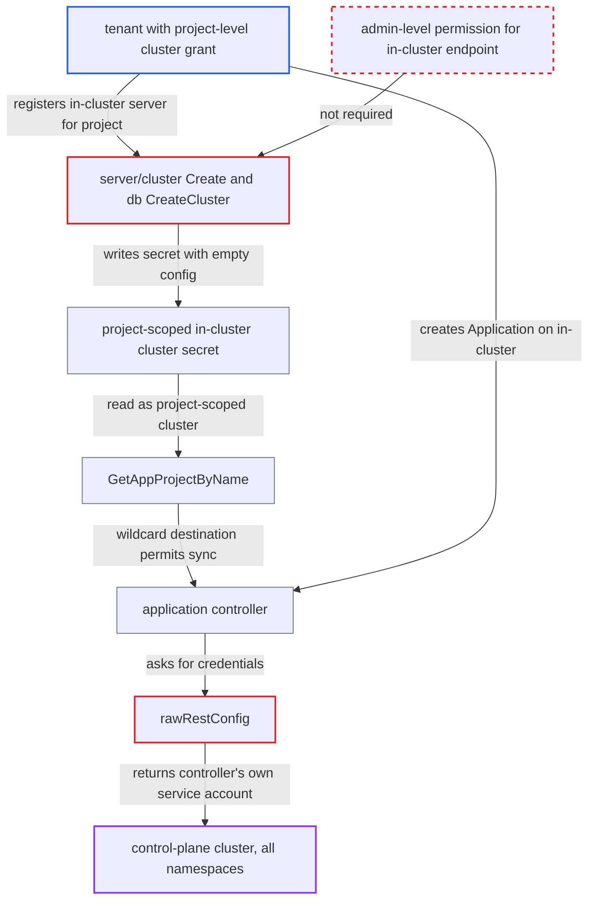

# Tenant can register in-cluster endpoint as project-scoped cluster, inheriting controller's service account

| Field | Value |
|---|---|
| ID | `find_011ZWVZB3gEb7btxY52Es9f8` |
| Severity | **Critical** |
| Status | open |
| CWE | CWE-863 — Incorrect authorization |
| Created | 2026-10-27T21:15:11.514625Z |
| Claude Security | https://claude.ai/security/findings/find_011ZWVZB3gEb7btxY52Es9f8 |

## Description

A tenant with project-level cluster permissions can deploy anything to any namespace of the Argo CD control-plane cluster. That includes the `argocd` namespace, and the deployment runs with the controller's own cluster-admin service account. The attacker needs the self-service grant `clusters, create, <proj>/*` plus permission to create and sync Applications in that project. The cause is that `rawRestConfig` picks credentials only from the `server` string, and the cluster-create path never requires admin rights for the in-cluster address.

1. **tenant** sends a create-cluster request for the in-cluster address. The request is a `POST /api/v1/clusters` with `server: https://kubernetes.default.svc`, `project: <proj>` and an empty config, and the handler `Create` only checks `clusters, create, <project>/<server>`, which the grant `my-project/*` satisfies. ([`server/cluster/cluster.go:144-160`](https://github.com/cx-benchmark/argo-cd/blob/b7bc418289a96130340ea79964c4491b416c14f2/server/cluster/cluster.go#L144-L160))
2. **`CreateCluster`** stores a cluster secret bound to the tenant's project. For the in-cluster address it only checks `IsInClusterEnabled()`, then writes the caller-supplied `project` with an empty `config`; in a default install there is no explicit in-cluster secret, so nothing collides. ([`util/db/cluster.go:107-139`](https://github.com/cx-benchmark/argo-cd/blob/b7bc418289a96130340ea79964c4491b416c14f2/util/db/cluster.go#L107-L139))
3. **`GetCluster`** returns the new secret instead of the synthetic local cluster. A stored in-cluster secret is preferred, so the tenant's record now defines the in-cluster destination. ([`util/db/cluster.go:247-269`](https://github.com/cx-benchmark/argo-cd/blob/b7bc418289a96130340ea79964c4491b416c14f2/util/db/cluster.go#L247-L269))
4. **`GetAppProjectByName`** adds the cluster to the project's destinations with namespace `*`. Every project-scoped cluster is appended to `Spec.Destinations`, so the admin's `spec.destinations` no longer limits the project; the controller's project cache is invalidated on the secret change, so this takes effect without admin action. ([`util/argo/argo.go:868-880`](https://github.com/cx-benchmark/argo-cd/blob/b7bc418289a96130340ea79964c4491b416c14f2/util/argo/argo.go#L868-L880))
5. **tenant** creates an Application in the project that targets the in-cluster server and any namespace, such as `argocd`. The implicit `*` destination lets the Application pass `ValidatePermissions`.
6. **`rawRestConfig`** returns `rest.InClusterConfig()` for the credential-less record. The server is `https://kubernetes.default.svc` and the secret has no username, password or bearer token, so the running component's own service-account token is used whoever created the record. ([`pkg/apis/application/v1alpha1/types.go:4303-4304`](https://github.com/cx-benchmark/argo-cd/blob/b7bc418289a96130340ea79964c4491b416c14f2/pkg/apis/application/v1alpha1/types.go#L4303-L4304))
7. **application controller** syncs the Application using its own service account. The controller resolves the destination with `GetDestinationCluster` and syncs with `destCluster.RawRestConfig()`/`RESTConfig()`; that account is cluster-admin on the control-plane cluster by default. ([`controller/sync.go:244-258`](https://github.com/cx-benchmark/argo-cd/blob/b7bc418289a96130340ea79964c4491b416c14f2/controller/sync.go#L244-L258))

## Assessment

The attacker is an authenticated tenant. They need the documented self-service grant `clusters, create, <proj>/*`, plus permission to create and sync Applications in `<proj>`. The default state is enough, because a default installation has no explicit in-cluster secret and the create therefore succeeds. The attacker only needs network access to the Argo CD API. The report gives no other entry point.

Impact: The tenant can deploy arbitrary manifests to any namespace of the control-plane cluster through the controller's cluster-admin service account, and the project destination restriction is bypassed. This includes the `argocd` namespace, so the tenant can read or overwrite cluster and repository secrets and `argocd-secret`, create privileged workloads, or delete control-plane components.

Subsequent-system impact: With write access to the `argocd` namespace, the attacker obtains the credentials for every managed target cluster. They can then deploy to or disrupt all of those clusters.

## Recommendation

(1) `rawRestConfig` falls back to the component's own in-cluster service account for any secret whose `server` is the in-cluster address, even one a non-admin bound to a project. A project-scoped registration therefore inherits Argo CD's identity instead of the tenant's.

Fix criteria: A project-scoped cluster record, or one created through the API by a caller without global cluster privileges, never resolves to Argo CD's own in-cluster service account. It either carries explicit credentials or is rejected. A project-role token cannot create `https://kubernetes.default.svc` under its project. An Application in that project targeting the in-cluster address is still rejected by `IsDestinationPermitted` when the admin's `spec.destinations` does not list it.

(2) `server/cluster.Create` and `db.CreateCluster` let a caller bind the in-cluster endpoint to an arbitrary project with only project-level RBAC. This turns the implicit local cluster into a project-scoped one and adds it as a wildcard destination.

Fix criteria: Registering or re-scoping the in-cluster endpoint requires the unscoped `clusters, create/update, https://kubernetes.default.svc` permission (admin level), whatever `project` value the request carries. An API test shows that `clusters, create, my-project/*` is not enough for the in-cluster server.

## Evidence

**https://github.com/cx-benchmark/argo-cd**

- [`pkg/apis/application/v1alpha1/types.go:4303-4304`](https://github.com/cx-benchmark/argo-cd/blob/b7bc418289a96130340ea79964c4491b416c14f2/pkg/apis/application/v1alpha1/types.go#L4303-L4304)
- [`server/cluster/cluster.go:144-160`](https://github.com/cx-benchmark/argo-cd/blob/b7bc418289a96130340ea79964c4491b416c14f2/server/cluster/cluster.go#L144-L160)
- [`util/db/cluster.go:107-139`](https://github.com/cx-benchmark/argo-cd/blob/b7bc418289a96130340ea79964c4491b416c14f2/util/db/cluster.go#L107-L139)
- [`util/db/cluster.go:247-269`](https://github.com/cx-benchmark/argo-cd/blob/b7bc418289a96130340ea79964c4491b416c14f2/util/db/cluster.go#L247-L269)
- [`util/argo/argo.go:868-880`](https://github.com/cx-benchmark/argo-cd/blob/b7bc418289a96130340ea79964c4491b416c14f2/util/argo/argo.go#L868-L880)
- [`controller/sync.go:244-258`](https://github.com/cx-benchmark/argo-cd/blob/b7bc418289a96130340ea79964c4491b416c14f2/controller/sync.go#L244-L258)
- [`cmd/argocd-application-controller/commands/argocd_application_controller.go:178-180`](https://github.com/cx-benchmark/argo-cd/blob/b7bc418289a96130340ea79964c4491b416c14f2/cmd/argocd-application-controller/commands/argocd_application_controller.go#L178-L180)

