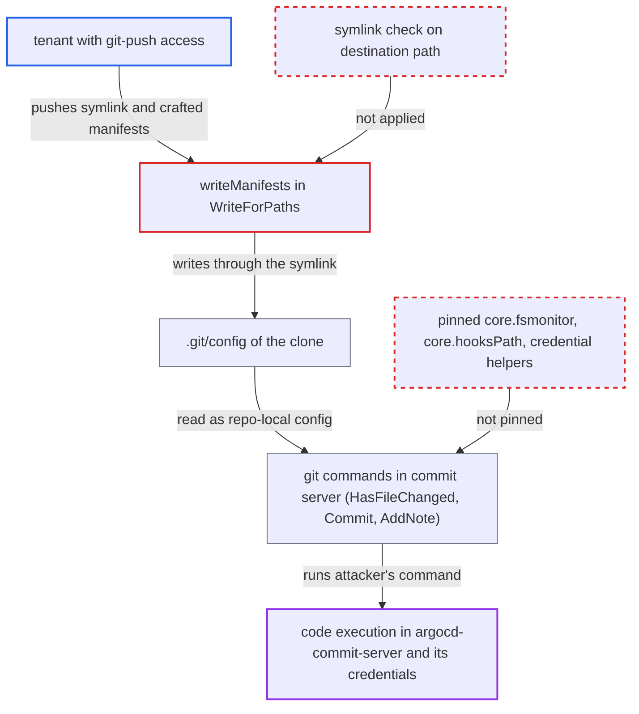

# Tracked symlink in hydration branch redirects manifest.yaml write into .git/config, giving commit-server code execution

| Field | Value |
|---|---|
| ID | `find_01ENDuZkawxUuHz55MWwcoLn` |
| Severity | **Critical** |
| Status | open |
| CWE | CWE-61 — Symlink following |
| Created | 2026-10-27T21:30:39.411925Z |
| Claude Security | https://claude.ai/security/findings/find_01ENDuZkawxUuHz55MWwcoLn |

## Description

A tenant with git-push access to a repository that Argo CD hydrates can run arbitrary commands inside `argocd-commit-server`. They also need Application rights or an existing hydrated app. The commit server writes `manifest.yaml` through a symlink that the attacker's own branch commits, so the write lands in the clone's `.git/config`. The write code in `WriteForPaths` and `writeManifests` never checks for symlinks, and git is not stopped from reading code-executing config settings.

1. **attacker (tenant)** pushes a target-branch commit that replaces `manifest.yaml` with a symlink. The symlink, for example `apps/foo/manifest.yaml -> ../../.git/config`, stays inside the clone, so `os.Root` allows it. The attacker also pushes a dry commit holding a crafted object. ([`controller/hydrator/hydrator.go:371-429`](https://github.com/cx-benchmark/argo-cd/blob/b7bc418289a96130340ea79964c4491b416c14f2/controller/hydrator/hydrator.go#L371-L429))
2. **the commit server** checks out the attacker's branch with `git checkout --force`. This creates the tracked symlink in the work tree, and the later `git clean -ffdx` removes only untracked files. ([`util/git/client.go:814-818`](https://github.com/cx-benchmark/argo-cd/blob/b7bc418289a96130340ea79964c4491b416c14f2/util/git/client.go#L814-L818))
3. **the controller** forwards the tenant's `syncSource.path` and rendered manifests unchanged. The tenant therefore chooses both where in the branch the write lands and which bytes are written. ([`controller/hydrator/hydrator.go:572-606`](https://github.com/cx-benchmark/argo-cd/blob/b7bc418289a96130340ea79964c4491b416c14f2/controller/hydrator/hydrator.go#L572-L606))
4. **`writeManifests`** opens `manifest.yaml` with `O_CREATE|O_WRONLY|O_TRUNC` and writes the manifests. The write goes through an `os.Root` opened on the clone's top directory, which contains `.git/`. `os.Root` follows symlinks that stay inside the root, and there is no `Lstat`, no-follow or remove-first step. So `.git/config` is truncated and overwritten. ([`commitserver/commit/hydratorhelper.go:180-194`](https://github.com/cx-benchmark/argo-cd/blob/b7bc418289a96130340ea79964c4491b416c14f2/commitserver/commit/hydratorhelper.go#L180-L194))
5. **the YAML encoder** serialises the crafted object into text that git reads as a valid config. The object becomes a comment line, then a `[core]` section that sets `fsmonitor`. A value ending in backslashes then swallows the remaining YAML lines. ([`commitserver/commit/hydratorhelper.go:39-107`](https://github.com/cx-benchmark/argo-cd/blob/b7bc418289a96130340ea79964c4491b416c14f2/commitserver/commit/hydratorhelper.go#L39-L107))
6. **the commit server's git commands** read the tampered `.git/config` and run the attacker's command. `HasFileChanged` runs `git diff --quiet` right after the write, and a `core.fsmonitor` command runs through a shell when git reads the index. A `core.hooksPath` pointing into the attacker's tree instead runs their hooks during `git commit`, `git notes add` and `git push`. ([`util/git/client.go:2143-2162`](https://github.com/cx-benchmark/argo-cd/blob/b7bc418289a96130340ea79964c4491b416c14f2/util/git/client.go#L2143-L2162))
7. **git config handling** does not pin the code-executing settings. `builtinGitConfig` sets only `*.autoDetach`, so `core.fsmonitor`, `core.hooksPath` and credential helpers all come from the local config. ([`util/git/client.go:74-77`](https://github.com/cx-benchmark/argo-cd/blob/b7bc418289a96130340ea79964c4491b416c14f2/util/git/client.go#L74-L77))

## Assessment

The attacker is a tenant with git-push access to a repository that Argo CD hydrates into. They also need Application rights or an existing hydrated app. They push a target-branch commit that replaces `<syncSource.path>/manifest.yaml` with a symlink to `../../.git/config`. They also push a dry commit holding the crafted object. The same weakness applies to the root `hydrator.metadata` and `.gitattributes`. Hydration then does the rest, and no victim action is needed. The next git command (`git diff`, `git commit`, `git notes` or `git push`) runs the attacker's command. Any branch of a permitted repo is accepted as the target branch, and nothing checks the content of the target tree. Even without a valid payload, the overwrite breaks hydration for that branch.

Impact: The attacker runs arbitrary commands as the commit-server user. They can take the request's push credential via the askpass nonce, and read or use the hydrator GPG signing key (mounted at `/app/config/gpg/signing`, agent in `GNUPGHOME`). They can leave a process that tampers with other tenants' clones under `/tmp/_commit-service/` before those clones are committed and pushed, and they can wedge the service. Kubernetes API access is not gained, because the pod mounts no service-account token (`automountServiceAccountToken: false`).

Subsequent-system impact: Stolen write credentials (credential templates, GitHub App installation tokens) give write access to git repositories beyond the attacker's own. Manifests injected into other tenants' hydrated branches, committed and optionally signed as Argo CD, are then synced into those tenants' destination clusters. This crosses the AppProject boundary.

## Recommendation

(1) `writeManifests`, `writeMetadata`, `writeReadme` and `writeGitAttributes` write through whatever already exists at the destination in the checked-out branch. `os.Root` follows in-root symlinks, so a tracked symlink redirects the write into `.git/` or elsewhere in the clone.

Fix criteria: No hydrator output write follows a symlink at any component of its destination path, and no destination resolves inside the clone's `.git` directory. An existing symlink is detected or removed before the write. Test: a target branch with `<path>/manifest.yaml -> ../../.git/config`, or the same at the root `hydrator.metadata` or `.gitattributes`, either fails hydration or replaces the symlink with a regular file. In both cases `.git/config` is left unchanged.

(2) The commit server runs git in a clone whose local configuration and hook directory the attacker's tree can influence. No environment override neutralises code-executing config keys.

Fix criteria: Every git invocation in the commit server ignores code-executing settings from the repository's local config. Hooks path, fsmonitor and credential helpers are pinned through command-line or environment config. Test: with `.git/config` tampered to set `core.fsmonitor` or `core.hooksPath` to attacker content, no attacker command runs during `HasFileChanged`, commit, notes or push.

## Evidence

**https://github.com/cx-benchmark/argo-cd**

- [`commitserver/commit/hydratorhelper.go:180-194`](https://github.com/cx-benchmark/argo-cd/blob/b7bc418289a96130340ea79964c4491b416c14f2/commitserver/commit/hydratorhelper.go#L180-L194)
- [`commitserver/commit/hydratorhelper.go:39-107`](https://github.com/cx-benchmark/argo-cd/blob/b7bc418289a96130340ea79964c4491b416c14f2/commitserver/commit/hydratorhelper.go#L39-L107)
- [`commitserver/commit/commit.go:137-154`](https://github.com/cx-benchmark/argo-cd/blob/b7bc418289a96130340ea79964c4491b416c14f2/commitserver/commit/commit.go#L137-L154)
- [`commitserver/commit/commit.go:179-199`](https://github.com/cx-benchmark/argo-cd/blob/b7bc418289a96130340ea79964c4491b416c14f2/commitserver/commit/commit.go#L179-L199)
- [`util/git/client.go:2143-2162`](https://github.com/cx-benchmark/argo-cd/blob/b7bc418289a96130340ea79964c4491b416c14f2/util/git/client.go#L2143-L2162)
- [`util/git/client.go:1968-1980`](https://github.com/cx-benchmark/argo-cd/blob/b7bc418289a96130340ea79964c4491b416c14f2/util/git/client.go#L1968-L1980)
- [`util/git/client.go:74-77`](https://github.com/cx-benchmark/argo-cd/blob/b7bc418289a96130340ea79964c4491b416c14f2/util/git/client.go#L74-L77)
- [`util/git/client.go:814-818`](https://github.com/cx-benchmark/argo-cd/blob/b7bc418289a96130340ea79964c4491b416c14f2/util/git/client.go#L814-L818)
- [`controller/hydrator/hydrator.go:572-606`](https://github.com/cx-benchmark/argo-cd/blob/b7bc418289a96130340ea79964c4491b416c14f2/controller/hydrator/hydrator.go#L572-L606)
- [`controller/hydrator/hydrator.go:371-429`](https://github.com/cx-benchmark/argo-cd/blob/b7bc418289a96130340ea79964c4491b416c14f2/controller/hydrator/hydrator.go#L371-L429)
- [`util/askpass/server.go:111-119`](https://github.com/cx-benchmark/argo-cd/blob/b7bc418289a96130340ea79964c4491b416c14f2/util/askpass/server.go#L111-L119)

