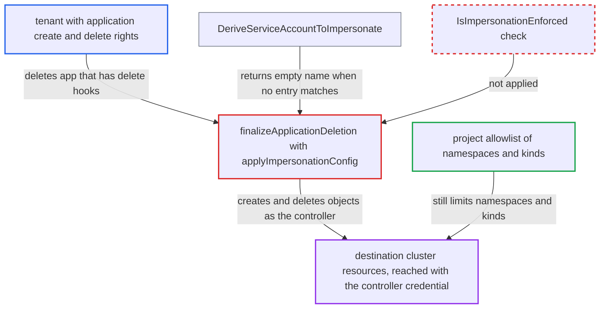

# App deletion and delete hooks fall back to controller credentials despite impersonation enforcement

| Field | Value |
|---|---|
| ID | `find_01SngDtHGgaEzLWygiKaQofh` |
| Severity | **High** |
| Status | open |
| CWE | CWE-636 — Failing open |
| Created | 2026-10-27T21:25:16.307645Z |
| Claude Security | https://claude.ai/security/findings/find_01SngDtHGgaEzLWygiKaQofh |

## Description

A tenant who can create and delete Applications in an Argo CD project can make the controller create and delete objects on the destination cluster with its own cluster-wide credential. This happens when impersonation is enabled and enforced, and the project's `destinations` allow a target that its `destinationServiceAccounts` do not cover. The helper `applyImpersonationConfig` skips the `IsImpersonationEnforced()` check and falls back to the controller credential. The project's namespace and kind allowlists still apply.

1. **tenant** points an app at a destination that the project's `destinations` allow but its `destinationServiceAccounts` do not cover. The app can never sync, because sync fails when no service account matches. Nothing at app create or update checks for a matching service account.
2. **tenant** commits `argocd.argoproj.io/hook: PreDelete` manifests to the app's source repo. The manifests can be a Job, a Pod or a RoleBinding. They must be of kinds and namespaces the project permits.
3. **Argo CD refresh** adds the PreDelete/PostDelete finalizers to the app. This happens whenever the rendered manifests contain delete hooks, even though every sync of the app fails. ([`controller/appcontroller.go:2340-2366`](https://github.com/cx-benchmark/argo-cd/blob/b7bc418289a96130340ea79964c4491b416c14f2/controller/appcontroller.go#L2340-L2366))
4. **tenant** deletes the app. Deletion is handled by `finalizeApplicationDeletion`, which builds the destination REST config and passes it through `applyImpersonationConfig`. ([`controller/appcontroller.go:1388-1410`](https://github.com/cx-benchmark/argo-cd/blob/b7bc418289a96130340ea79964c4491b416c14f2/controller/appcontroller.go#L1388-L1410))
5. **`DeriveServiceAccountToImpersonate`** returns an empty service account name with no error. No entry matches the destination server and namespace. The function leaves it to each caller to enforce. ([`util/settings/impersonation.go:19-49`](https://github.com/cx-benchmark/argo-cd/blob/b7bc418289a96130340ea79964c4491b416c14f2/util/settings/impersonation.go#L19-L49))
6. **the helper `applyImpersonationConfig`** sets an empty `ImpersonationConfig` instead of failing. It never calls `IsImpersonationEnforced()`, so requests go out with the controller's own credential. Sync and diff fail in this same situation. ([`controller/appcontroller.go:3435-3451`](https://github.com/cx-benchmark/argo-cd/blob/b7bc418289a96130340ea79964c4491b416c14f2/controller/appcontroller.go#L3435-L3451))
7. **the controller** creates the hook objects from the tenant's Git source with the controller credential. The hooks are checked only against project policy by `validateSyncPermissions`, then created with `ctrl.kubectl.CreateResource`. ([`controller/hook.go:160-190`](https://github.com/cx-benchmark/argo-cd/blob/b7bc418289a96130340ea79964c4491b416c14f2/controller/hook.go#L160-L190))
8. **the controller** runs cascade deletion of tracked resources with the same config. Failed-hook deletion and hook cleanup also use the non-impersonated config. ([`controller/appcontroller.go:1455-1458`](https://github.com/cx-benchmark/argo-cd/blob/b7bc418289a96130340ea79964c4491b416c14f2/controller/appcontroller.go#L1455-L1458))

## Assessment

The attacker is a tenant with `applications, create/update/delete` rights in a project P and push access to a source repo that P permits. The admin has enabled `application.sync.impersonation.enabled`, and enforcement (`application.sync.impersonation.enforced`) is on, which is its default. P's `destinations` must cover a namespace or cluster that its `destinationServiceAccounts` do not. The destination namespace is chosen by the tenant in `spec.destination.namespace`. The report names no other way in.

Impact: The tenant gets project-permitted namespaced objects created, and later deleted, on the destination cluster with the controller's credential, which is cluster-wide `*/*` in the default install. Argo CD's own data is not disclosed or disrupted directly. The reach is bounded by the project's destinations, namespaces and kinds.

Subsequent-system impact: On the destination cluster, a hook Pod or Job can run as any service account in its namespace and mount that namespace's Secrets. A RoleBinding hook can grant namespace admin. Cascade deletion and failed-hook deletion also run with the controller credential. The tenant should have no such access there.

## Recommendation

`applyImpersonationConfig` turns an unmatched `destinationServiceAccounts` lookup into an empty `ImpersonationConfig` and ignores `application.sync.impersonation.enforced`. Deletion, delete-hook creation and hook cleanup therefore run with the controller credential, unlike sync, diff and API operations, which fail closed.

Fix criteria: With impersonation enabled and enforcement on, every Kubernetes call in `finalizeApplicationDeletion` (hook create and delete, cascade delete, cleanup) runs as a derived service account, or deletion stops with a `DeletionError` condition. With enforcement off, the fallback may stay as documented. Verify with an app whose destination has no matching entry and whose source has PreDelete/PostDelete hooks. Deleting it must create and delete nothing on the cluster.

## Evidence

**https://github.com/cx-benchmark/argo-cd**

- [`controller/appcontroller.go:3435-3451`](https://github.com/cx-benchmark/argo-cd/blob/b7bc418289a96130340ea79964c4491b416c14f2/controller/appcontroller.go#L3435-L3451)
- [`controller/appcontroller.go:1388-1410`](https://github.com/cx-benchmark/argo-cd/blob/b7bc418289a96130340ea79964c4491b416c14f2/controller/appcontroller.go#L1388-L1410)
- [`controller/hook.go:160-190`](https://github.com/cx-benchmark/argo-cd/blob/b7bc418289a96130340ea79964c4491b416c14f2/controller/hook.go#L160-L190)
- [`controller/appcontroller.go:1455-1458`](https://github.com/cx-benchmark/argo-cd/blob/b7bc418289a96130340ea79964c4491b416c14f2/controller/appcontroller.go#L1455-L1458)
- [`util/settings/impersonation.go:19-49`](https://github.com/cx-benchmark/argo-cd/blob/b7bc418289a96130340ea79964c4491b416c14f2/util/settings/impersonation.go#L19-L49)
- [`controller/sync.go:343-366`](https://github.com/cx-benchmark/argo-cd/blob/b7bc418289a96130340ea79964c4491b416c14f2/controller/sync.go#L343-L366)
- [`controller/appcontroller.go:2340-2366`](https://github.com/cx-benchmark/argo-cd/blob/b7bc418289a96130340ea79964c4491b416c14f2/controller/appcontroller.go#L2340-L2366)
- [`util/settings/settings.go:2957-2966`](https://github.com/cx-benchmark/argo-cd/blob/b7bc418289a96130340ea79964c4491b416c14f2/util/settings/settings.go#L2957-L2966)

