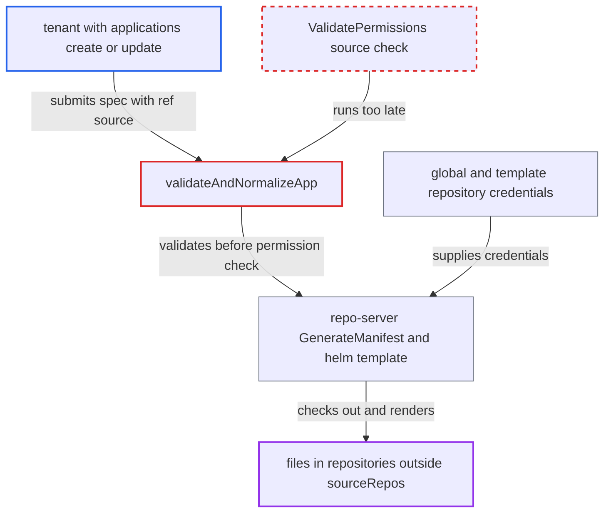

# App validation renders unpermitted ref-source repos before AppProject sourceRepos check, leaking contents

| Field | Value |
|---|---|
| ID | `find_01Jzr37Yb13bJqFPDjeAsBYJ` |
| Severity | **High** |
| Status | open |
| CWE | CWE-863 — Incorrect Authorization |
| Created | 2026-10-27T21:24:41.828567Z |
| Claude Security | https://claude.ai/security/findings/find_01Jzr37Yb13bJqFPDjeAsBYJ |

## Description

A tenant with permission to create or update applications in one project can read files from private repositories that the project's `sourceRepos` list does not allow. This covers any repository Argo CD holds global or credential-template access to. The file contents come back in an API error. The cause is that `validateAndNormalizeApp` runs `ValidateRepo`, which uses those credentials, before `ValidatePermissions` checks the sources.

1. **tenant** sends an application create or update request with two sources. One source is the private repository with `ref: v`. The other is a chart in a repository the project permits, with `valueFiles` set to a `$v/` path and a template containing `{{ fail (toJson .Values) }}`.
2. **the function `validateAndNormalizeApp`** calls `argo.ValidateRepo` and returns its conditions before calling `argo.ValidatePermissions`. `ValidatePermissions` is the only place that checks each `repoURL` with `proj.IsSourcePermitted`, so it has not run yet. ([`server/application/application.go:1386-1404`](https://github.com/cx-benchmark/argo-cd/blob/b7bc418289a96130340ea79964c4491b416c14f2/server/application/application.go#L1386-L1404))
3. **the function `validateRepo`** looks up every source with `db.GetRepository` and builds credentialed `RefSources`. The lookup falls back to global repository secrets and credential templates whatever the project is, and nothing checks `proj.IsSourcePermitted`. ([`util/argo/argo.go:540-604`](https://github.com/cx-benchmark/argo-cd/blob/b7bc418289a96130340ea79964c4491b416c14f2/util/argo/argo.go#L540-L604))
4. **the repo-server** checks out each ref repository and passes the `$v/` value file to `helm template`. It trusts the `RefSources` it receives and never compares them with `ProjectSourceRepos`. ([`reposerver/repository/repository.go:900-960`](https://github.com/cx-benchmark/argo-cd/blob/b7bc418289a96130340ea79964c4491b416c14f2/reposerver/repository/repository.go#L900-L960))
5. **Helm** fails on the chart's `fail` call and prints the values to stderr. The values include the private file's contents. ([`reposerver/repository/repository.go:1354-1440`](https://github.com/cx-benchmark/argo-cd/blob/b7bc418289a96130340ea79964c4491b416c14f2/reposerver/repository/repository.go#L1354-L1440))
6. **the function `verifyGenerateManifests`** copies the error text into the `InvalidSpecError` message returned as an InvalidArgument response. The request is later rejected and nothing is saved, but the caller has already received the file contents. ([`util/argo/argo.go:1011-1025`](https://github.com/cx-benchmark/argo-cd/blob/b7bc418289a96130340ea79964c4491b416c14f2/util/argo/argo.go#L1011-L1025))

## Assessment

The attacker is a tenant with `applications, create` or `update` in a project whose `sourceRepos` excludes the target repository. They also control a permitted repository holding a chart with `{{ fail (toJson .Values) }}`. They call `POST /api/v1/applications`, where validation is on by default. The same validation runs for `Create`, `Update`, `UpdateSpec` and `Patch`. No user interaction is needed. A second route needs only one unpermitted `repoURL`. It makes the repo-server connect to an arbitrary URL and return the connection error. The destination cluster is also contacted for API discovery before the destination permission check.

Impact: The tenant bypasses the AppProject source boundary. They can read any file from any repository Argo CD holds global or template credentials for, including other tenants' private config and secret values files. Nothing is persisted, so the request still fails, but the disclosure has already happened.

Subsequent-system impact: The repo-server can be made to connect to arbitrary URLs, such as internal git, HTTP or OCI hosts, and the connection error is returned. This gives a read-only probe of the internal network. Destination clusters are contacted only for discovery, which is read-only and returns only errors. Registered cluster names can already be enumerated by other paths.

## Recommendation

(1) `validateAndNormalizeApp` runs credential-bearing validation (`ValidateRepo`: repo tests, ref-source checkouts, manifest generation, cluster discovery) before `ValidatePermissions` decides whether the spec's repositories and destination are allowed for the project.

Fix criteria: No repository, repo-server or destination-cluster call is made for a source, ref source, hydrator source or destination the AppProject does not permit. Project permission validation succeeds before any such call. To verify, submit a spec with an unpermitted `ref:` source or `repoURL` and confirm the request is rejected with no repo-server or cluster request issued.

(2) The repo-server trusts the `RefSources` it receives. It checks out and reads ref repositories without checking them against `ProjectSourceRepos`. Any caller that can reach `GenerateManifest` with crafted ref sources can read unpermitted repositories.

Fix criteria: The repo-server refuses to resolve a `$ref` value or file parameter from a repository not permitted by the request's project source list. To verify, a manifest request whose ref source is outside `ProjectSourceRepos` fails without checking out that repository.

## Evidence

**https://github.com/cx-benchmark/argo-cd**

- [`server/application/application.go:1386-1404`](https://github.com/cx-benchmark/argo-cd/blob/b7bc418289a96130340ea79964c4491b416c14f2/server/application/application.go#L1386-L1404)
- [`util/argo/argo.go:540-604`](https://github.com/cx-benchmark/argo-cd/blob/b7bc418289a96130340ea79964c4491b416c14f2/util/argo/argo.go#L540-L604)
- [`util/argo/argo.go:655-674`](https://github.com/cx-benchmark/argo-cd/blob/b7bc418289a96130340ea79964c4491b416c14f2/util/argo/argo.go#L655-L674)
- [`util/argo/argo.go:1011-1025`](https://github.com/cx-benchmark/argo-cd/blob/b7bc418289a96130340ea79964c4491b416c14f2/util/argo/argo.go#L1011-L1025)
- [`reposerver/repository/repository.go:900-960`](https://github.com/cx-benchmark/argo-cd/blob/b7bc418289a96130340ea79964c4491b416c14f2/reposerver/repository/repository.go#L900-L960)
- [`reposerver/repository/repository.go:1354-1440`](https://github.com/cx-benchmark/argo-cd/blob/b7bc418289a96130340ea79964c4491b416c14f2/reposerver/repository/repository.go#L1354-L1440)
- [`util/exec/exec.go:119-127`](https://github.com/cx-benchmark/argo-cd/blob/b7bc418289a96130340ea79964c4491b416c14f2/util/exec/exec.go#L119-L127)
- [`util/db/repository_secrets.go:568-603`](https://github.com/cx-benchmark/argo-cd/blob/b7bc418289a96130340ea79964c4491b416c14f2/util/db/repository_secrets.go#L568-L603)
- [`util/argo/argo.go:449-468`](https://github.com/cx-benchmark/argo-cd/blob/b7bc418289a96130340ea79964c4491b416c14f2/util/argo/argo.go#L449-L468)

