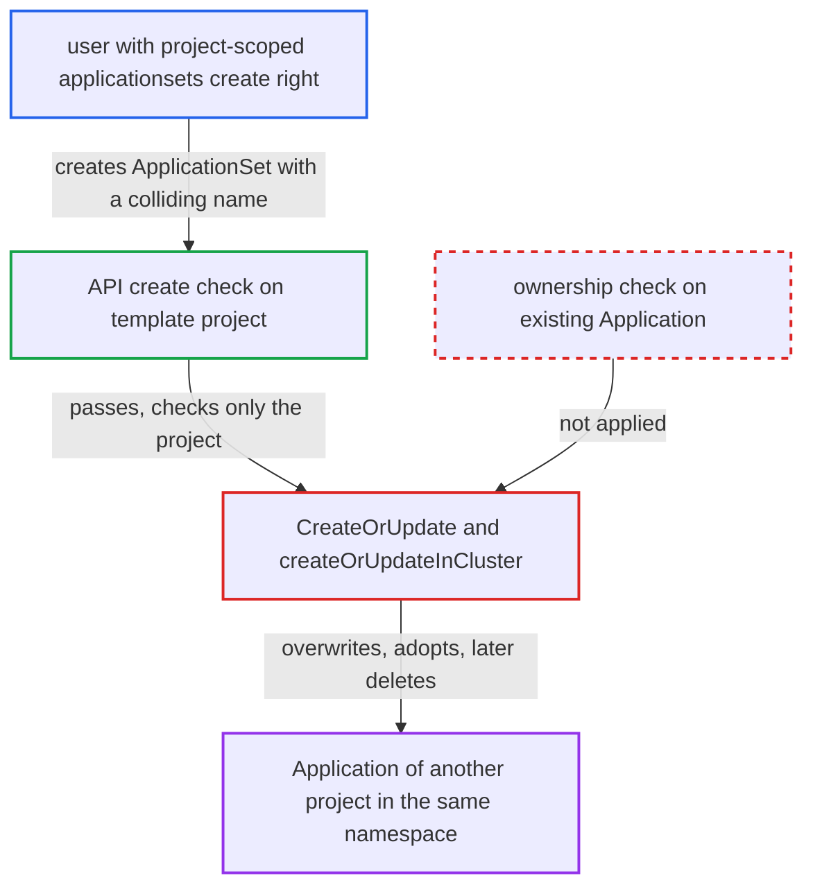

# ApplicationSet adopts and overwrites any unowned Application whose name it generates

| Field | Value |
|---|---|
| ID | `find_01ByuV3aYUzjngEW2cP6Suwh` |
| Severity | **High** |
| Status | open |
| CWE | CWE-639 — Authorization bypass |
| Created | 2026-10-27T21:16:49.075809Z |
| Claude Security | https://claude.ai/security/findings/find_01ByuV3aYUzjngEW2cP6Suwh |

## Description

A user who may create ApplicationSets only for their own project can rewrite, take over and delete Applications that belong to other projects in the same namespace (normally `argocd`). The attacker needs only the `applicationsets, create` right on their own project. The cause is `CreateOrUpdate`, which picks its write target by name alone and never checks that the existing Application belongs to the ApplicationSet.

1. **attacker with limited RBAC** creates an ApplicationSet in their own project with a generated name that matches a victim Application. The attacker holds only `applicationsets, create/delete, dev-project/*`, and the API checks only the top-level template project, so the generated `metadata.name` is unconstrained. ([`server/applicationset/applicationset.go:545-576`](https://github.com/cx-benchmark/argo-cd/blob/b7bc418289a96130340ea79964c4491b416c14f2/server/applicationset/applicationset.go#L545-L576))
2. **the template code** takes the generated name from the template without constraining it. Only the namespace is pinned to the ApplicationSet's namespace; the name comes from the attacker's template or generator data. ([`applicationset/controllers/template/template.go:65-67`](https://github.com/cx-benchmark/argo-cd/blob/b7bc418289a96130340ea79964c4491b416c14f2/applicationset/controllers/template/template.go#L65-L67))
3. **the validator `validateGeneratedApplications`** accepts the generated Applications. It checks only that names are unique within the set and that the project and destination exist, not whether the name is already used by an Application outside the set. ([`applicationset/controllers/applicationset_controller.go:608-643`](https://github.com/cx-benchmark/argo-cd/blob/b7bc418289a96130340ea79964c4491b416c14f2/applicationset/controllers/applicationset_controller.go#L608-L643))
4. **the function `CreateOrUpdate`** finds the existing Application by name and namespace and patches it. It runs the mutate callback and calls `c.Patch` without checking that the Application is owned by this ApplicationSet. ([`applicationset/utils/createOrUpdate.go:108-156`](https://github.com/cx-benchmark/argo-cd/blob/b7bc418289a96130340ea79964c4491b416c14f2/applicationset/utils/createOrUpdate.go#L108-L156))
5. **the mutate callback in `createOrUpdateInCluster`** overwrites the victim and adopts it. It replaces `Spec` (including `project`, sources and destination), `Operation`, `Annotations`, `Labels` and `Finalizers`, then calls `SetControllerReference`, which refuses only when a different controller owner is already set. ([`applicationset/controllers/applicationset_controller.go:763-826`](https://github.com/cx-benchmark/argo-cd/blob/b7bc418289a96130340ea79964c4491b416c14f2/applicationset/controllers/applicationset_controller.go#L763-L826))
6. **the function `deleteInCluster`** deletes the adopted Application when it is no longer generated. The Application is now in the owned set, and Kubernetes garbage collection also deletes it when the ApplicationSet is deleted. ([`applicationset/controllers/applicationset_controller.go:900-965`](https://github.com/cx-benchmark/argo-cd/blob/b7bc418289a96130340ea79964c4491b416c14f2/applicationset/controllers/applicationset_controller.go#L900-L965))

## Assessment

The attacker is an authenticated Argo CD user whose only relevant right is `applicationsets, create/delete` on their own project, for example `dev-project`. They create an ApplicationSet with `project: dev-project` and a list generator whose `template.metadata.name` equals an existing standalone Application of another project. The victim Application must have no controller owner, which covers every Application created through the UI, CLI, API or `kubectl`. No action by the victim is needed. A second way in: a developer with push access to a generator source can trigger the same takeover when an admin templates `metadata.name` from generator data such as `{{path.basename}}` or `{{branch}}`. With the `create-only` or `create-delete` policies, the colliding Application is still overwritten, because `createInCluster` compares only against Applications already owned, so a pre-existing unowned one still reaches `CreateOrUpdate`.

Impact: The attacker gets write and delete control over any Application in the namespace that has no controller owner, whatever its project. They can rewrite its spec within their own project's limits and move it into their own project. They can also delete it, and the victim tenant loses GitOps management of the app. The attacker can also read its retained status (history, resource list), which is limited disclosure. Live workloads outside the attacker's project are orphaned rather than deleted, because cascade deletion is bounded by the new project's permissions.

## Recommendation

(1) `CreateOrUpdate` and `createOrUpdateInCluster` treat any existing Application with the generated name as belonging to the ApplicationSet. Ownership is never verified before the object is patched and adopted.

Fix criteria: An ApplicationSet only updates, adopts or deletes Applications that already carry its controller ownerReference with a matching UID. An existing Application without it is left unchanged and reported as a conflict, unless an administrator-controlled adoption opt-in exists. Test: create a standalone Application in project A, then an ApplicationSet in project B generating the same name. The Application must keep its spec and project and stay unowned.

(2) `createInCluster`, used by the `create-only` and `create-delete` policies, decides which Applications are new only by comparing against Applications already owned. A pre-existing unowned Application with a colliding name is therefore updated even though these policies forbid updates.

Fix criteria: Under policies that forbid updates, an existing Application with the same name, owned or not, is never patched. Creation fails with AlreadyExists rather than falling through to an update. Test: with `--policy create-only`, a colliding pre-existing Application is not modified.

## Evidence

**https://github.com/cx-benchmark/argo-cd**

- [`applicationset/utils/createOrUpdate.go:108-156`](https://github.com/cx-benchmark/argo-cd/blob/b7bc418289a96130340ea79964c4491b416c14f2/applicationset/utils/createOrUpdate.go#L108-L156)
- [`applicationset/controllers/applicationset_controller.go:763-826`](https://github.com/cx-benchmark/argo-cd/blob/b7bc418289a96130340ea79964c4491b416c14f2/applicationset/controllers/applicationset_controller.go#L763-L826)
- [`applicationset/controllers/applicationset_controller.go:608-643`](https://github.com/cx-benchmark/argo-cd/blob/b7bc418289a96130340ea79964c4491b416c14f2/applicationset/controllers/applicationset_controller.go#L608-L643)
- [`server/applicationset/applicationset.go:545-576`](https://github.com/cx-benchmark/argo-cd/blob/b7bc418289a96130340ea79964c4491b416c14f2/server/applicationset/applicationset.go#L545-L576)
- [`applicationset/controllers/template/template.go:65-67`](https://github.com/cx-benchmark/argo-cd/blob/b7bc418289a96130340ea79964c4491b416c14f2/applicationset/controllers/template/template.go#L65-L67)
- [`applicationset/controllers/applicationset_controller.go:863-886`](https://github.com/cx-benchmark/argo-cd/blob/b7bc418289a96130340ea79964c4491b416c14f2/applicationset/controllers/applicationset_controller.go#L863-L886)
- [`applicationset/controllers/applicationset_controller.go:900-965`](https://github.com/cx-benchmark/argo-cd/blob/b7bc418289a96130340ea79964c4491b416c14f2/applicationset/controllers/applicationset_controller.go#L900-L965)
- [`controller/appcontroller.go:1334-1351`](https://github.com/cx-benchmark/argo-cd/blob/b7bc418289a96130340ea79964c4491b416c14f2/controller/appcontroller.go#L1334-L1351)
- [`docs/operator-manual/rbac.md:273-288`](https://github.com/cx-benchmark/argo-cd/blob/b7bc418289a96130340ea79964c4491b416c14f2/docs/operator-manual/rbac.md#L273-L288)

