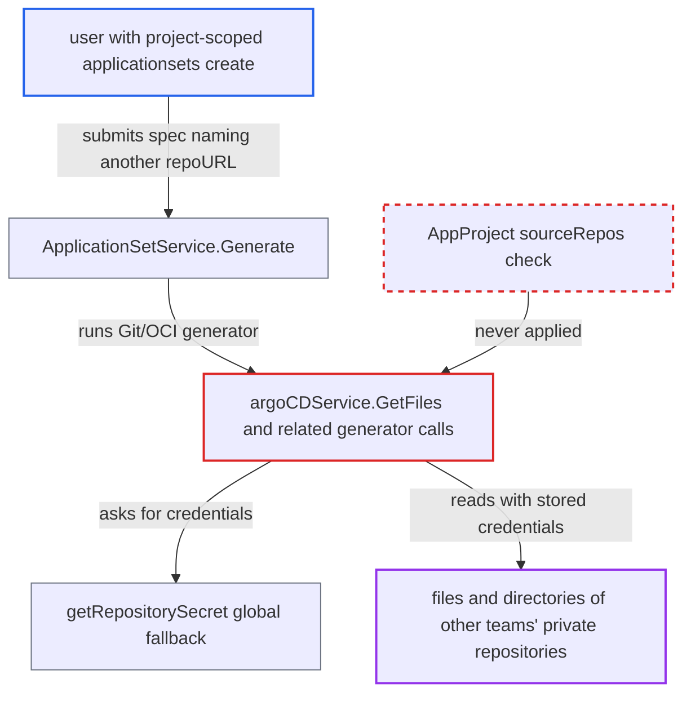

# ApplicationSet Git/OCI generators bypass AppProject sourceRepos to read credentialed repositories

| Field | Value |
|---|---|
| ID | `find_0161YRyKfjjTv2e8ptnFyAwn` |
| Severity | **High** |
| Status | open |
| CWE | CWE-863 — Incorrect authorization |
| Created | 2026-10-27T21:17:32.050829Z |
| Claude Security | https://claude.ai/security/findings/find_0161YRyKfjjTv2e8ptnFyAwn |

## Description

A user who is limited to one Argo CD project can read the YAML/JSON files and directory tree of private repositories that the project's `sourceRepos` does not allow. This works if the user holds `applicationsets, create` on that project, and it needs no victim action. The Git and OCI generators fetch from any `repoURL` using Argo CD's stored credentials, and nothing checks `AppProject.spec.sourceRepos`.

1. **attacker with project-scoped `applicationsets, create` rights** sends a spec to `POST /api/v1/applicationsets/generate`. The spec sets `template.spec.project` to project P, and a `git` generator names another team's private `repoURL` with `files: [{path: '**/*.yaml'}]`. P's `sourceRepos` excludes that repository.
2. **the handler `ApplicationSetService.Generate`** runs the generators on the caller's spec. Its only gates are the enabled-namespace check, the `applicationsets, create, <project>/<name>` permission and project existence, so the request passes. ([`server/applicationset/applicationset.go:459-504`](https://github.com/cx-benchmark/argo-cd/blob/b7bc418289a96130340ea79964c4491b416c14f2/server/applicationset/applicationset.go#L459-L504))
3. **the Git generator** takes `repoURL`, `revision` and the path globs unchanged from the spec. No value is compared with the project's allowed sources. ([`applicationset/generators/git.go:63-88`](https://github.com/cx-benchmark/argo-cd/blob/b7bc418289a96130340ea79964c4491b416c14f2/applicationset/generators/git.go#L63-L88))
4. **`generateRepoSourceParams`** passes the spec's repository and the template's project on to the repository service. The project is the top-level `spec.template.spec.project`, and `sourceRepos` is not consulted here. ([`applicationset/generators/repo_path_utils.go:258-298`](https://github.com/cx-benchmark/argo-cd/blob/b7bc418289a96130340ea79964c4491b416c14f2/applicationset/generators/repo_path_utils.go#L258-L298))
5. **the service `argoCDService.GetFiles`** looks up credentials with `db.GetRepository(ctx, repoURL, project)` and sends the credentialed `Repository` to the repo-server. `GetDirectories`, `GetOciFiles` and `GetOciDirectories` do the same, and none of them checks that the project may use `repoURL`. ([`applicationset/services/repo_service.go:77-160`](https://github.com/cx-benchmark/argo-cd/blob/b7bc418289a96130340ea79964c4491b416c14f2/applicationset/services/repo_service.go#L77-L160))
6. **`getRepositorySecret`** returns a secret for the repository, falling back to a global one. It returns the secret scoped to the project, or else any unscoped repository secret for that URL. If none matches, `enrichCredsToRepo` fills in a global `repo-creds` template whose URL prefix matches. ([`util/db/repository_secrets.go:568-603`](https://github.com/cx-benchmark/argo-cd/blob/b7bc418289a96130340ea79964c4491b416c14f2/util/db/repository_secrets.go#L568-L603))
7. **the repo-server and `parseFileParams`** clones the repository and turns each matching YAML/JSON file into template parameters. A goTemplate annotation such as `{{ toJson . }}` writes the file contents into the rendered Applications, and `Generate` returns them to the caller.

## Assessment

The attacker is an authenticated Argo CD user with `applicationsets, create, P/*` on a project P whose `sourceRepos` excludes the target repository. The docs' RBAC guide presents `applicationsets, *, dev-project/*` as a safe project-scoped grant. The target repository must be one for which Argo CD holds a global repository secret or a matching `repo-creds` template. It works in the default configuration and needs no victim action. The report gives a second route when ApplicationSets in any namespace (non-default) is enabled. A tenant who can create ApplicationSets in an enabled namespace through Kubernetes RBAC can name another project in `template.spec.project` and use that project's project-scoped credentials. The contents then land in Applications in the tenant's namespace. Through the API, another project's project-scoped secrets are not selected, because the top-level project must be RBAC-authorized.

Impact: The attacker reads every YAML/JSON file and the directory tree of any repository that Argo CD's global secrets or credential templates can reach, across the project boundary. This includes other tenants' Helm values and config, which often hold secrets. Files that do not parse as YAML are not returned verbatim. The credentials themselves are not disclosed. Nothing is written, and generated Applications are still subject to `sourceRepos` at sync.

## Recommendation

Generator repository access is authorized only by whether credentials exist in the control plane. It is not authorized by the ApplicationSet's project (`sourceRepos`) or namespace (`sourceNamespaces`), so tenants can borrow credentials for repositories outside their boundary.

Fix criteria: Before fetching, the Git/OCI generator (or the controller or API around it) checks that the resolved project permits the generator's `repoURL` under `spec.sourceRepos`. For ApplicationSets outside the control-plane namespace, it also checks that the project's `sourceNamespaces` includes the AppSet's namespace. Project-scoped credentials are never selected for a project the AppSet is not authorized for. An AppSet in project P that targets a repository not in P's `sourceRepos` fails generation, both through `Generate` and through the controller, before any repo-server call.

## Evidence

**https://github.com/cx-benchmark/argo-cd**

- [`applicationset/services/repo_service.go:77-160`](https://github.com/cx-benchmark/argo-cd/blob/b7bc418289a96130340ea79964c4491b416c14f2/applicationset/services/repo_service.go#L77-L160)
- [`applicationset/generators/repo_path_utils.go:258-298`](https://github.com/cx-benchmark/argo-cd/blob/b7bc418289a96130340ea79964c4491b416c14f2/applicationset/generators/repo_path_utils.go#L258-L298)
- [`applicationset/generators/git.go:63-88`](https://github.com/cx-benchmark/argo-cd/blob/b7bc418289a96130340ea79964c4491b416c14f2/applicationset/generators/git.go#L63-L88)
- [`util/db/repository_secrets.go:568-603`](https://github.com/cx-benchmark/argo-cd/blob/b7bc418289a96130340ea79964c4491b416c14f2/util/db/repository_secrets.go#L568-L603)
- [`applicationset/controllers/applicationset_controller.go:608-643`](https://github.com/cx-benchmark/argo-cd/blob/b7bc418289a96130340ea79964c4491b416c14f2/applicationset/controllers/applicationset_controller.go#L608-L643)
- [`server/applicationset/applicationset.go:459-504`](https://github.com/cx-benchmark/argo-cd/blob/b7bc418289a96130340ea79964c4491b416c14f2/server/applicationset/applicationset.go#L459-L504)

