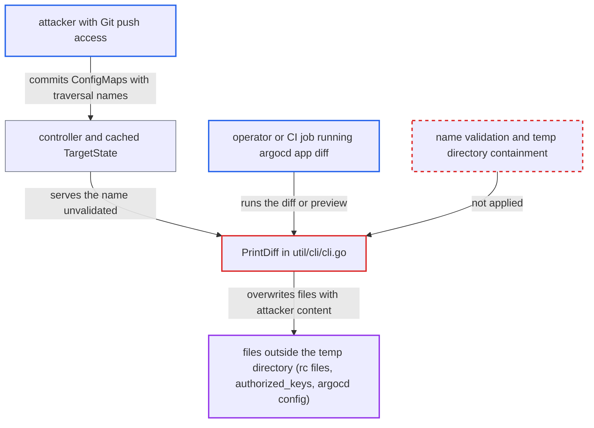

# argocd app diff/sync preview writes files at paths taken from Git-controlled resource names

| Field | Value |
|---|---|
| ID | `find_01HnR2iXjGWGEEz7eu4BuNAt` |
| Severity | **High** |
| Status | open |
| CWE | CWE-22 — Path traversal |
| Created | 2026-10-27T21:12:39.123478Z |
| Claude Security | https://claude.ai/security/findings/find_01HnR2iXjGWGEEz7eu4BuNAt |

## Description

A person with push access to a Git repository that an Argo CD Application tracks can make the `argocd` CLI overwrite files on an operator's workstation or CI runner. The attack runs when someone uses `argocd app diff` or `argocd app sync --preview-changes`. `PrintDiff` in `util/cli/cli.go` uses the resource's `metadata.name` as a file path, with no check for `/` or `..`.

1. **attacker with Git push access** commits ConfigMaps whose `metadata.name` is a `../`-prefixed path to a file such as a shell rc file. The `data` values hold shell payloads, and several resources can each guess a different home directory path.
2. **controller `CompareAppState`** stores the target-only objects in `ManagedResources` without validating the name. For a watched kind such as ConfigMap with no live object, no call is made to the kube-apiserver, so the invalid name is never rejected during comparison. ([`controller/state.go:1048-1089`](https://github.com/cx-benchmark/argo-cd/blob/b7bc418289a96130340ea79964c4491b416c14f2/controller/state.go#L1048-L1089))
3. **controller `hideSecretData`** marshals the unvalidated target into `ResourceDiff.TargetState` in the cache. The API server later returns this state unchanged to any user with `get` on the app. ([`controller/appcontroller.go:897-904`](https://github.com/cx-benchmark/argo-cd/blob/b7bc418289a96130340ea79964c4491b416c14f2/controller/appcontroller.go#L897-L904))
4. **operator or CI job** runs `argocd app diff`, or `argocd app sync --preview-changes`. For a resource with no live object, `compareManifests` takes the key straight from the target manifest, so the name is passed on as written. ([`cmd/argocd/commands/app_diff.go:603-611`](https://github.com/cx-benchmark/argo-cd/blob/b7bc418289a96130340ea79964c4491b416c14f2/cmd/argocd/commands/app_diff.go#L603-L611))
5. **the CLI's `printResourceDiff`** calls `cli.PrintDiff` for each resource and ignores the returned error. A failed write to one guessed path does not stop the writes to the other guessed paths. ([`cmd/argocd/commands/app_diff.go:779-782`](https://github.com/cx-benchmark/argo-cd/blob/b7bc418289a96130340ea79964c4491b416c14f2/cmd/argocd/commands/app_diff.go#L779-L782))
6. **`PrintDiff`** writes the target object's YAML to `path.Join(tempDir, name)`. `path.Join` collapses `..`, so the path leaves the `os.MkdirTemp` directory and `os.WriteFile` truncates and replaces an existing file there. ([`util/cli/cli.go:345-371`](https://github.com/cx-benchmark/argo-cd/blob/b7bc418289a96130340ea79964c4491b416c14f2/util/cli/cli.go#L345-L371))
7. **the user's shell** runs the attacker's payload the next time it sources the overwritten rc file. A `data` value such as a command substitution is written as a line in the YAML, and bash runs the substitution even though the line is not a valid command.

## Assessment

The attacker needs push access to one Git repository, or a pull request branch, that an Application tracks. They commit ConfigMaps with traversal names. The controller caches these as target-only resources. An operator or CI job then runs the routine `argocd app diff <app>`, or `argocd app diff --revision <branch>`, or `argocd app sync --preview-changes`. With `--revision`, `--revisions` or `--local`, the manifests come from `GetManifests`, `GetManifestsWithFiles` or local generation instead of the cache. Success depends on guessing a path whose parent directory exists, such as `/root`, `/home/runner`, `/home/<user>` or `/Users/<user>`. The `admin` subcommands that call `PrintDiff` take names from local input, so they are not the remote path.

Impact: The attacker can replace files with content they control, running as the CLI user. Overwriting a shell rc file gives code execution as that user the next time a shell starts. Overwriting `~/.ssh/authorized_keys` or `~/.config/argocd/config` can give persistence or redirect credentials. The limits are the user's file permissions, the parent directory having to exist, and the content being YAML. For known kinds such as ConfigMap, unknown top-level fields are dropped, but `data` values come through as written.

Subsequent-system impact: With code execution as the CLI user, the attacker can read the Argo CD session token that `util/localconfig` stores in `~/.config/argocd/config`, and any kubeconfig credentials on that host. They can then act on the Argo CD server and its managed clusters with the victim's privileges, which are often admin. That reaches well beyond the attacker's own project.

## Recommendation

(1) `PrintDiff` in `util/cli/cli.go` (lines 350 and 362) uses the resource name as a path component. Files can therefore be created outside the fresh temp directory.

Fix criteria: The diff temp files are always created inside the `os.MkdirTemp` directory, whatever the resource name is. The file name comes from a sanitised or synthetic value, for example one that rejects or replaces `/`, `\`, `..` and non DNS-1123 characters, or uses an index or hash. After joining, the cleaned path is checked to still have the temp dir as its prefix. A regression test with `name = "../../x"` shows no file written outside the temp directory. The temp directory is removed after `diff` returns.

(2) The CLI trusts `metadata.name` from server-returned manifests (`cmd/argocd/commands/app_diff.go` lines 669-727 and 779-782, `app.go` lines 1255-1260) as if Kubernetes had already validated it.

Fix criteria: Any server-provided group, kind, namespace or name is validated before it is used for local file or display purposes. The check uses Kubernetes name rules (`validation.IsDNS1123Subdomain` or `IsDNS1123Label`), or at least rejects path separators and `..`. Names that fail validation are reported and skipped, and never written to disk.

## Evidence

**https://github.com/cx-benchmark/argo-cd**

- [`util/cli/cli.go:345-371`](https://github.com/cx-benchmark/argo-cd/blob/b7bc418289a96130340ea79964c4491b416c14f2/util/cli/cli.go#L345-L371)
- [`cmd/argocd/commands/app_diff.go:779-782`](https://github.com/cx-benchmark/argo-cd/blob/b7bc418289a96130340ea79964c4491b416c14f2/cmd/argocd/commands/app_diff.go#L779-L782)
- [`cmd/argocd/commands/app_diff.go:603-611`](https://github.com/cx-benchmark/argo-cd/blob/b7bc418289a96130340ea79964c4491b416c14f2/cmd/argocd/commands/app_diff.go#L603-L611)
- [`cmd/argocd/commands/app.go:1254-1260`](https://github.com/cx-benchmark/argo-cd/blob/b7bc418289a96130340ea79964c4491b416c14f2/cmd/argocd/commands/app.go#L1254-L1260)
- [`controller/state.go:1048-1089`](https://github.com/cx-benchmark/argo-cd/blob/b7bc418289a96130340ea79964c4491b416c14f2/controller/state.go#L1048-L1089)
- [`controller/appcontroller.go:897-904`](https://github.com/cx-benchmark/argo-cd/blob/b7bc418289a96130340ea79964c4491b416c14f2/controller/appcontroller.go#L897-L904)

