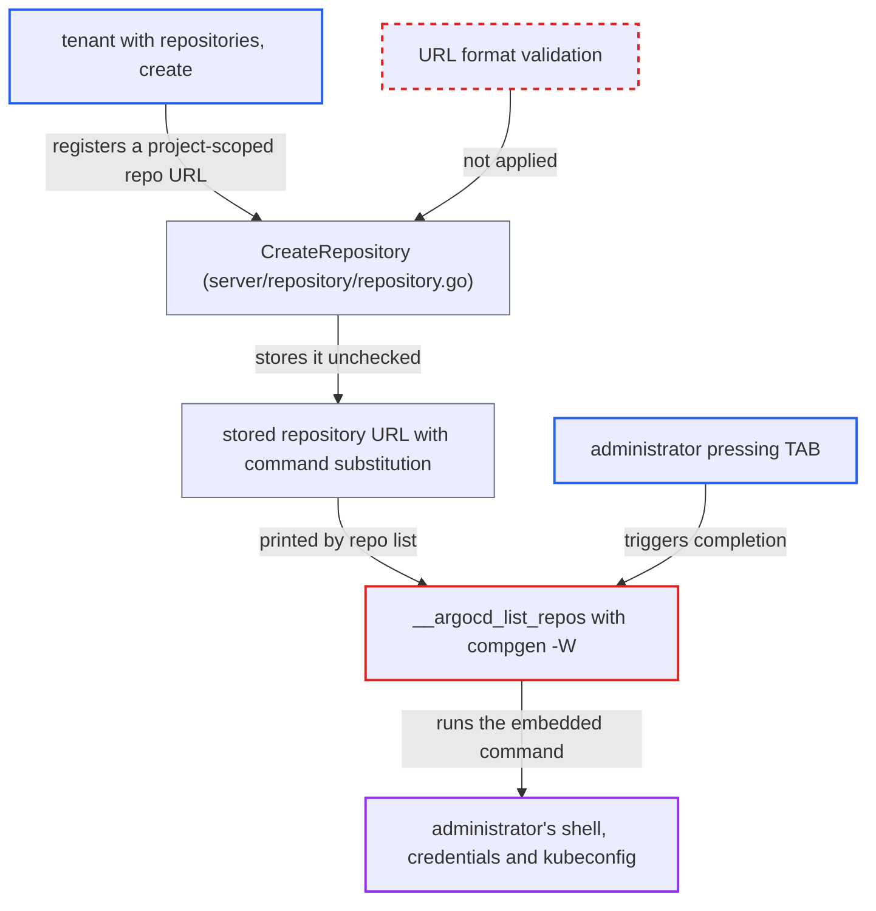

# Bash completion expands server-provided repo/cluster URLs with compgen -W, allowing command injection

| Field | Value |
|---|---|
| ID | `find_01NWcYcfvg1vrahV9waVaYxj` |
| Severity | **High** |
| Status | open |
| CWE | CWE-78 — OS command injection |
| Created | 2026-10-27T21:28:59.469587Z |
| Claude Security | https://claude.ai/security/findings/find_01NWcYcfvg1vrahV9waVaYxj |

## Description

A tenant with limited Argo CD permissions can run commands on an administrator's machine. The attacker needs `repositories, create` on a project, and the administrator must press TAB in bash completion on an argument such as `argocd repo rm`. The completion script passes server-supplied repository URLs to `compgen -W`, and bash runs any `$(...)` inside them.

1. **attacker with `repositories, create` on a project** registers a project-scoped repository whose URL contains command substitution. `CreateRepository` skips the connectivity test for project-scoped repositories and does no URL format validation, so a URL such as one containing `$(curl ...)` is stored as given. ([`server/repository/repository.go:449-462`](https://github.com/cx-benchmark/argo-cd/blob/b7bc418289a96130340ea79964c4491b416c14f2/server/repository/repository.go#L449-L462))
2. **administrator** types `argocd repo rm` or `argocd repo add` and presses TAB with the bash completion sourced. `__argocd_custom_func` wires these commands, and others such as `argocd cluster ...` and `argocd login`, to the dynamic list helpers, so ordinary completion triggers the code. ([`cmd/argocd/commands/completion.go:124-185`](https://github.com/cx-benchmark/argo-cd/blob/b7bc418289a96130340ea79964c4491b416c14f2/cmd/argocd/commands/completion.go#L124-L185))
3. **the helper `__argocd_list_repos`** runs `argocd repo list --output url` and stores the output in an array. The output holds every repository URL the current user may read, including the attacker's. ([`cmd/argocd/commands/completion.go:52-57`](https://github.com/cx-benchmark/argo-cd/blob/b7bc418289a96130340ea79964c4491b416c14f2/cmd/argocd/commands/completion.go#L52-L57))
4. **the printer `printRepoUrls`** prints each stored URL unchanged. It writes `r.Repo` with no escaping or validation, so the `$(...)` text reaches the shell script intact. ([`cmd/argocd/commands/repo.go:367-371`](https://github.com/cx-benchmark/argo-cd/blob/b7bc418289a96130340ea79964c4491b416c14f2/cmd/argocd/commands/repo.go#L367-L371))
5. **bash `compgen -W`** expands the wordlist, including command substitution, and runs the embedded command. bash expands each word of a `-W` wordlist before matching, so the attacker's command runs in the administrator's interactive shell with their privileges. ([`cmd/argocd/commands/completion.go:52-57`](https://github.com/cx-benchmark/argo-cd/blob/b7bc418289a96130340ea79964c4491b416c14f2/cmd/argocd/commands/completion.go#L52-L57))

## Assessment

The attacker is an Argo CD user with `repositories, create` on some project. They create the malicious repository through the REST API. The victim is an administrator who has sourced the output of `argocd completion bash`, as documented. The administrator presses TAB while completing a repository argument, for example after `argocd repo rm` or `argocd repo add`. The same flaw exists for cluster server URLs, which needs `clusters, create` and triggers on `argocd cluster ...` or `argocd login` completion. It also exists for project role names.

Impact: The attacker runs arbitrary commands in the administrator's interactive shell with that user's full local privileges. They can read or change the user's files and credentials such as the kubeconfig, the Argo CD CLI token and SSH keys, and they can set up persistence.

Subsequent-system impact: The compromised operator typically holds admin rights on Argo CD and cluster-admin kubeconfigs. The payload can use those credentials against the Argo CD server and all managed clusters.

## Recommendation

(1) The completion script passes server-sourced strings through `compgen -W`, which applies shell expansion including command substitution. The affected places are in `completion.go` at lines 24-26, 45-64 and 107-113.

Fix criteria: Dynamic completion never expands remote data. `COMPREPLY` is built by matching each array element literally, or the data is quoted with `printf '%q'` before `compgen -W`, or cobra's `ValidArgsFunction`/`__complete` is used. A repository URL containing `$(touch /tmp/pwned)` offered through completion does not create the file.

(2) Repository and cluster URLs are accepted without format validation in `server/repository/repository.go` and printed verbatim in `cmd/argocd/commands/repo.go`.

Fix criteria: The server validates repository URLs regardless of project scope. A valid URL is a parseable git, helm or oci URL with no shell metacharacters or control characters. The `--output url` and table printers refuse or escape non-printable and shell-special characters, so other consumers of the output are not exposed.

## Evidence

**https://github.com/cx-benchmark/argo-cd**

- [`cmd/argocd/commands/completion.go:52-57`](https://github.com/cx-benchmark/argo-cd/blob/b7bc418289a96130340ea79964c4491b416c14f2/cmd/argocd/commands/completion.go#L52-L57)
- [`cmd/argocd/commands/completion.go:45-50`](https://github.com/cx-benchmark/argo-cd/blob/b7bc418289a96130340ea79964c4491b416c14f2/cmd/argocd/commands/completion.go#L45-L50)
- [`cmd/argocd/commands/completion.go:124-185`](https://github.com/cx-benchmark/argo-cd/blob/b7bc418289a96130340ea79964c4491b416c14f2/cmd/argocd/commands/completion.go#L124-L185)
- [`cmd/argocd/commands/repo.go:367-371`](https://github.com/cx-benchmark/argo-cd/blob/b7bc418289a96130340ea79964c4491b416c14f2/cmd/argocd/commands/repo.go#L367-L371)
- [`server/repository/repository.go:449-462`](https://github.com/cx-benchmark/argo-cd/blob/b7bc418289a96130340ea79964c4491b416c14f2/server/repository/repository.go#L449-L462)

