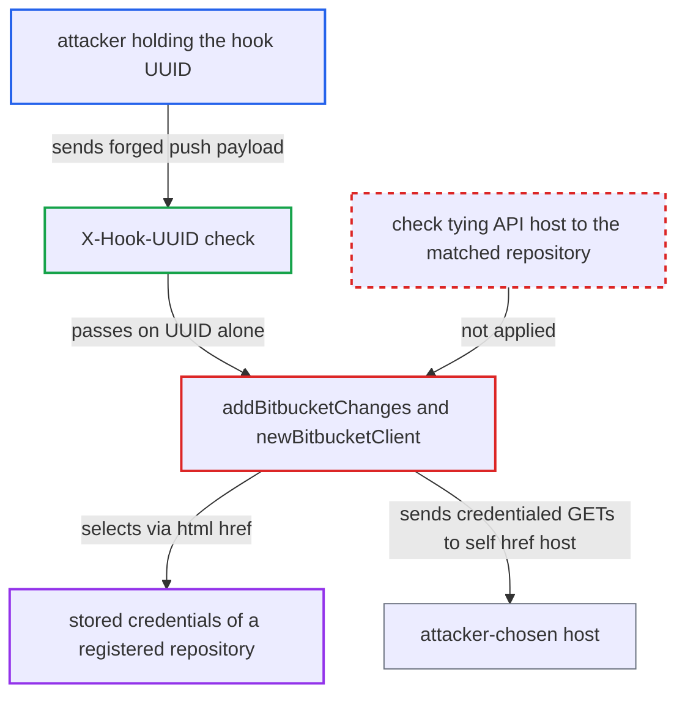

# Bitbucket Cloud webhook sends stored repository credentials to payload-chosen API host

| Field | Value |
|---|---|
| ID | `find_01XWau2yNDBopJ6PX1RyeXUH` |
| Severity | **High** |
| Status | open |
| CWE | CWE-918 — Server-Side Request Forgery |
| Created | 2026-10-27T21:21:22.529518Z |
| Claude Security | https://claude.ai/security/findings/find_01XWau2yNDBopJ6PX1RyeXUH |

## Description

Someone who knows the Bitbucket webhook UUID can make argocd-server send the stored login or token of any registered HTTPS repository to a host they choose. That includes GitHub or GitLab tokens. It works only when `webhook.bitbucket.uuid` is set and some repository has username/password or token credentials. The cause is `addBitbucketChanges`, which takes the API host from the payload's `links.self.href` and attaches credentials chosen by a different payload field.

1. **attacker** posts a forged `repo:push` payload to `/api/webhook`. The request carries the known `X-Hook-UUID` and `X-Event-Key: repo:push`, and the endpoint needs no Argo CD login. ([`server/server.go:1334-1336`](https://github.com/cx-benchmark/argo-cd/blob/b7bc418289a96130340ea79964c4491b416c14f2/server/server.go#L1334-L1336))
2. **the parser in `scm.go`** accepts the request on the UUID alone. The Bitbucket parser checks only that the header equals the UUID, with no HMAC secret. ([`util/webhook/scm.go:86-91`](https://github.com/cx-benchmark/argo-cd/blob/b7bc418289a96130340ea79964c4491b416c14f2/util/webhook/scm.go#L86-L91))
3. **`affectedRevisionInfo`** calls `addBitbucketChanges` for the payload. This happens whenever `webhook.bitbucket.uuid` is set, and nothing else gates it. ([`util/webhook/webhook.go:209-213`](https://github.com/cx-benchmark/argo-cd/blob/b7bc418289a96130340ea79964c4491b416c14f2/util/webhook/webhook.go#L209-L213))
4. **`lookupRepository`** selects a stored repository from the payload's `repository.links.html.href`. The match uses `git.SameURL` against every registered repository, so a GitHub or GitLab repository can be picked, and the records include credentials inherited from credential templates. ([`util/webhook/webhook.go:537-551`](https://github.com/cx-benchmark/argo-cd/blob/b7bc418289a96130340ea79964c4491b416c14f2/util/webhook/webhook.go#L537-L551))
5. **`addBitbucketChanges`** derives the API base URL from `links.self.href`. It strips `/repositories/` plus `full_name` from that value, so the attacker controls the host, for example `https://attacker.example`. ([`util/webhook/webhook.go:247-248`](https://github.com/cx-benchmark/argo-cd/blob/b7bc418289a96130340ea79964c4491b416c14f2/util/webhook/webhook.go#L247-L248))
6. **`newBitbucketClient`** builds a client carrying the matched repository's credentials and the attacker's base URL. It attaches Basic or Bearer credentials and calls `SetApiBaseURL` with the payload-derived URL. ([`util/webhook/webhook.go:612-646`](https://github.com/cx-benchmark/argo-cd/blob/b7bc418289a96130340ea79964c4491b416c14f2/util/webhook/webhook.go#L612-L646))
7. **`fetchDiffStatFromBitbucket` and `isHeadTouched`** send two authenticated GET requests to the attacker's host. The requests go to `<base>/repositories/<owner>/<slug>/diffstat/<spec>` and `<base>/repositories/<owner>/<slug>`, and the Authorization header exposes the credential. ([`util/webhook/webhook.go:650-686`](https://github.com/cx-benchmark/argo-cd/blob/b7bc418289a96130340ea79964c4491b416c14f2/util/webhook/webhook.go#L650-L686))

## Assessment

The attacker knows the Bitbucket webhook UUID. The report gives one example: a Bitbucket admin of the repository or workspace that owns the webhook, since Bitbucket Cloud shows the UUID to them. The attacker POSTs to the unauthenticated `/api/webhook` with `X-Hook-UUID` and `X-Event-Key: repo:push`. In the body, `repository.links.html.href` names a registered HTTPS repository, `full_name` is `a/b`, and `links.self.href` is `https://attacker.example/repositories/a/b`. The operator must have set the UUID, and some repository must have HTTPS username/password or token credentials. A second use is to point the credentialed requests at internal HTTP services.

Impact: The attacker obtains the stored password, personal access token or bearer token of any registered HTTPS repository, across projects. Requests to internal HTTP services are mostly blind, because the response is only parsed as Bitbucket JSON and logged. Argo CD's own data and availability are not changed.

Subsequent-system impact: The leaked credential is the one Argo CD uses to read the repository from its SCM (Bitbucket, GitHub, GitLab and others). It gives the attacker at least read access to private source repositories. Whether it also allows writes depends on how the operator scoped the token, which the report says the code does not establish.

## Recommendation

(1) The outbound Bitbucket API base URL comes from the payload field `links.self.href`, which has nothing to do with the repository whose credentials are attached. Stored credentials can therefore go to any host.

Fix criteria: A repository's credentials are sent only to that repository's own SCM API host. The base URL is derived from the matched repository URL, or is a fixed `api.bitbucket.org` for `bitbucket.org`, and no call is made for repositories that are not Bitbucket Cloud. Test: send a UUID-valid payload whose `links.self.href` points at a listener on another host. No request should arrive there, and in particular none with an Authorization header.

(2) The credentialed callback is gated only on the Bitbucket hook UUID. Bitbucket shows that UUID to repository or workspace admins, so it is not a write-only shared secret.

Fix criteria: A credentialed outbound call does not depend on the payload's host fields at all, so holding the UUID never yields credentials. Where possible, a real shared secret (Bitbucket Cloud's HMAC signature) is also required. Test: a payload with a correct UUID and an attacker-chosen self link never causes stored credentials to leave for a non-SCM host.

## Evidence

**https://github.com/cx-benchmark/argo-cd**

- [`util/webhook/webhook.go:247-248`](https://github.com/cx-benchmark/argo-cd/blob/b7bc418289a96130340ea79964c4491b416c14f2/util/webhook/webhook.go#L247-L248)
- [`util/webhook/webhook.go:233-246`](https://github.com/cx-benchmark/argo-cd/blob/b7bc418289a96130340ea79964c4491b416c14f2/util/webhook/webhook.go#L233-L246)
- [`util/webhook/webhook.go:537-551`](https://github.com/cx-benchmark/argo-cd/blob/b7bc418289a96130340ea79964c4491b416c14f2/util/webhook/webhook.go#L537-L551)
- [`util/webhook/webhook.go:612-646`](https://github.com/cx-benchmark/argo-cd/blob/b7bc418289a96130340ea79964c4491b416c14f2/util/webhook/webhook.go#L612-L646)
- [`util/webhook/webhook.go:650-686`](https://github.com/cx-benchmark/argo-cd/blob/b7bc418289a96130340ea79964c4491b416c14f2/util/webhook/webhook.go#L650-L686)
- [`util/webhook/push.go:77-87`](https://github.com/cx-benchmark/argo-cd/blob/b7bc418289a96130340ea79964c4491b416c14f2/util/webhook/push.go#L77-L87)
- [`util/webhook/webhook.go:209-213`](https://github.com/cx-benchmark/argo-cd/blob/b7bc418289a96130340ea79964c4491b416c14f2/util/webhook/webhook.go#L209-L213)
- [`util/webhook/scm.go:86-91`](https://github.com/cx-benchmark/argo-cd/blob/b7bc418289a96130340ea79964c4491b416c14f2/util/webhook/scm.go#L86-L91)
- [`util/db/repository.go:175-192`](https://github.com/cx-benchmark/argo-cd/blob/b7bc418289a96130340ea79964c4491b416c14f2/util/db/repository.go#L175-L192)
- [`server/server.go:1334-1336`](https://github.com/cx-benchmark/argo-cd/blob/b7bc418289a96130340ea79964c4491b416c14f2/server/server.go#L1334-L1336)

