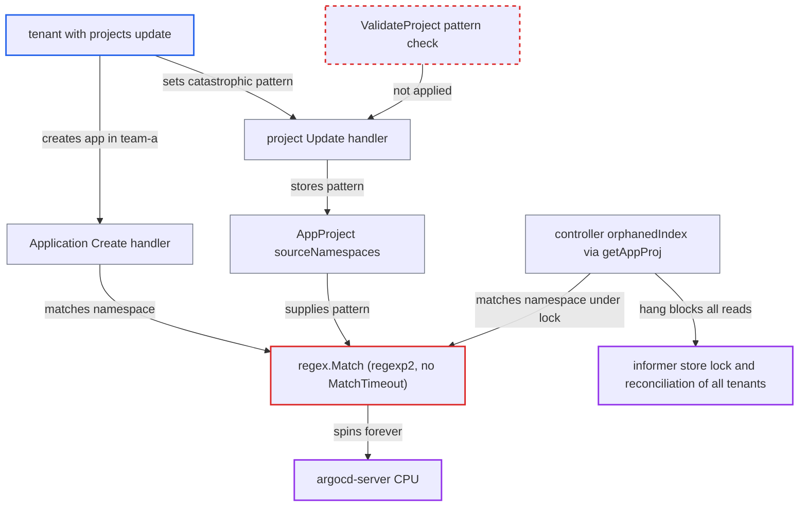

# Catastrophic regex in AppProject sourceNamespaces hangs API server and controller (ReDoS)

| Field | Value |
|---|---|
| ID | `find_01Et4UkTWnJdj4B1HqY9J4oo` |
| Severity | **High** |
| Status | open |
| CWE | CWE-1333 — Regular expression DoS |
| Created | 2026-10-27T21:12:34.190620Z |
| Claude Security | https://claude.ai/security/findings/find_01Et4UkTWnJdj4B1HqY9J4oo |

## Description

A tenant with `projects, update` on a project can freeze Argo CD's API server and, when apps-in-any-namespace is enabled, the application-controller for every tenant. They also need `applications, create` on that project for the API route. The cause is that `util/regex.Match` runs `sourceNamespaces` patterns on a backtracking regex engine with no timeout, and `ValidateProject` never checks those patterns.

1. **tenant with `projects, update`** sets a catastrophic pattern in the project's `sourceNamespaces`. The update is a `PUT /api/v1/projects/P` with an entry such as `/^((((.*)*)*)*)*X$/`, and the project `Update` handler only requires the RBAC permission `projects, update, <name>`. ([`server/project/project.go:372-382`](https://github.com/cx-benchmark/argo-cd/blob/b7bc418289a96130340ea79964c4491b416c14f2/server/project/project.go#L372-L382))
2. **`ValidateProject`** accepts the entry without compiling or bounding it. It only checks that the `sourceNamespaces` entries are unique, so the malicious pattern is saved with the project. ([`pkg/apis/application/v1alpha1/app_project_types.go:214-220`](https://github.com/cx-benchmark/argo-cd/blob/b7bc418289a96130340ea79964c4491b416c14f2/pkg/apis/application/v1alpha1/app_project_types.go#L214-L220))
3. **tenant with `applications, create`** sends a create request for an Application in namespace `team-a` in project `P`. Application `Create` checks RBAC on the project, namespace and name from the request body. It then resolves the project before `isNamespaceEnabled` is checked. ([`server/application/application.go:350-371`](https://github.com/cx-benchmark/argo-cd/blob/b7bc418289a96130340ea79964c4491b416c14f2/server/application/application.go#L350-L371))
4. **`IsAppNamespacePermitted`** passes the tenant's pattern list and the namespace text to the glob matcher. `GetAppProject` runs this for every API handler that resolves an app's project. The list is `proj.Spec.SourceNamespaces`, so the pattern is attacker-chosen. ([`pkg/apis/application/v1alpha1/app_project_types.go:625-631`](https://github.com/cx-benchmark/argo-cd/blob/b7bc418289a96130340ea79964c4491b416c14f2/pkg/apis/application/v1alpha1/app_project_types.go#L625-L631))
5. **`MatchStringInList`** treats every entry wrapped in `/.../` as a regex and hands it to `regex.Match`. No length, complexity or compile-time check is applied to the pattern. ([`util/glob/list.go:19-31`](https://github.com/cx-benchmark/argo-cd/blob/b7bc418289a96130340ea79964c4491b416c14f2/util/glob/list.go#L19-L31))
6. **`regex.Match`** compiles the pattern with `regexp2` and calls `MatchString` with no `MatchTimeout`. The backtracking engine explores exponentially many paths even on a short text like `team-a`, so the request goroutine never returns and uses 100% CPU. ([`util/regex/regex.go:7-19`](https://github.com/cx-benchmark/argo-cd/blob/b7bc418289a96130340ea79964c4491b416c14f2/util/regex/regex.go#L7-L19))
7. **controller's `orphanedIndex` index function** calls `getAppProj`, which evaluates the same pattern while the informer holds its store write lock. This applies when apps-in-any-namespace is enabled and an Application of the project in a non-control-plane namespace is re-indexed on its next update. The hang blocks all lister reads, so the whole controller stops. ([`controller/appcontroller.go:3157-3175`](https://github.com/cx-benchmark/argo-cd/blob/b7bc418289a96130340ea79964c4491b416c14f2/controller/appcontroller.go#L3157-L3175))

## Assessment

The attacker is a tenant with `projects, update` on a project `P`. This is an ordinary tenant-admin privilege in multi-tenant setups. For the API-server route they also need `applications, create, P/*`. The Application namespace text comes straight from the request body, so it can be short, such as `team-a`. The controller route needs apps-in-any-namespace enabled. There, any Application of `P` in a non-control-plane namespace is re-indexed on its next update. The same pattern is also evaluated from the refresh workers, the cluster-info updater and the metrics collector through `getAppProj`, and each evaluation pins a goroutine permanently. Nothing in the report says the pattern must be long, because the attacker controls it. A pattern with a few hundred alternatives, or with nested quantifiers, is enough.

Impact: Each request that hits the pattern pins a goroutine in `argocd-server` at 100% CPU forever, so a handful of requests exhaust its CPU. With apps-in-any-namespace the application-controller deadlocks on its informer store lock. It then stops reconciling and syncing every application of every tenant until it is restarted. The hung API goroutines also hold `projectLock.RLock(project)`, so the project cannot be repaired through the API and must be fixed with kubectl. No data is disclosed or modified.

## Recommendation

(1) `util/regex.Match` runs tenant-supplied patterns on the backtracking `regexp2` engine with no match timeout and no context cancellation, so a crafted pattern uses unbounded CPU and never returns.

Fix criteria: Every regex evaluation of user-supplied patterns is bounded. Either Go's linear-time `regexp` (RE2) is used, or a short `MatchTimeout` is set on the compiled `regexp2` pattern and a timeout counts as a non-match with a logged warning. Test: set `sourceNamespaces` to a nested-quantifier pattern. `Create` must return within the timeout, and the controller must keep reconciling other apps.

(2) `ValidateProject` and the project `Update` RPC accept `sourceNamespaces` entries wrapped in `/.../` without compiling or size-limiting them. A malicious regex is therefore saved and evaluated everywhere the project is used.

Fix criteria: Project create and update reject `sourceNamespaces` regex entries that fail to compile or exceed a modest length. If the engine stays backtracking, they also reject entries that exceed a complexity bound. The same check applies to any other spec field matched with `glob.REGEXP`. Test: the malicious project update from the attack path is refused with an InvalidArgument error.

(3) The Application informer's `orphanedIndex` index function resolves the project and matches patterns while client-go holds the informer store write lock. Any slow evaluation therefore freezes the whole controller.

Fix criteria: Index functions do only constant-time work on the object itself, and project-dependent decisions are made outside the indexer. Test: a slow or hanging `getAppProj` no longer blocks `appLister` reads for unrelated applications.

## Evidence

**https://github.com/cx-benchmark/argo-cd**

- [`util/regex/regex.go:7-19`](https://github.com/cx-benchmark/argo-cd/blob/b7bc418289a96130340ea79964c4491b416c14f2/util/regex/regex.go#L7-L19)
- [`util/glob/list.go:19-31`](https://github.com/cx-benchmark/argo-cd/blob/b7bc418289a96130340ea79964c4491b416c14f2/util/glob/list.go#L19-L31)
- [`pkg/apis/application/v1alpha1/app_project_types.go:625-631`](https://github.com/cx-benchmark/argo-cd/blob/b7bc418289a96130340ea79964c4491b416c14f2/pkg/apis/application/v1alpha1/app_project_types.go#L625-L631)
- [`pkg/apis/application/v1alpha1/app_project_types.go:214-220`](https://github.com/cx-benchmark/argo-cd/blob/b7bc418289a96130340ea79964c4491b416c14f2/pkg/apis/application/v1alpha1/app_project_types.go#L214-L220)
- [`server/project/project.go:372-382`](https://github.com/cx-benchmark/argo-cd/blob/b7bc418289a96130340ea79964c4491b416c14f2/server/project/project.go#L372-L382)
- [`server/application/application.go:350-371`](https://github.com/cx-benchmark/argo-cd/blob/b7bc418289a96130340ea79964c4491b416c14f2/server/application/application.go#L350-L371)
- [`util/argo/argo.go:885-895`](https://github.com/cx-benchmark/argo-cd/blob/b7bc418289a96130340ea79964c4491b416c14f2/util/argo/argo.go#L885-L895)
- [`controller/appcontroller.go:3157-3175`](https://github.com/cx-benchmark/argo-cd/blob/b7bc418289a96130340ea79964c4491b416c14f2/controller/appcontroller.go#L3157-L3175)
- [`controller/appcontroller.go:391-407`](https://github.com/cx-benchmark/argo-cd/blob/b7bc418289a96130340ea79964c4491b416c14f2/controller/appcontroller.go#L391-L407)

