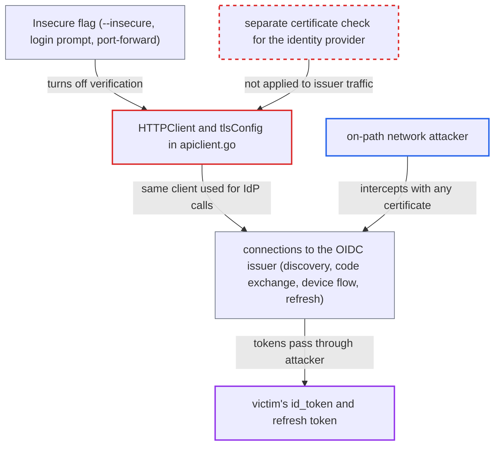

# CLI applies Argo CD server's insecure TLS setting to OIDC IdP connections, exposing SSO tokens

| Field | Value |
|---|---|
| ID | `find_01WxpheA5miYoS1h2KEeMCoA` |
| Severity | **High** |
| Status | open |
| CWE | CWE-295 — Improper certificate validation |
| Created | 2026-10-27T21:17:36.779612Z |
| Claude Security | https://claude.ai/security/findings/find_01WxpheA5miYoS1h2KEeMCoA |

## Description

An attacker who can sit on the network path between a developer's workstation and the SSO identity provider can steal the developer's SSO tokens and then act as them in Argo CD, within the victim's RBAC rights. It needs SSO configured and an insecure CLI context, set by `--insecure`, the login prompt, or forced by port-forward mode. The cause is that `HTTPClient()` reuses the `tlsConfig()` that skips certificate checks, so identity-provider traffic is unverified too.

1. **the user or the CLI** puts the context into insecure mode. This happens through `--insecure`, by answering `y` at the login prompt, or automatically, because `--port-forward` and `--port-forward-namespace` force `opts.Insecure = true` for the `127.0.0.1` tunnel. ([`pkg/apiclient/apiclient.go:264-275`](https://github.com/cx-benchmark/argo-cd/blob/b7bc418289a96130340ea79964c4491b416c14f2/pkg/apiclient/apiclient.go#L264-L275))
2. **`tlsConfig()`** sets `InsecureSkipVerify` for every connection built from it. It does this whenever `c.Insecure` is true and makes no difference between the Argo CD server and any other host. ([`pkg/apiclient/apiclient.go:686-703`](https://github.com/cx-benchmark/argo-cd/blob/b7bc418289a96130340ea79964c4491b416c14f2/pkg/apiclient/apiclient.go#L686-L703))
3. **`HTTPClient()`** wraps that TLS config and all `--header` values in the client used for SSO. The same client is handed to the OIDC code for issuer discovery, the code exchange, device-flow polling and refresh-token redemption, and the issuer is a different host from the Argo CD server. ([`pkg/apiclient/apiclient.go:478-510`](https://github.com/cx-benchmark/argo-cd/blob/b7bc418289a96130340ea79964c4491b416c14f2/pkg/apiclient/apiclient.go#L478-L510))
4. **the CLI** connects to the identity provider without verifying its certificate. This happens during `login --sso` and also automatically on any command once the cached id_token has expired, because `NewClientWithContext` calls `refreshAuthToken` and `redeemRefreshToken` posts the stored refresh token to the issuer. ([`pkg/apiclient/apiclient.go:558-592`](https://github.com/cx-benchmark/argo-cd/blob/b7bc418289a96130340ea79964c4491b416c14f2/pkg/apiclient/apiclient.go#L558-L592))
5. **on-path attacker** terminates TLS with any certificate and relays the traffic. The CLI accepts the certificate because verification is off, so the attacker can read the authorization code with its PKCE verifier, the id_token and the refresh token.
6. **attacker** uses the stolen refresh token to get new id_tokens. The Argo CD API server accepts these tokens for as long as the identity provider honours the refresh token.

## Assessment

The attacker needs an on-path network position between the user's workstation and the OIDC issuer, for example public Wi-Fi or a split-tunnel VPN that sends IdP traffic over the open network. Argo CD must have SSO configured, and the user's context must be insecure. That happens in three ways: `--insecure` (which getting_started.md recommends for the default self-signed install), answering `y` at the login prompt (both are saved in the context), or port-forward mode, which forces it. The attack triggers when the user runs `argocd login --sso`, uses the device flow, runs `relogin`, or runs any command after the id_token has expired. In port-forward mode the user never chose an insecure option. Also, every `--header` value, often a proxy or zero-trust credential meant for the gateway in front of Argo CD, is sent to the identity provider.

Impact: The attacker obtains the victim's refresh token and id_token and can keep impersonating the victim in Argo CD for as long as the identity provider honours the refresh token. This allows reading application data, syncing or changing applications, and deleting them. The damage is limited by the victim's RBAC rights.

## Recommendation

(1) One TLS configuration, built from the Argo CD server's `Insecure` flag in `tlsConfig()`, is reused by `HTTPClient()` for identity-provider traffic. A trust exception for one host, or the one forced for the port-forward tunnel, therefore also covers the identity provider.

Fix criteria: Requests to the OIDC issuer (discovery, code exchange, device flow, refresh) verify the issuer's certificate, using the system trust store plus any CA the user explicitly provides, even when the context is insecure or in port-forward mode. Relaxing IdP verification is possible only through a separate, explicitly named opt-in. To check, use an insecure context and a port-forward context, and confirm that an IdP serving an untrusted certificate makes `login --sso`, the device flow and token refresh fail.

(2) `HTTPClient()` attaches every `--header` value to requests sent to the identity provider. These values are often a proxy or zero-trust credential meant for the gateway in front of Argo CD.

Fix criteria: User-supplied `--header` values are sent only to the Argo CD server endpoint and never to the identity provider. To check, capture the IdP requests during login and refresh and confirm they carry none of the configured headers.

## Evidence

**https://github.com/cx-benchmark/argo-cd**

- [`pkg/apiclient/apiclient.go:478-510`](https://github.com/cx-benchmark/argo-cd/blob/b7bc418289a96130340ea79964c4491b416c14f2/pkg/apiclient/apiclient.go#L478-L510)
- [`pkg/apiclient/apiclient.go:686-703`](https://github.com/cx-benchmark/argo-cd/blob/b7bc418289a96130340ea79964c4491b416c14f2/pkg/apiclient/apiclient.go#L686-L703)
- [`pkg/apiclient/apiclient.go:264-275`](https://github.com/cx-benchmark/argo-cd/blob/b7bc418289a96130340ea79964c4491b416c14f2/pkg/apiclient/apiclient.go#L264-L275)
- [`pkg/apiclient/apiclient.go:558-592`](https://github.com/cx-benchmark/argo-cd/blob/b7bc418289a96130340ea79964c4491b416c14f2/pkg/apiclient/apiclient.go#L558-L592)
- [`pkg/apiclient/apiclient.go:409-416`](https://github.com/cx-benchmark/argo-cd/blob/b7bc418289a96130340ea79964c4491b416c14f2/pkg/apiclient/apiclient.go#L409-L416)
- [`pkg/apiclient/apiclient.go:443-451`](https://github.com/cx-benchmark/argo-cd/blob/b7bc418289a96130340ea79964c4491b416c14f2/pkg/apiclient/apiclient.go#L443-L451)
- [`cmd/argocd/commands/login.go:172-175`](https://github.com/cx-benchmark/argo-cd/blob/b7bc418289a96130340ea79964c4491b416c14f2/cmd/argocd/commands/login.go#L172-L175)
- [`cmd/argocd/commands/login.go:107-113`](https://github.com/cx-benchmark/argo-cd/blob/b7bc418289a96130340ea79964c4491b416c14f2/cmd/argocd/commands/login.go#L107-L113)
- [`cmd/argocd/commands/root.go:77`](https://github.com/cx-benchmark/argo-cd/blob/b7bc418289a96130340ea79964c4491b416c14f2/cmd/argocd/commands/root.go#L77)

