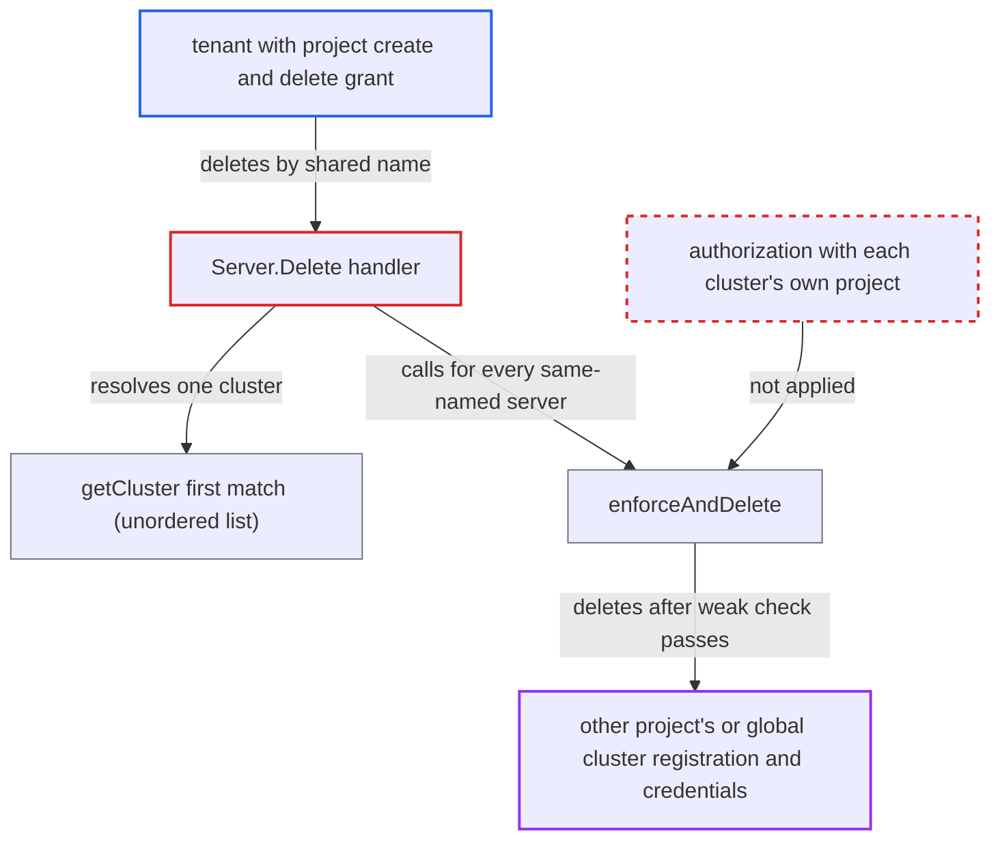

# Cluster Delete by name authorizes every same-named cluster under the first match's project

| Field | Value |
|---|---|
| ID | `find_01RKGSodvTpKwsbBS17uPWDZ` |
| Severity | **High** |
| Status | open |
| CWE | CWE-863 — Incorrect Authorization |
| Created | 2026-10-27T21:26:50.127344Z |
| Claude Security | https://claude.ai/security/findings/find_01RKGSodvTpKwsbBS17uPWDZ |

## Description

A tenant with a project-level cluster create and delete grant can delete clusters that belong to other projects or to the global scope, if they know the cluster's name. Deleting a cluster removes its registration and stored credentials. The cause is `Server.Delete`: for a name-based delete it authorizes every same-named server with the project of the first match, not with each server's own project.

1. **attacker (tenant)** registers a project-scoped cluster with the victim cluster's name. `db.CreateCluster` names the Secret after the server URL only and does not reject a `name` that is already in use, so duplicate names are accepted. ([`util/db/cluster.go:107-139`](https://github.com/cx-benchmark/argo-cd/blob/b7bc418289a96130340ea79964c4491b416c14f2/util/db/cluster.go#L107-L139))
2. **attacker (tenant)** sends a delete request by name. The request is `DELETE /api/v1/clusters/<name>?id.type=name`, or uses `q.Name`, and `getCluster` copies the name into `q.Name`. ([`server/cluster/cluster.go:226-266`](https://github.com/cx-benchmark/argo-cd/blob/b7bc418289a96130340ea79964c4491b416c14f2/server/cluster/cluster.go#L226-L266))
3. **`getCluster`** returns the first cluster in the list whose `Name` matches. The list comes from the informer's unordered `List()`, so the first match changes from call to call and can be the attacker's cluster. ([`util/settings/cluster_informer.go:161-191`](https://github.com/cx-benchmark/argo-cd/blob/b7bc418289a96130340ea79964c4491b416c14f2/util/settings/cluster_informer.go#L161-L191))
4. **the handler `Server.Delete`** collects every server that has this name. `GetClusterServersByName` returns servers from all projects and the global scope, not only the first match. ([`util/settings/cluster_informer.go:161-191`](https://github.com/cx-benchmark/argo-cd/blob/b7bc418289a96130340ea79964c4491b416c14f2/util/settings/cluster_informer.go#L161-L191))
5. **`enforceAndDelete`** checks each server as `<project of the first match>/<server>`. It is called with `c.Project`, the project of the first match, so a victim in another project is checked against the attacker's project. ([`server/cluster/cluster.go:351-383`](https://github.com/cx-benchmark/argo-cd/blob/b7bc418289a96130340ea79964c4491b416c14f2/server/cluster/cluster.go#L351-L383))
6. **RBAC glob matcher** accepts the victim as matching the attacker's `<proj>/*` grant. The glob matcher has no separators, so `<proj>/*` also matches `<proj>/<victim-server>`. ([`util/rbac/rbac.go:288-302`](https://github.com/cx-benchmark/argo-cd/blob/b7bc418289a96130340ea79964c4491b416c14f2/util/rbac/rbac.go#L288-L302))
7. **`db.DeleteCluster`** deletes the victim's Secret or strips its secret-type label. This removes the victim's cluster registration and its credentials. ([`util/db/cluster.go:364-376`](https://github.com/cx-benchmark/argo-cd/blob/b7bc418289a96130340ea79964c4491b416c14f2/util/db/cluster.go#L364-L376))

## Assessment

The attacker is an authenticated tenant with the documented self-service grant `clusters, create|delete, <proj>/*`. They must know the victim cluster's name. Holders of `clusters, get`, such as `role:readonly`, can see names, and names often default to the server URL. The attacker registers a project-scoped cluster with that name, pointing at any endpoint that answers `/version`. They then delete by name. If the victim is the first match, the first check fails with 403 before anything is deleted, so the attacker can retry until their own cluster comes first. No victim action is needed. Renaming one cluster lets the attacker delete clusters one after another.

Impact: The attacker can delete the registration and stored credentials of any global or other-project cluster whose name they know, repeatedly and across tenants. Applications that target those clusters stop being reconciled or synced until an administrator re-registers them. If `in-cluster` was registered through a Secret, for example to limit `namespaces`, deleting it falls back to the unrestricted built-in local cluster. Nothing is disclosed, and the attacker gains no write access to the target clusters themselves. `RotateAuth` uses the same first-match project but only rotates the first-matched cluster, so it does not reach other clusters.

## Recommendation

When deleting by name, `Delete` authorizes each matched server with the project of whichever same-named cluster `getCluster` returned first, not the project of the cluster being deleted. A caller's rights in their own project therefore authorize deleting clusters in other projects or the global scope.

Fix criteria: Every cluster removed by a name-based delete is authorized with its own `project`/`server` pair, or ambiguous names are refused. Test this with a tenant's project-scoped cluster that shares a name with a cluster the tenant has no `delete` right on. Deleting by that name must never remove the other cluster, whatever the list order. It removes at most the tenant's own cluster.

## Evidence

**https://github.com/cx-benchmark/argo-cd**

- [`server/cluster/cluster.go:351-383`](https://github.com/cx-benchmark/argo-cd/blob/b7bc418289a96130340ea79964c4491b416c14f2/server/cluster/cluster.go#L351-L383)
- [`server/cluster/cluster.go:226-266`](https://github.com/cx-benchmark/argo-cd/blob/b7bc418289a96130340ea79964c4491b416c14f2/server/cluster/cluster.go#L226-L266)
- [`util/settings/cluster_informer.go:161-191`](https://github.com/cx-benchmark/argo-cd/blob/b7bc418289a96130340ea79964c4491b416c14f2/util/settings/cluster_informer.go#L161-L191)
- [`util/db/cluster.go:107-139`](https://github.com/cx-benchmark/argo-cd/blob/b7bc418289a96130340ea79964c4491b416c14f2/util/db/cluster.go#L107-L139)
- [`util/rbac/rbac.go:288-302`](https://github.com/cx-benchmark/argo-cd/blob/b7bc418289a96130340ea79964c4491b416c14f2/util/rbac/rbac.go#L288-L302)
- [`util/db/cluster.go:364-376`](https://github.com/cx-benchmark/argo-cd/blob/b7bc418289a96130340ea79964c4491b416c14f2/util/db/cluster.go#L364-L376)

