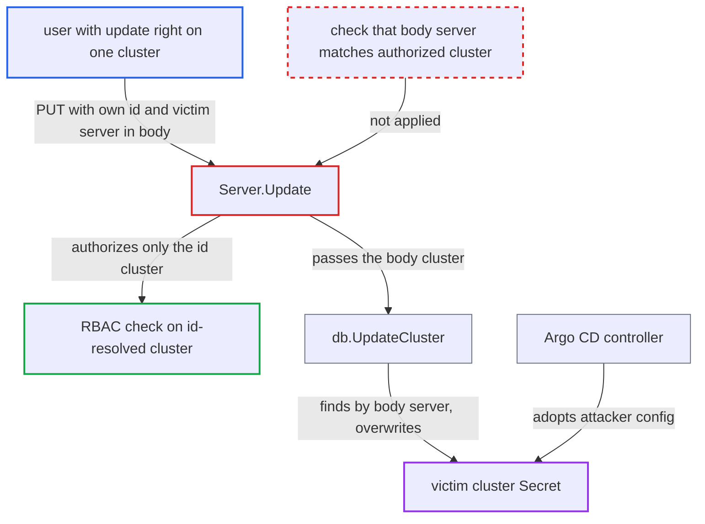

# Cluster Update authorizes the id-resolved cluster but overwrites the body server's Secret

| Field | Value |
|---|---|
| ID | `find_019wgK7Ky7B2cCagktj8cSAG` |
| Severity | **High** |
| Status | open |
| CWE | CWE-863 — Incorrect Authorization |
| Created | 2026-10-27T21:28:21.497119Z |
| Claude Security | https://claude.ai/security/findings/find_019wgK7Ky7B2cCagktj8cSAG |

## Description

A user with `clusters, update` permission on one cluster can overwrite the registration of any other existing cluster, including one in another project. They can replace its credentials and config and move it into their own project. The cause is `Server.Update`: it authorizes the cluster named by the id in the URL path, but with empty `updatedFields` it saves the cluster given in the request body.

1. **attacker** sends a PUT to `/api/v1/clusters/{id.value}` with their own cluster in the path and a victim's server in the body. The body names the victim's `server`, sets the attacker's `project`, and carries a `config` with `proxyUrl` and `insecure`. `updatedFields` is left empty. ([`server/cluster/cluster.proto:62-66`](https://github.com/cx-benchmark/argo-cd/blob/b7bc418289a96130340ea79964c4491b416c14f2/server/cluster/cluster.proto#L62-L66))
2. **`getCluster`** resolves the cluster `c` from the path id alone. It clears `q.Server` and `q.Name`, so the server named in the body plays no part in authorization. ([`server/cluster/cluster.go:211-245`](https://github.com/cx-benchmark/argo-cd/blob/b7bc418289a96130340ea79964c4491b416c14f2/server/cluster/cluster.go#L211-L245))
3. **`Server.Update`** runs both RBAC `update` checks on the resolved cluster. The checks cover `c.Project/c.Server` and `q.Cluster.Project/c.Server`. Both pass because the attacker really holds update rights on that cluster. ([`server/cluster/cluster.go:297-336`](https://github.com/cx-benchmark/argo-cd/blob/b7bc418289a96130340ea79964c4491b416c14f2/server/cluster/cluster.go#L297-L336))
4. **`Server.Update`** keeps the body's `q.Cluster` unchanged and probes it with `RESTConfig()` and `GetServerVersion`. With empty `updatedFields`, `q.Cluster` is not replaced by `c`. The probe therefore runs with the attacker's config and the body's server. ([`server/cluster/cluster.go:297-336`](https://github.com/cx-benchmark/argo-cd/blob/b7bc418289a96130340ea79964c4491b416c14f2/server/cluster/cluster.go#L297-L336))
5. **`db.UpdateCluster`** finds the Secret by the body's `Server` and updates it. `getClusterSecret` locates the Secret by the `Server` of the object it receives. Nothing compares that server with the authorized cluster. ([`util/db/cluster.go:339-361`](https://github.com/cx-benchmark/argo-cd/blob/b7bc418289a96130340ea79964c4491b416c14f2/util/db/cluster.go#L339-L361))
6. **`clusterToSecret`** replaces the victim Secret's whole `Data`, labels and annotations with the attacker's values. The server, name, namespaces, config, shard, clusterResources and project are all overwritten, so the old credentials are lost. ([`util/db/cluster.go:379-420`](https://github.com/cx-benchmark/argo-cd/blob/b7bc418289a96130340ea79964c4491b416c14f2/util/db/cluster.go#L379-L420))
7. **Argo CD controller** adopts the attacker-written config for the victim server. The entry now belongs to the attacker's project and becomes a `*`-namespace destination of it. The controller then uses the attacker's `proxyUrl` and `insecure` settings. ([`controller/cache/cache.go:869-890`](https://github.com/cx-benchmark/argo-cd/blob/b7bc418289a96130340ea79964c4491b416c14f2/controller/cache/cache.go#L869-L890))

## Assessment

The attacker is an authenticated user holding `clusters, update` on a single cluster. An example is the documented self-service grant `clusters, create|update, <proj>/*`, used to register their own cluster. They send the PUT with no `updatedFields`. The `GetServerVersion` probe uses the attacker's config, which means their proxy, an anonymous `/version` call, or the in-cluster service account. No victim interaction is needed. The `updatedFields` path is not affected, because it writes the resolved cluster `c`.

Impact: The attacker can destroy the credentials of any existing cluster registration in the Argo CD namespace, which stops reconciliation for every Application on that cluster. They can re-scope the entry to their own project, gaining get/update/delete on it and a `*` destination. Through `proxyUrl` and `insecure` they can route the controller's traffic for that server through their own proxy. That traffic includes manifests, such as Secret objects, that other tenants' Applications apply there. Where an explicit Secret exists for `https://kubernetes.default.svc`, an overwrite without credentials still resolves to `rest.InClusterConfig()`. The attacker's project then deploys with the controller's service account.

## Recommendation

(1) `Server.Update` authorizes the cluster resolved from the id or name, but with empty `updatedFields` it writes the body's `q.Cluster.Server`. The RBAC object is therefore not the resource that gets modified.

Fix criteria: `Update` modifies only the cluster it authorized, on both the empty and non-empty `updatedFields` paths. A request whose body `server` differs from the resolved cluster's server is rejected, or the body server never selects the Secret. To verify, send a PUT whose body `server` differs from the id or name, with no `updatedFields`. The call must fail, and the other cluster's Secret must stay unchanged.

(2) `db.UpdateCluster` trusts the `Server` of the object it receives to find the Secret. It gives no protection when a caller authorized a different object.

Fix criteria: The persistence layer takes the Secret's identity from the already-authorized object, or checks that the located Secret is that cluster, so a server mismatch cannot redirect the write. A unit test shows the update is refused when the resolved Secret differs from the authorized cluster.

## Evidence

**https://github.com/cx-benchmark/argo-cd**

- [`server/cluster/cluster.go:297-336`](https://github.com/cx-benchmark/argo-cd/blob/b7bc418289a96130340ea79964c4491b416c14f2/server/cluster/cluster.go#L297-L336)
- [`server/cluster/cluster.go:211-245`](https://github.com/cx-benchmark/argo-cd/blob/b7bc418289a96130340ea79964c4491b416c14f2/server/cluster/cluster.go#L211-L245)
- [`server/cluster/cluster.proto:62-66`](https://github.com/cx-benchmark/argo-cd/blob/b7bc418289a96130340ea79964c4491b416c14f2/server/cluster/cluster.proto#L62-L66)
- [`server/server.go:1849-1856`](https://github.com/cx-benchmark/argo-cd/blob/b7bc418289a96130340ea79964c4491b416c14f2/server/server.go#L1849-L1856)
- [`util/db/cluster.go:339-361`](https://github.com/cx-benchmark/argo-cd/blob/b7bc418289a96130340ea79964c4491b416c14f2/util/db/cluster.go#L339-L361)
- [`util/db/cluster.go:379-420`](https://github.com/cx-benchmark/argo-cd/blob/b7bc418289a96130340ea79964c4491b416c14f2/util/db/cluster.go#L379-L420)
- [`util/argo/argo.go:868-878`](https://github.com/cx-benchmark/argo-cd/blob/b7bc418289a96130340ea79964c4491b416c14f2/util/argo/argo.go#L868-L878)
- [`controller/cache/cache.go:869-890`](https://github.com/cx-benchmark/argo-cd/blob/b7bc418289a96130340ea79964c4491b416c14f2/controller/cache/cache.go#L869-L890)
- [`pkg/apis/application/v1alpha1/types.go:4303-4304`](https://github.com/cx-benchmark/argo-cd/blob/b7bc418289a96130340ea79964c4491b416c14f2/pkg/apis/application/v1alpha1/types.go#L4303-L4304)

