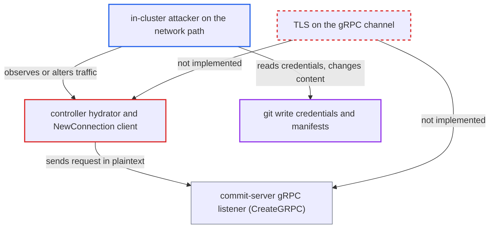

# Commit-server gRPC has no TLS: repository write credentials sent in cleartext from controller

| Field | Value |
|---|---|
| ID | `find_01MNfHrNZgc2jVye73MyXMDf` |
| Severity | **High** |
| Status | open |
| CWE | CWE-319 — Cleartext transmission |
| Created | 2026-10-27T21:28:21.703034Z |
| Claude Security | https://claude.ai/security/findings/find_01MNfHrNZgc2jVye73MyXMDf |

## Description

Someone who can watch or intercept traffic between the application-controller and `argocd-commit-server:8086` can read the git write credentials sent there. An active interceptor can also change what gets committed and pushed. This needs a network position inside the cluster, and only applies when the source hydrator is enabled. The cause is that the gRPC channel is always plaintext: the client in `commitserver/apiclient/clientset.go` uses `insecure.NewCredentials()` and the server sets no transport credentials.

1. **the controller hydrator** loads the destination repository's write credentials and builds the request. `GetWriteCredentials` returns the secrets from the `repository-write` secrets, and they are placed in `CommitHydratedManifestsRequest.Repo` together with the manifests, branch and commit message. ([`controller/hydrator/hydrator.go:506-556`](https://github.com/cx-benchmark/argo-cd/blob/b7bc418289a96130340ea79964c4491b416c14f2/controller/hydrator/hydrator.go#L506-L556))
2. **`NewConnection` in the controller** dials the commit-server with no encryption. It always passes `grpc.WithTransportCredentials(insecure.NewCredentials())`, and no TLS option exists. ([`commitserver/apiclient/clientset.go:38-49`](https://github.com/cx-benchmark/argo-cd/blob/b7bc418289a96130340ea79964c4491b416c14f2/commitserver/apiclient/clientset.go#L38-L49))
3. **the commit-server** accepts the request on a plain TCP listener. `CreateGRPC` builds `grpc.NewServer` without `grpc.Creds`, and the binary has no TLS, cert or `--disable-tls` flag. ([`commitserver/server.go:30-41`](https://github.com/cx-benchmark/argo-cd/blob/b7bc418289a96130340ea79964c4491b416c14f2/commitserver/server.go#L30-L41))
4. **the attacker** captures the traffic during an automatic hydration run. The captured `Repository` message holds the write credential in readable form, such as a password, token, SSH private key, GitHub App private key, GCP service-account key or TLS client key. ([`commitserver/commit/commit.proto:7-10`](https://github.com/cx-benchmark/argo-cd/blob/b7bc418289a96130340ea79964c4491b416c14f2/commitserver/commit/commit.proto#L7-L10))
5. **the attacker with an active position** alters the request, for example `Paths`, before the commit-server reads it. Nothing authenticates or protects the content, so the commit-server commits and pushes the changed content under Argo CD's identity, and signs it if signing is configured.

## Assessment

The attacker is a compromised workload or node inside the cluster with a position on the pod network between `argocd-application-controller` and `argocd-commit-server`. Examples are a node on the path, or a pod using ARP spoofing on a bridge CNI. The attacker needs no Argo CD credentials and no user has to act. The source hydrator must be enabled, and it is enabled in the shipped `*-install-with-hydrator` manifests. The attacker waits for any automatic hydration run. Passive capture is enough to read the credentials. Changing the committed content needs an active position on the path. The ingress NetworkPolicy on port 8086 limits who may connect, but it does not protect the data in transit.

Impact: The attacker can read the repository write credentials and the rendered manifests in transit. With an active position they can change the manifests, commit message or branch. The commit-server then commits and pushes that content under Argo CD's identity and signing key, and Argo CD syncs it. The availability of the commit-server is not affected.

Subsequent-system impact: The captured write token, SSH key or GitHub App private key works directly against the git hosting provider. It gives read and push access to the destination repository, and possibly to other repositories the app is installed on. That access lies outside the cluster network segment the attacker controls.

## Recommendation

The controller-to-commit-server gRPC channel is hard-wired to plaintext. It carries repository write secrets and the content to be committed, so both can be read or changed in transit. The `argocd-commit-server-tls` secret volume is declared in the deployment but never used.

Fix criteria: The commit-server offers TLS, at least self-signed by default, with a documented disable flag mirroring the repo-server. The controller client verifies the server certificate. Alternatively, the deployment guarantees an encrypted and authenticated mesh. A packet capture between the controller and commit-server during hydration shows no plaintext credential fields. The client rejects a server presenting an untrusted certificate.

## Evidence

**https://github.com/cx-benchmark/argo-cd**

- [`commitserver/apiclient/clientset.go:38-49`](https://github.com/cx-benchmark/argo-cd/blob/b7bc418289a96130340ea79964c4491b416c14f2/commitserver/apiclient/clientset.go#L38-L49)
- [`commitserver/server.go:30-41`](https://github.com/cx-benchmark/argo-cd/blob/b7bc418289a96130340ea79964c4491b416c14f2/commitserver/server.go#L30-L41)
- [`cmd/argocd-commit-server/commands/argocd_commit_server.go:84-89`](https://github.com/cx-benchmark/argo-cd/blob/b7bc418289a96130340ea79964c4491b416c14f2/cmd/argocd-commit-server/commands/argocd_commit_server.go#L84-L89)
- [`controller/hydrator/hydrator.go:506-556`](https://github.com/cx-benchmark/argo-cd/blob/b7bc418289a96130340ea79964c4491b416c14f2/controller/hydrator/hydrator.go#L506-L556)
- [`commitserver/commit/commit.proto:7-10`](https://github.com/cx-benchmark/argo-cd/blob/b7bc418289a96130340ea79964c4491b416c14f2/commitserver/commit/commit.proto#L7-L10)
- [`manifests/base/commit-server/argocd-commit-server-deployment.yaml:129-139`](https://github.com/cx-benchmark/argo-cd/blob/b7bc418289a96130340ea79964c4491b416c14f2/manifests/base/commit-server/argocd-commit-server-deployment.yaml#L129-L139)

