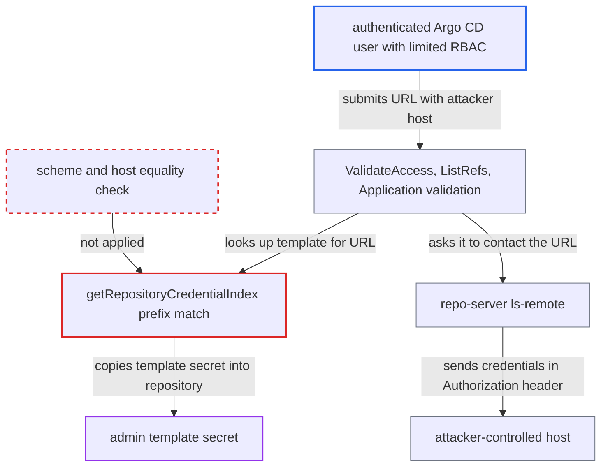

# Credential template prefix match crosses host boundary, sending template secrets to attacker hosts

| Field | Value |
|---|---|
| ID | `find_01HZVEZgpq5i4DMiPdVMu3MF` |
| Severity | **High** |
| Status | open |
| CWE | CWE-522 — Insufficiently Protected Credentials |
| Created | 2026-10-27T21:22:11.495354Z |
| Claude Security | https://claude.ai/security/findings/find_01HZVEZgpq5i4DMiPdVMu3MF |

## Description

A low-privilege Argo CD user can steal the secret from an admin-defined credential template, such as a password, token or GitHub App, GCP or Azure key. The attack needs a template whose URL is only scheme and host, such as `https://git.example.com`, and a user who may validate a repository, list refs or create an Application. `getRepositoryCredentialIndex` matches templates by a plain string prefix on the whole URL, so it never checks that the host is the same.

1. **attacker** submits a repository URL that starts with the template's URL but points at another host. Examples are `https://git.example.com.evil.net/x` and `https://git.example.com@evil.net/x`. In the second, `git.example.com` is only the userinfo and the host is `evil.net`.
2. **`getRepository`** returns an empty stub `Repository` for the unregistered URL. Any URL with no stored secret gets a stub, so the attacker's URL reaches credential enrichment. ([`util/db/repository.go:151-165`](https://github.com/cx-benchmark/argo-cd/blob/b7bc418289a96130340ea79964c4491b416c14f2/util/db/repository.go#L151-L165))
3. **`getRepositoryCredentialIndex`** picks the host-only template because its URL is a string prefix of the attacker's URL. It uses `strings.HasPrefix` on the two strings from `NormalizeGitURL`. That function keeps userinfo and does not isolate the host, so the test runs across the authority. ([`util/db/repository_secrets.go:619-634`](https://github.com/cx-benchmark/argo-cd/blob/b7bc418289a96130340ea79964c4491b416c14f2/util/db/repository_secrets.go#L619-L634))
4. **`enrichCredsToRepo`** copies the template's secrets into the stub repository. `ValidateAccess` does the same copy directly. The stub then holds the username and password, bearer token, or the GitHub App, GCP or Azure secret. ([`util/db/repository.go:435-449`](https://github.com/cx-benchmark/argo-cd/blob/b7bc418289a96130340ea79964c4491b416c14f2/util/db/repository.go#L435-L449))
5. **repo-server** runs `ls-remote` against the attacker's host with the inherited credentials. go-git builds `BasicAuth` or `TokenAuth` and sends it as the `Authorization` header on the `info/refs` request. A GitHub App key is first exchanged for an installation token. ([`util/git/workaround.go:57-68`](https://github.com/cx-benchmark/argo-cd/blob/b7bc418289a96130340ea79964c4491b416c14f2/util/git/workaround.go#L57-L68))
6. **attacker's host** logs the credential it receives. TLS does not stop this, because the attacker's host presents a valid certificate for its own name.

## Assessment

The attacker is an authenticated Argo CD user with limited RBAC. They need one of: `repositories, create, <proj>/*`; `repositories, get` (built into `role:readonly`); or the right to create an Application in a project whose `sourceRepos` admits the URL, for example `default`'s `*`. An admin must have defined a `repo-creds` template (`argocd.argoproj.io/secret-type: repo-creds`) whose URL is scheme and host only, a form the project's own test treats as intended. The attacker calls `ValidateAccess` or `ListRefs`, or creates an Application, with a URL such as `https://git.example.com@attacker.net/x`. No user interaction is needed. Git CLI commands are a second route. `HTTPSCreds.Environ` puts the password in the askpass store, and `argocd-git-ask-pass` returns it for any `Password` prompt without checking the host. Templates with a path, such as `https://github.com/argoproj`, are not exposed to host takeover, because the authority ends at the first `/`. SSH keys and TLS client keys are only proven, not disclosed. The report assumes go-git `v5.19.2` sends the explicit `AuthMethod` as the `Authorization` header.

Impact: The attacker receives in clear the admin-owned template secret, or a token derived from it, which the API never returns and the tenant was never given. Argo CD's own data and service are not modified by this path.

Subsequent-system impact: The stolen credential works directly against the organisation's SCM host for every repository the template covers, outside any AppProject boundary. The attacker can read all of them. If the credential has write scope, which the code does not establish, they could also change sources that Argo CD deploys.

## Recommendation

`getRepositoryCredentialIndex` compares whole normalised URL strings by prefix. A template is therefore applied to URLs whose host, port or userinfo differs from the template's, and its secret is sent to a host the admin never bound it to.

Fix criteria: A template applies only when the repository URL's scheme and host/port equal the template's, with userinfo stripped or required to match exactly, and the template path is a prefix of the repository path. With a template `https://git.example.com`, the URLs `https://git.example.com.evil.net/x`, `https://git.example.com@evil.net/x` and `https://git.example.community/x` receive no credentials through `ValidateAccess`, `ListRefs` or Application validation. `https://git.example.com/org/repo.git` still receives them.

## Evidence

**https://github.com/cx-benchmark/argo-cd**

- [`util/db/repository_secrets.go:619-634`](https://github.com/cx-benchmark/argo-cd/blob/b7bc418289a96130340ea79964c4491b416c14f2/util/db/repository_secrets.go#L619-L634)
- [`util/git/git.go:74-91`](https://github.com/cx-benchmark/argo-cd/blob/b7bc418289a96130340ea79964c4491b416c14f2/util/git/git.go#L74-L91)
- [`util/db/repository.go:151-165`](https://github.com/cx-benchmark/argo-cd/blob/b7bc418289a96130340ea79964c4491b416c14f2/util/db/repository.go#L151-L165)
- [`util/db/repository.go:435-449`](https://github.com/cx-benchmark/argo-cd/blob/b7bc418289a96130340ea79964c4491b416c14f2/util/db/repository.go#L435-L449)
- [`server/repository/repository.go:683-730`](https://github.com/cx-benchmark/argo-cd/blob/b7bc418289a96130340ea79964c4491b416c14f2/server/repository/repository.go#L683-L730)
- [`server/repository/repository.go:262-281`](https://github.com/cx-benchmark/argo-cd/blob/b7bc418289a96130340ea79964c4491b416c14f2/server/repository/repository.go#L262-L281)
- [`util/argo/argo.go:540-545`](https://github.com/cx-benchmark/argo-cd/blob/b7bc418289a96130340ea79964c4491b416c14f2/util/argo/argo.go#L540-L545)
- [`util/git/client.go:510-527`](https://github.com/cx-benchmark/argo-cd/blob/b7bc418289a96130340ea79964c4491b416c14f2/util/git/client.go#L510-L527)
- [`util/git/workaround.go:57-68`](https://github.com/cx-benchmark/argo-cd/blob/b7bc418289a96130340ea79964c4491b416c14f2/util/git/workaround.go#L57-L68)
- [`util/git/creds.go:326-337`](https://github.com/cx-benchmark/argo-cd/blob/b7bc418289a96130340ea79964c4491b416c14f2/util/git/creds.go#L326-L337)
- [`cmd/argocd-git-ask-pass/commands/argocd_git_ask_pass.go:42-45`](https://github.com/cx-benchmark/argo-cd/blob/b7bc418289a96130340ea79964c4491b416c14f2/cmd/argocd-git-ask-pass/commands/argocd_git_ask_pass.go#L42-L45)
- [`util/db/repo_cred_prefix_matrix_test.go:138-143`](https://github.com/cx-benchmark/argo-cd/blob/b7bc418289a96130340ea79964c4491b416c14f2/util/db/repo_cred_prefix_matrix_test.go#L138-L143)

