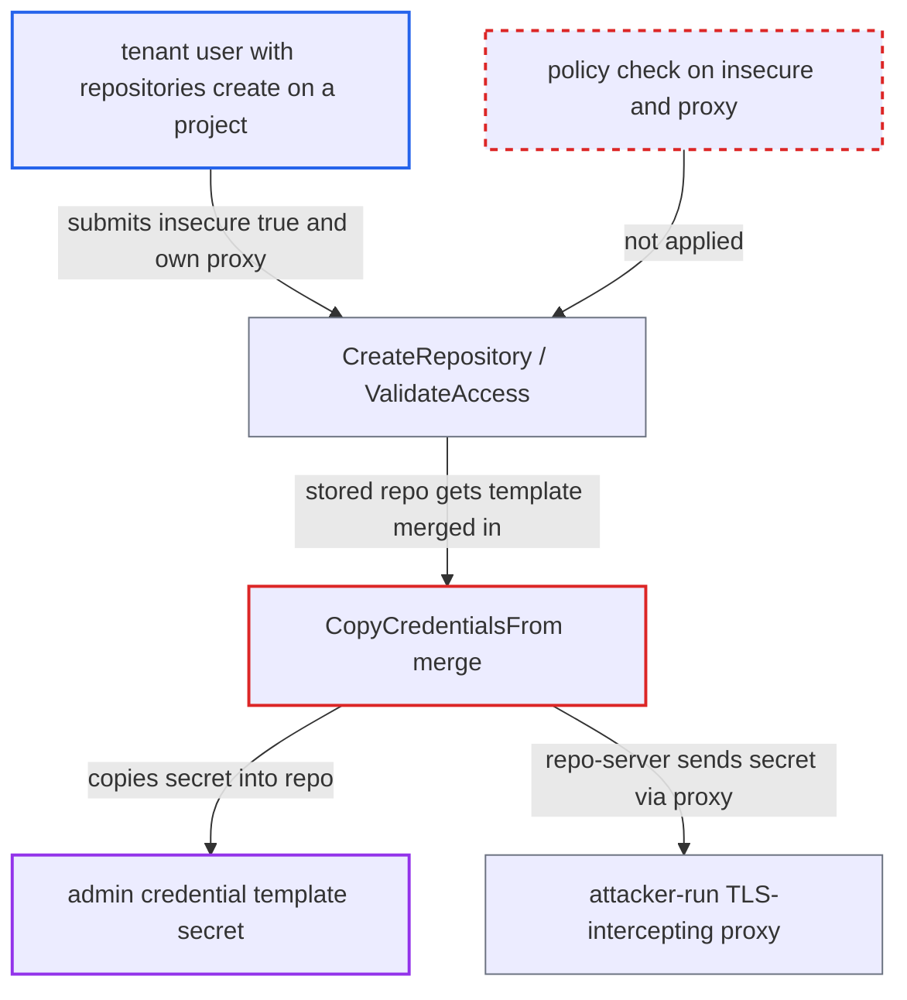

# Credential-template secrets inherited by tenant repos are sent through tenant-chosen proxy with TLS verification off

| Field | Value |
|---|---|
| ID | `find_01KUn5XztFeZzLCbhE9q6RAt` |
| Severity | **High** |
| Status | open |
| CWE | CWE-522 — Insufficiently Protected Credentials |
| Created | 2026-10-27T21:15:58.099737Z |
| Claude Security | https://claude.ai/security/findings/find_01KUn5XztFeZzLCbhE9q6RAt |

## Description

A user with limited Argo CD rights can steal an admin's repository credentials, such as passwords, bearer tokens and Helm/OCI registry passwords. They need `repositories, create` or `update` on their own project, and an admin credential template must exist for the repo URL prefix. The cause is `CopyCredentialsFrom`, which fills in the template's secrets but keeps the tenant's `Insecure` and `Proxy` settings.

1. **attacker** creates a project-scoped repository with no credentials under a template URL prefix. The repository is submitted with `insecure: true` and `proxy` set to an attacker-run proxy such as `http://attacker:8080`, and `CreateRepository` stores it as submitted without a connectivity test. ([`server/repository/repository.go:437-461`](https://github.com/cx-benchmark/argo-cd/blob/b7bc418289a96130340ea79964c4491b416c14f2/server/repository/repository.go#L437-L461))
2. **attacker** triggers a connection to the repository. Listing repositories with force refresh reaches `getConnectionState`, which makes the repo-server connect. Calling `ValidateAccess` with the same fields is a second trigger that needs no stored object. ([`server/repository/repository.go:97-127`](https://github.com/cx-benchmark/argo-cd/blob/b7bc418289a96130340ea79964c4491b416c14f2/server/repository/repository.go#L97-L127))
3. **`enrichCredsToRepo`** merges the admin template into the repository. `CopyCredentialsFrom` copies the template's secrets but keeps the repository's non-empty `Proxy`/`NoProxy` and never resets `Insecure`. ([`pkg/apis/application/v1alpha1/repository_types.go:211-271`](https://github.com/cx-benchmark/argo-cd/blob/b7bc418289a96130340ea79964c4491b416c14f2/pkg/apis/application/v1alpha1/repository_types.go#L211-L271))
4. **repo-server** connects through the attacker's proxy with TLS verification off. go-git uses `GetRepoHTTPClient` with `InsecureSkipVerify = true` and sends basic auth preemptively. The git CLI, Helm and OCI clients take the same route. ([`util/git/client.go:405-414`](https://github.com/cx-benchmark/argo-cd/blob/b7bc418289a96130340ea79964c4491b416c14f2/util/git/client.go#L405-L414))
5. **attacker's proxy** intercepts the TLS connection and reads the credential. Because certificate checks are off, the proxy can decrypt the traffic and read the Authorization header with the admin's secret in clear.

## Assessment

The attacker is an authenticated user with `repositories, create` (or `update`) on their project, which is a normal self-service grant. An admin must have defined a credential template (`repo-creds`) whose URL prefix matches, for example `https://github.com/org`. The attacker stores a credential-less repo under that prefix, then triggers a use of it. The triggers are a force-refreshed repository listing, repo browsing APIs, an Application in that project, or a `ValidateAccess` call carrying the same fields.

Impact: The attacker reads the admin-owned template secret in clear. This covers the password, bearer token, GitHub App installation token, and Helm/OCI registry password stored in the Argo CD namespace, which the API never shows to tenants. Argo CD's own state and availability are not changed.

Subsequent-system impact: The stolen credential works directly against the external SCM or registry for every repository under the template prefix, outside any AppProject boundary. The attacker can read all of them and, where the credential has write scope, can modify them.

## Recommendation

(1) Admin-owned template credentials are combined with `insecure`, `proxy` and `noProxy` values chosen by the lower-privileged repository object that inherits them.

Fix criteria: When credentials come from a template, the effective `insecure`, `proxy` and `noProxy` come from the template or are forced to secure defaults, never from the inheriting repository. Alternatively, project-scoped repositories that set `insecure` or `proxy` do not inherit template credentials. To check, create a project-scoped repo with `insecure: true` and an attacker proxy under a template prefix. The repo-server must either refuse to use the template credential or connect with certificate verification and without the tenant proxy.

(2) The API server stores tenant-submitted `insecure` and `proxy` fields for project-scoped repositories without any policy check.

Fix criteria: Setting `insecure` or `proxy` requires a distinct, higher privilege, or is rejected for project-scoped repositories when a matching global template exists. To check, confirm that a user with only `repositories, create` on a project cannot persist these fields.

## Evidence

**https://github.com/cx-benchmark/argo-cd**

- [`pkg/apis/application/v1alpha1/repository_types.go:211-271`](https://github.com/cx-benchmark/argo-cd/blob/b7bc418289a96130340ea79964c4491b416c14f2/pkg/apis/application/v1alpha1/repository_types.go#L211-L271)
- [`util/db/repository.go:435-449`](https://github.com/cx-benchmark/argo-cd/blob/b7bc418289a96130340ea79964c4491b416c14f2/util/db/repository.go#L435-L449)
- [`server/repository/repository.go:437-461`](https://github.com/cx-benchmark/argo-cd/blob/b7bc418289a96130340ea79964c4491b416c14f2/server/repository/repository.go#L437-L461)
- [`server/repository/repository.go:686-727`](https://github.com/cx-benchmark/argo-cd/blob/b7bc418289a96130340ea79964c4491b416c14f2/server/repository/repository.go#L686-L727)
- [`server/repository/repository.go:97-127`](https://github.com/cx-benchmark/argo-cd/blob/b7bc418289a96130340ea79964c4491b416c14f2/server/repository/repository.go#L97-L127)
- [`util/git/client.go:405-414`](https://github.com/cx-benchmark/argo-cd/blob/b7bc418289a96130340ea79964c4491b416c14f2/util/git/client.go#L405-L414)
- [`util/git/client.go:2258-2277`](https://github.com/cx-benchmark/argo-cd/blob/b7bc418289a96130340ea79964c4491b416c14f2/util/git/client.go#L2258-L2277)
- [`util/helm/cmd.go:257-275`](https://github.com/cx-benchmark/argo-cd/blob/b7bc418289a96130340ea79964c4491b416c14f2/util/helm/cmd.go#L257-L275)
- [`util/oci/client.go:146-166`](https://github.com/cx-benchmark/argo-cd/blob/b7bc418289a96130340ea79964c4491b416c14f2/util/oci/client.go#L146-L166)

