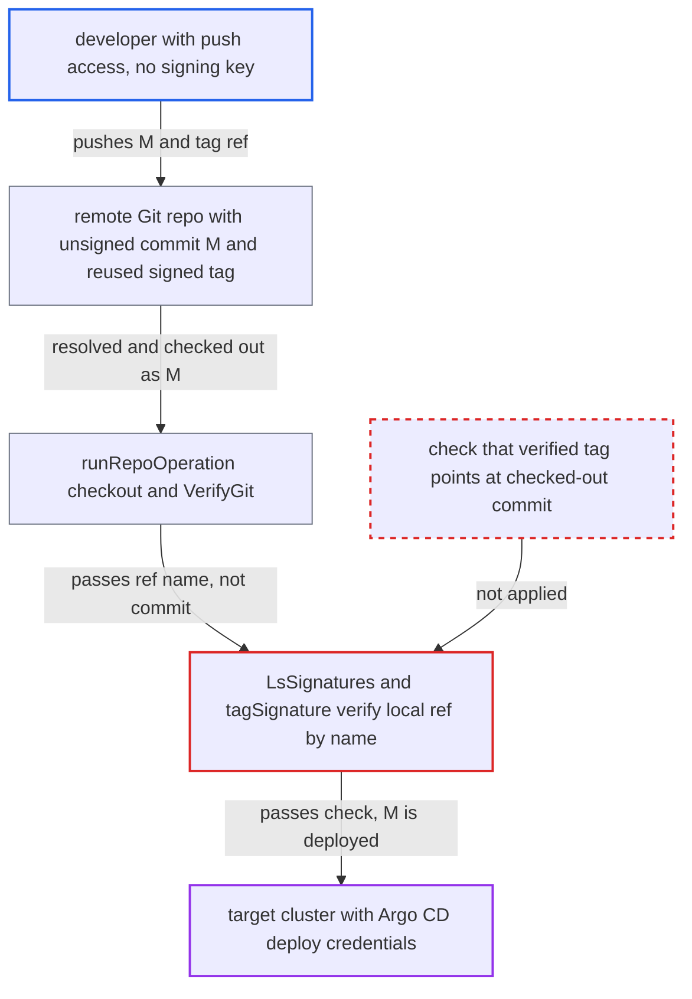

# GPG tag verification checks local ref by name, not the checked-out commit

| Field | Value |
|---|---|
| ID | `find_01MJs1Jhc1aHXL1aAegqedKE` |
| Severity | **High** |
| Status | open |
| CWE | CWE-347 — Improper verification of cryptographic signature |
| Created | 2026-10-27T21:22:22.490537Z |
| Claude Security | https://claude.ai/security/findings/find_01MJs1Jhc1aHXL1aAegqedKE |

## Description

A developer with push access to a source repo can get unsigned manifests deployed, even though the project requires GPG-signed sources. The attacker needs no signing key, only an existing signed tag object, and the project's policy must use `head` mode or the legacy `signatureKeys`. `LsSignatures` verifies the local ref named by `targetRevision`, not the commit that `runRepoOperation` checked out.

1. **attacker with push access** pushes an unsigned commit `M` and a tag ref that reuses an already-signed tag object. No new signature is needed. Either the tag is named like the tracked branch (for example `refs/tags/main`), or the tracked tag such as `v1.0` is force-moved to `M`.
2. **repo-server `fetch`** mirrors the attacker's tag ref into the local clone. A fetch with no revision runs `git fetch origin --tags --force --prune`, so any tag ref, including one named after a branch, lands in the local `refs/tags/`. ([`util/git/client.go:617-630`](https://github.com/cx-benchmark/argo-cd/blob/b7bc418289a96130340ea79964c4491b416c14f2/util/git/client.go#L617-L630))
3. **`runRepoOperation`** resolves `targetRevision` to commit `M` and checks it out. It passes the unresolved name (such as `main` or `v1.0`) to `sourceintegrity.VerifyGit`, while manifests are generated from the checked-out HEAD. ([`reposerver/repository/repository.go:536-547`](https://github.com/cx-benchmark/argo-cd/blob/b7bc418289a96130340ea79964c4491b416c14f2/reposerver/repository/repository.go#L536-L547))
4. **`checkoutRevision`** skips the fetch when the resolved SHA is already present locally. If `M` was fetched earlier, a tag moved on the remote is never refreshed, so the local signed tag stays stale. ([`reposerver/repository/repository.go:3200-3217`](https://github.com/cx-benchmark/argo-cd/blob/b7bc418289a96130340ea79964c4491b416c14f2/reposerver/repository/repository.go#L3200-L3217))
5. **`IsAnnotatedTag`** resolves the name with `git cat-file -t` and finds the local tag. Git prefers `refs/tags/<name>` over `refs/remotes/origin/<name>`, so a tag named like a branch wins. ([`util/git/client.go:1840-1848`](https://github.com/cx-benchmark/argo-cd/blob/b7bc418289a96130340ea79964c4491b416c14f2/util/git/client.go#L1840-L1848))
6. **`tagSignature`** runs `git verify-tag` on the local ref by name. This verifies whichever object the local `refs/tags/<name>` points to, and nothing compares it with the checked-out commit. ([`util/git/client.go:1554-1583`](https://github.com/cx-benchmark/argo-cd/blob/b7bc418289a96130340ea79964c4491b416c14f2/util/git/client.go#L1554-L1583))
7. **`LsSignatures` and `verify`** return the single tag result as the verdict in `head` mode. The good signature yields no problems, so the check passes and the unsigned content of `M` is deployed. ([`util/git/client.go:1638-1649`](https://github.com/cx-benchmark/argo-cd/blob/b7bc418289a96130340ea79964c4491b416c14f2/util/git/client.go#L1638-L1649))

## Assessment

The attacker is a developer with git-push access to one source repo governed by a GPG source-integrity policy, either `AppProject.spec.sourceIntegrity.git` in `head` mode or the legacy `signatureKeys`, which `EffectiveSourceIntegrity()` migrates into a `head`-mode policy. They do not need the signing key, Argo CD credentials or any user interaction. Route A is a tag and branch name collision. For an app tracking branch `main`, they push `refs/tags/main` pointing at an existing signed tag object. Argo resolves `main` by short name. The default go-git resolver iterates a map, so `refs/heads/main` is picked on some refreshes. It is picked every time when `ARGOCD_GIT_LS_REMOTE_OPTIMIZED_ENABLED` is on. Route B is a stale local tag. For an app tracking signed tag `v1.0`, commit `M` must already exist in the clone. That happens after any earlier fetch following a push of `M` to a branch, or a semver-constraint app that fetched a probe tag. The attacker then force-moves the remote `v1.0` to `M`, as a lightweight and unsigned tag. The semver path (`resolveSemverRevisionForSignature`) skips its `validate` step unless the optimized ls-remote is enabled, so it also trusts the name. The next automatic refresh and auto-sync deploy `M`.

Impact: The attacker defeats the project's signature requirement and gets unsigned manifests rendered and applied with Argo CD's deploy credentials. They can ship arbitrary Kubernetes manifests, including workloads, RBAC and secrets access, to every cluster and namespace the application may target. `strict` mode is not affected for the commit part, because `listRawSignatures` walks from `m.CommitSHA()`.

## Recommendation

(1) `LsSignatures` and `tagSignature` verify whichever object the local ref named by `targetRevision` currently points to. Manifests come from the separately resolved and checked-out commit, and nothing ties the two together.

Fix criteria: The signature that satisfies a `head`-mode policy belongs to the exact object being deployed. For an annotated tag, the tag's peeled commit (`<tag>^{commit}`) must equal the checked-out commit SHA. The tag must also come from the same remote ref snapshot used for checkout, or be re-fetched and verified by tag object SHA. Otherwise verification falls back to the HEAD commit. A pushed `refs/tags/<branch>` pointing at an old signed tag object must produce a verification problem rather than a pass. A moved remote tag whose target commit is already present locally must also produce a verification problem.

(2) `checkoutRevision` skips `git fetch` when the resolved SHA already exists locally. The local `refs/tags/*` used for verification can therefore be stale compared with the remote state Argo just resolved against.

Fix criteria: Before a tag name is signature-verified, the local tag ref reflects the remote ref state used for revision resolution. This is done by fetching tags or by verifying against the ls-remote tag object SHA. After a remote tag is moved to a commit already present in the clone, verification uses the new tag object, not the stale one.

## Evidence

**https://github.com/cx-benchmark/argo-cd**

- [`util/git/client.go:1638-1649`](https://github.com/cx-benchmark/argo-cd/blob/b7bc418289a96130340ea79964c4491b416c14f2/util/git/client.go#L1638-L1649)
- [`util/git/client.go:1554-1583`](https://github.com/cx-benchmark/argo-cd/blob/b7bc418289a96130340ea79964c4491b416c14f2/util/git/client.go#L1554-L1583)
- [`reposerver/repository/repository.go:536-547`](https://github.com/cx-benchmark/argo-cd/blob/b7bc418289a96130340ea79964c4491b416c14f2/reposerver/repository/repository.go#L536-L547)
- [`reposerver/repository/repository.go:3200-3217`](https://github.com/cx-benchmark/argo-cd/blob/b7bc418289a96130340ea79964c4491b416c14f2/reposerver/repository/repository.go#L3200-L3217)
- [`util/git/client.go:1840-1848`](https://github.com/cx-benchmark/argo-cd/blob/b7bc418289a96130340ea79964c4491b416c14f2/util/git/client.go#L1840-L1848)
- [`util/git/client.go:617-630`](https://github.com/cx-benchmark/argo-cd/blob/b7bc418289a96130340ea79964c4491b416c14f2/util/git/client.go#L617-L630)
- [`util/sourceintegrity/source_integrity.go:134-180`](https://github.com/cx-benchmark/argo-cd/blob/b7bc418289a96130340ea79964c4491b416c14f2/util/sourceintegrity/source_integrity.go#L134-L180)

