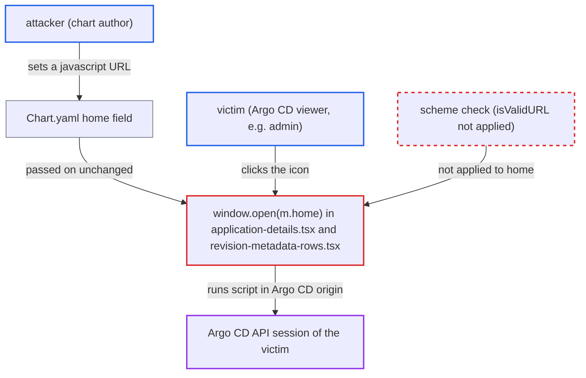

# Helm chart home URL passed to window.open without scheme check enables XSS

| Field | Value |
|---|---|
| ID | `find_01Sm5wdPg48MufPDYRJVzmXq` |
| Severity | **High** |
| Status | open |
| CWE | CWE-79 — Cross-site scripting |
| Created | 2026-10-27T21:14:25.004994Z |
| Claude Security | https://claude.ai/security/findings/find_01Sm5wdPg48MufPDYRJVzmXq |

## Description

A user who controls a Helm chart can run script in an Argo CD user's browser, using that user's session. This needs a victim to open the sync-revision or History and Rollback panel and click the chart's external-link icon. The UI passes the chart's `home` value to `window.open` without checking its scheme. Damage is limited by the victim's RBAC.

1. **attacker** publishes a chart whose `Chart.yaml` sets a `javascript:` URL as `home`. The attacker is a tenant who can create or update an Application and point it at a Helm repo they control, or a publisher of an upstream chart repo.
2. **repo-server `GetRevisionChartDetails`** extracts the chart and runs `helm show chart`. It returns the parsed details unchanged, and `getChartDetails` copies `home` into `ChartDetails.Home` with only YAML unmarshalling. ([`reposerver/repository/repository.go:2980-3015`](https://github.com/cx-benchmark/argo-cd/blob/b7bc418289a96130340ea79964c4491b416c14f2/reposerver/repository/repository.go#L2980-L3015))
3. **API server `RevisionChartDetails`** returns the `ChartDetails` struct to the UI. It checks only RBAC `get` on the application and does not sanitize `Home`. ([`server/application/application.go:1711-1740`](https://github.com/cx-benchmark/argo-cd/blob/b7bc418289a96130340ea79964c4491b416c14f2/server/application/application.go#L1711-L1740))
4. **victim's browser** shows an external-link icon in the sync-revision or History and Rollback panel. The hover `title` shows only the raw value, so the payload is easy to miss. ([`ui/src/app/applications/components/application-deployment-history/revision-metadata-rows.tsx:45-53`](https://github.com/cx-benchmark/argo-cd/blob/b7bc418289a96130340ea79964c4491b416c14f2/ui/src/app/applications/components/application-deployment-history/revision-metadata-rows.tsx#L45-L53))
5. **the click handler** calls `window.open(m.home)` when the victim clicks the icon. No scheme check is applied, and the helpers `isValidURL()` and `isValidManagedByURL()` are not used on `home`. ([`ui/src/app/applications/components/application-details/application-details.tsx:467-476`](https://github.com/cx-benchmark/argo-cd/blob/b7bc418289a96130340ea79964c4491b416c14f2/ui/src/app/applications/components/application-details/application-details.tsx#L467-L476))
6. **the popup** runs the `javascript:` code in the Argo CD origin. The new about:blank document inherits the opener's origin, and the default CSP `frame-ancestors 'self';` does not restrict script execution. ([`cmd/argocd-server/commands/argocd_server.go:348`](https://github.com/cx-benchmark/argo-cd/blob/b7bc418289a96130340ea79964c4491b416c14f2/cmd/argocd-server/commands/argocd_server.go#L348))

## Assessment

The attacker controls a chart that an Application uses. This can be a tenant with app create or update rights who points a chart source at a Helm repo they control, where the project's `sourceRepos` allows it. It can also be a publisher of an upstream chart repo. The attacker sets `home` in `Chart.yaml` to a `javascript:` URL. A victim, such as an admin, must open the app's sync-revision or History and Rollback panel and click the external-link icon. The report assumes browsers run `window.open('javascript:…')` without `noopener` in a document that inherits the opener's origin.

Impact: The script makes same-origin requests to the Argo CD API with the victim's session cookie. It can read manifests and secrets the victim can see, mint tokens, change resources within the victim's RBAC, and create, sync or delete applications. The only limit is the victim's RBAC, so an admin victim gives full control.

Subsequent-system impact: With an admin's session the payload can create and sync Applications. Argo CD deploys these to managed clusters using its stored cluster credentials. The attacker can deploy arbitrary workloads, disclose secrets and delete resources on clusters beyond their own tenant.

## Recommendation

The UI (`application-details.tsx:472`, `revision-metadata-rows.tsx:50`) passes the repository-supplied `ChartDetails.home` string to `window.open` without constraining its scheme, so `javascript:` URLs execute in the viewer's Argo CD origin.

Fix criteria: `home` is clickable only when it parses as an absolute `http:` or `https:` URL. It is opened in a way that cannot run script in the Argo CD origin, for example a link with `noopener noreferrer`. Any other value is shown as inert text or not linked. A chart with `home: javascript:alert(document.domain)` gives no clickable icon in either panel. No code path passes the raw value to `window.open`.

## Evidence

**https://github.com/cx-benchmark/argo-cd**

- [`ui/src/app/applications/components/application-details/application-details.tsx:467-476`](https://github.com/cx-benchmark/argo-cd/blob/b7bc418289a96130340ea79964c4491b416c14f2/ui/src/app/applications/components/application-details/application-details.tsx#L467-L476)
- [`ui/src/app/applications/components/application-deployment-history/revision-metadata-rows.tsx:45-53`](https://github.com/cx-benchmark/argo-cd/blob/b7bc418289a96130340ea79964c4491b416c14f2/ui/src/app/applications/components/application-deployment-history/revision-metadata-rows.tsx#L45-L53)
- [`reposerver/repository/chart.go:12-30`](https://github.com/cx-benchmark/argo-cd/blob/b7bc418289a96130340ea79964c4491b416c14f2/reposerver/repository/chart.go#L12-L30)
- [`reposerver/repository/repository.go:2980-3015`](https://github.com/cx-benchmark/argo-cd/blob/b7bc418289a96130340ea79964c4491b416c14f2/reposerver/repository/repository.go#L2980-L3015)
- [`server/application/application.go:1711-1740`](https://github.com/cx-benchmark/argo-cd/blob/b7bc418289a96130340ea79964c4491b416c14f2/server/application/application.go#L1711-L1740)
- [`ui/src/app/shared/utils.ts:27-50`](https://github.com/cx-benchmark/argo-cd/blob/b7bc418289a96130340ea79964c4491b416c14f2/ui/src/app/shared/utils.ts#L27-L50)
- [`cmd/argocd-server/commands/argocd_server.go:348`](https://github.com/cx-benchmark/argo-cd/blob/b7bc418289a96130340ea79964c4491b416c14f2/cmd/argocd-server/commands/argocd_server.go#L348)

