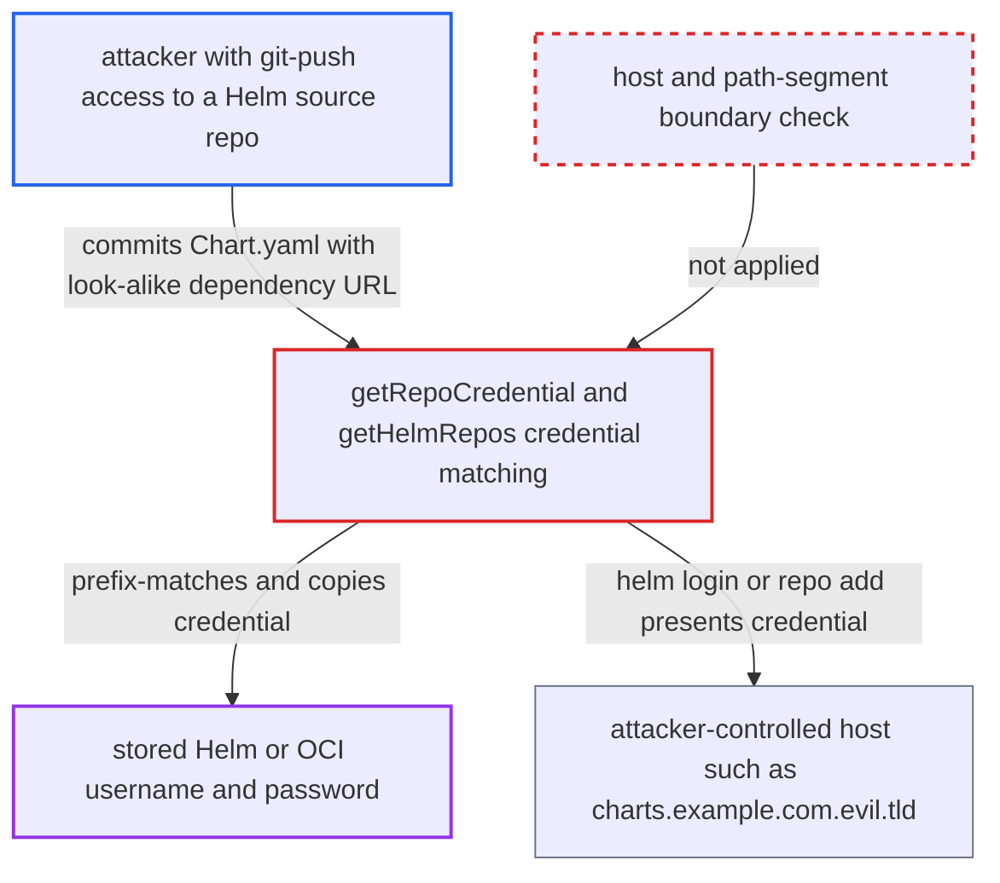

# Helm dependency URL prefix-matched to stored credentials sends them to attacker host

| Field | Value |
|---|---|
| ID | `find_01P7fLaofnPGZAEwBNn8p8fd` |
| Severity | **High** |
| Status | open |
| CWE | CWE-187 — Partial string comparison |
| Created | 2026-10-27T21:22:22.581621Z |
| Claude Security | https://claude.ai/security/findings/find_01P7fLaofnPGZAEwBNn8p8fd |

## Description

A developer with git-push access to one source repository that Argo CD renders as a Helm app can steal the username and password of a stored Helm or OCI credential. The attacker commits a `Chart.yaml` whose dependency URL only starts with a trusted host name, and repo-server sends the credential to the attacker's host. The cause is `getRepoCredential`, which matches by bare `strings.HasPrefix`.

1. **attacker** commits a `Chart.yaml` with a look-alike dependency and no `charts/` directory. The dependency `repository:` is a URL such as `https://charts.example.com.evil.tld/` or `oci://registry.example.com.evil.tld/x`, and `getHelmDependencyRepos` accepts any `https://` or `oci://` URL from this file. ([`reposerver/repository/repository.go:1234-1266`](https://github.com/cx-benchmark/argo-cd/blob/b7bc418289a96130340ea79964c4491b416c14f2/reposerver/repository/repository.go#L1234-L1266))
2. **the function `helmTemplate`** runs a dependency build after `helm template` fails on the missing dependency. It builds the repository list with the request's `HelmRepoCreds` and then calls `runHelmBuild`. ([`reposerver/repository/repository.go:1424-1442`](https://github.com/cx-benchmark/argo-cd/blob/b7bc418289a96130340ea79964c4491b416c14f2/reposerver/repository/repository.go#L1424-L1442))
3. **the function `getRepoCredential`** picks a stored credential by raw string prefix. `strings.HasPrefix(repoURL, cred.URL)` has no host or path-segment boundary, so a template for `https://charts.example.com` also matches the attacker's URL. ([`reposerver/repository/repository.go:1661-1673`](https://github.com/cx-benchmark/argo-cd/blob/b7bc418289a96130340ea79964c4491b416c14f2/reposerver/repository/repository.go#L1661-L1673))
4. **the function `getHelmRepos`** builds a `Repository` that keeps the attacker's URL and copies the stored secrets into it. If no template matches, the OCI fallback copies `Username` and `Password` from any OCI-enabled repository whose URL is a prefix of the dependency URL, or the reverse. ([`reposerver/repository/repository.go:1189-1221`](https://github.com/cx-benchmark/argo-cd/blob/b7bc418289a96130340ea79964c4491b416c14f2/reposerver/repository/repository.go#L1189-L1221))
5. **the function `DependencyBuild`** logs in to or adds the attacker's host with the stored credentials. It calls `RegistryLogin` for OCI dependencies when a username and password are set, and `RepoAdd` for HTTPS dependencies. ([`util/helm/helm.go:80-128`](https://github.com/cx-benchmark/argo-cd/blob/b7bc418289a96130340ea79964c4491b416c14f2/util/helm/helm.go#L80-L128))
6. **helm** sends the username and password to the attacker's server. `helm registry login` is run against the host parsed from the dependency URL, with the password on stdin. `helm repo add` is run with `--username` and `--password` and downloads `index.yaml` from the attacker's URL. ([`util/helm/cmd.go:93-149`](https://github.com/cx-benchmark/argo-cd/blob/b7bc418289a96130340ea79964c4491b416c14f2/util/helm/cmd.go#L93-L149))

## Assessment

The attacker needs git-push access to a source repository that is rendered as a Helm app. Argo CD must hold a permitted Helm credential template or OCI-enabled repository whose URL is a bare host, such as `https://charts.example.com` or `registry.example.com`. The repo-server must be able to reach the attacker's host. The attacker commits a `Chart.yaml` with a look-alike dependency, for example `https://charts.example.com.evil.tld/` or `oci://registry.example.com.evil.tld/x`, and no `charts/` directory. On the next reconcile `helm template` fails and the credential is attached. Two routes lead to the credential. One is the template prefix match in `getRepoCredential`, including the schemeless `--enable-oci` template. The other is the OCI fallback, which matches any configured OCI-enabled repository by prefix in either direction. The only project filter applies to the credential's own URL, so nothing checks that the dependency is on the credential's host.

Impact: The attacker obtains the plaintext username and password of a stored Helm or OCI credential. Argo CD's own data and service are not modified or disrupted. TLS client certificate and key are also copied, but only the certificate is presented in a TLS handshake, so the private key is not disclosed. For `useAzureWorkloadIdentity`, the ACR token exchange runs against the attacker host, which the report tracks as a separate issue.

Subsequent-system impact: The stolen credential authenticates to the organisation's real chart repository or registry. It gives read access to private charts and images. It gives write access only where that account has push rights, which the report says the code does not establish.

## Recommendation

`getRepoCredential` and the OCI fallback in `getHelmRepos` attach stored credentials to a chart-supplied dependency URL by raw string prefix. A credential bound to one host is therefore used against another host whose name merely starts with it. The fallback also matches in reverse, with `HasPrefix(cred.Repo, dep.Repo)`.

Fix criteria: A credential is attached to a dependency only when the parsed scheme, host and port equal the credential URL's and the credential's path is a whole-segment prefix of the dependency path. The reverse-prefix match never attaches credentials to a different host. With only `https://charts.example.com` and `registry.example.com` configured, the dependencies `https://charts.example.com.evil.tld/`, `https://charts.example.com@evil.tld/` and `oci://registry.example.com.evil.tld/x` are fetched without credentials.

## Evidence

**https://github.com/cx-benchmark/argo-cd**

- [`reposerver/repository/repository.go:1661-1673`](https://github.com/cx-benchmark/argo-cd/blob/b7bc418289a96130340ea79964c4491b416c14f2/reposerver/repository/repository.go#L1661-L1673)
- [`reposerver/repository/repository.go:1189-1221`](https://github.com/cx-benchmark/argo-cd/blob/b7bc418289a96130340ea79964c4491b416c14f2/reposerver/repository/repository.go#L1189-L1221)
- [`reposerver/repository/repository.go:1234-1266`](https://github.com/cx-benchmark/argo-cd/blob/b7bc418289a96130340ea79964c4491b416c14f2/reposerver/repository/repository.go#L1234-L1266)
- [`reposerver/repository/repository.go:1424-1442`](https://github.com/cx-benchmark/argo-cd/blob/b7bc418289a96130340ea79964c4491b416c14f2/reposerver/repository/repository.go#L1424-L1442)
- [`util/helm/helm.go:80-128`](https://github.com/cx-benchmark/argo-cd/blob/b7bc418289a96130340ea79964c4491b416c14f2/util/helm/helm.go#L80-L128)
- [`util/helm/cmd.go:93-149`](https://github.com/cx-benchmark/argo-cd/blob/b7bc418289a96130340ea79964c4491b416c14f2/util/helm/cmd.go#L93-L149)
- [`util/helm/cmd.go:166-231`](https://github.com/cx-benchmark/argo-cd/blob/b7bc418289a96130340ea79964c4491b416c14f2/util/helm/cmd.go#L166-L231)
- [`controller/state.go:255-262`](https://github.com/cx-benchmark/argo-cd/blob/b7bc418289a96130340ea79964c4491b416c14f2/controller/state.go#L255-L262)

