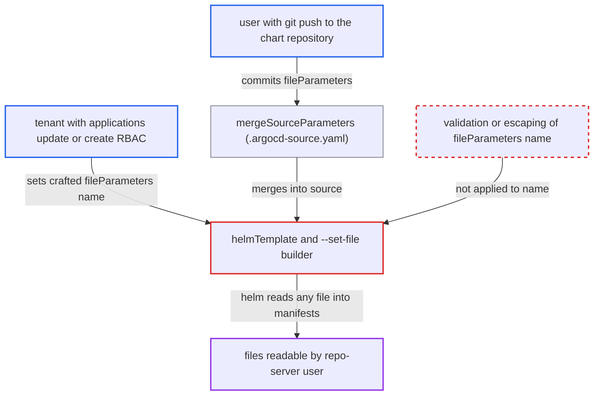

# Helm fileParameters name injected into --set-file reads arbitrary repo-server files

| Field | Value |
|---|---|
| ID | `find_014MTnMkvTEf1jrvFcj7wQTu` |
| Severity | **High** |
| Status | open |
| CWE | CWE-88 — Argument injection |
| Created | 2026-10-27T21:20:12.515947Z |
| Claude Security | https://claude.ai/security/findings/find_014MTnMkvTEf1jrvFcj7wQTu |

## Description

A user who can edit an Argo CD application, or who can push to the chart repository, can make the repo-server read any file its own user can read and put the contents into the rendered manifests. This exposes the repo-server's environment variables (including `REDIS_PASSWORD`) and its TLS key. The cause is that `helmTemplate` copies `fileParameters[].name` unvalidated into a `--set-file` argument, so a name with `=` and `,` adds a second key/file pair.

1. **attacker** sets a crafted name in `helm.fileParameters`. The name is something like `leak=/proc/self/environ,x` with `path` set to `values.yaml`; `HelmFileParameter.Name` is a free-form string that no CRD schema or server/controller code validates. ([`pkg/apis/application/v1alpha1/types.go:616-622`](https://github.com/cx-benchmark/argo-cd/blob/b7bc418289a96130340ea79964c4491b416c14f2/pkg/apis/application/v1alpha1/types.go#L616-L622))
2. **`mergeSourceParameters`** merges `helm.fileParameters` from `.argocd-source.yaml` in the repository into the source. This is the second way in: repository content can set the parameter without touching the application, because the merge resets only chart, path, repoURL and targetRevision. ([`reposerver/repository/repository.go:1929-1980`](https://github.com/cx-benchmark/argo-cd/blob/b7bc418289a96130340ea79964c4491b416c14f2/reposerver/repository/repository.go#L1929-L1980))
3. **the function `helmTemplate`** checks only the `path` half and stores the name as the `templateOpts.SetFile` key. `p.Path` is resolved and confined to the repo or referenced-source checkout, but `p.Name` goes in unchanged. ([`reposerver/repository/repository.go:1387-1402`](https://github.com/cx-benchmark/argo-cd/blob/b7bc418289a96130340ea79964c4491b416c14f2/reposerver/repository/repository.go#L1387-L1402))
4. **the command builder in `util/helm/cmd.go`** renders one argument `--set-file <name>=<escaped path>`. `cleanSetParameters` escapes commas in the value but not in the key, so the name yields `--set-file leak=/proc/self/environ,x=<repo>/values.yaml`. ([`util/helm/cmd.go:450-452`](https://github.com/cx-benchmark/argo-cd/blob/b7bc418289a96130340ea79964c4491b416c14f2/util/helm/cmd.go#L450-L452))
5. **helm** splits the argument into several `key=filepath` pairs and reads each file. The child process inherits the repo-server environment through `cmd.Env = os.Environ()`, so `/proc/self/environ` contains `REDIS_PASSWORD`, which the shipped deployment injects. ([`util/helm/cmd.go:70-73`](https://github.com/cx-benchmark/argo-cd/blob/b7bc418289a96130340ea79964c4491b416c14f2/util/helm/cmd.go#L70-L73))
6. **attacker's chart** renders `.Values.leak` into the generated manifests. The content comes back to the controller, shows in `GetManifests` and the UI diff, and is deployed into the tenant's namespace.

## Assessment

The attacker is either a tenant with `applications, update` (or `create`) RBAC in their own project, or someone with git-push access to the chart repository, who sets `helm.fileParameters` through `.argocd-source.yaml`. The application must use a helm source whose chart renders `.Values.leak` (the value key the attacker picked). No user interaction or special configuration is needed, and the attack runs on the next refresh, when the controller calls `GenerateManifest`. The report assumes that the pinned Helm CLI `4.3.1` splits `--set-file` on commas, and says Argo CD's own value escaping relies on the same splitting. Other readable targets include the repo-server TLS key at `/app/config/reposerver/tls/tls.key` when mounted, and `/proc/<pid>/cmdline` of concurrent helm processes, which carry `--password` on their command line. A URL with a scheme in the key also bypasses the `valuesFileSchemes` allow-list. `parameters[].name` for `--set` and `--set-string` has the same unescaped-key flaw, but without a file read.

Impact: The attacker reads any file the repo-server user can read. This includes every environment variable (such as `REDIS_PASSWORD`), the TLS private key, helm `--password` command lines and the working directories of other tenants' concurrent renders, so repository and credential data leaks across tenants. Pointing the key at `/dev/zero` makes helm use unbounded memory and degrades the repo-server pod. The report finds no direct write ability on the repo-server.

## Recommendation

`helmTemplate` passes `fileParameters[].name` (and `parameters[].name`) into the helm `--set-file`, `--set` and `--set-string` arguments without validating or escaping the key. The attacker therefore controls the structure of the key/value list and the file path helm reads.

Fix criteria: A `fileParameters[].name` or `parameters[].name` containing `=`, `,` or other strvals metacharacters is rejected or escaped before the argument is built. Exactly one key/value pair per parameter then reaches helm, and the file read is always the path that `ResolveValueFilePathOrUrl` or `getResolvedRefValueFile` approved. A name like `a=/etc/passwd,b` makes manifest generation fail (or is escaped). No file outside the repository checkout or referenced-source checkout can be read through `fileParameters`.

## Evidence

**https://github.com/cx-benchmark/argo-cd**

- [`reposerver/repository/repository.go:1387-1402`](https://github.com/cx-benchmark/argo-cd/blob/b7bc418289a96130340ea79964c4491b416c14f2/reposerver/repository/repository.go#L1387-L1402)
- [`util/helm/cmd.go:450-452`](https://github.com/cx-benchmark/argo-cd/blob/b7bc418289a96130340ea79964c4491b416c14f2/util/helm/cmd.go#L450-L452)
- [`reposerver/repository/repository.go:1929-1980`](https://github.com/cx-benchmark/argo-cd/blob/b7bc418289a96130340ea79964c4491b416c14f2/reposerver/repository/repository.go#L1929-L1980)
- [`pkg/apis/application/v1alpha1/types.go:616-622`](https://github.com/cx-benchmark/argo-cd/blob/b7bc418289a96130340ea79964c4491b416c14f2/pkg/apis/application/v1alpha1/types.go#L616-L622)
- [`util/helm/cmd.go:70-73`](https://github.com/cx-benchmark/argo-cd/blob/b7bc418289a96130340ea79964c4491b416c14f2/util/helm/cmd.go#L70-L73)
- [`manifests/base/repo-server/argocd-repo-server-deployment.yaml:26-30`](https://github.com/cx-benchmark/argo-cd/blob/b7bc418289a96130340ea79964c4491b416c14f2/manifests/base/repo-server/argocd-repo-server-deployment.yaml#L26-L30)

