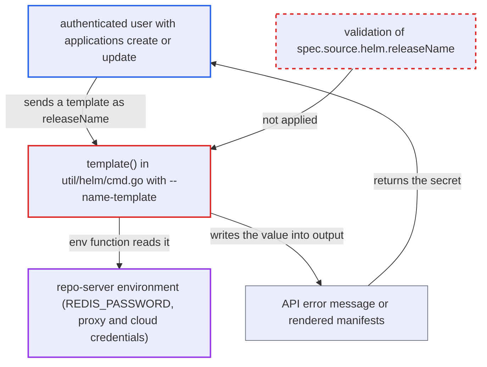

# Helm releaseName executed as sprig template via --name-template, disclosing repo-server environment

| Field | Value |
|---|---|
| ID | `find_01JSG6F1krZ2cWZbJpt2jgLx` |
| Severity | **High** |
| Status | open |
| CWE | CWE-1336 — Template injection |
| Created | 2026-10-27T21:26:17.135090Z |
| Claude Security | https://claude.ai/security/findings/find_01JSG6F1krZ2cWZbJpt2jgLx |

## Description

An authenticated Argo CD user who can create or update applications can read environment variables of the repo-server process, such as the Redis password. The attacker sets `spec.source.helm.releaseName` to a template like `{{ env "REDIS_PASSWORD" }}`, in a project that allows a Helm source. `template()` in `util/helm/cmd.go` passes the name via `--name-template`, so Helm runs it as a template, and the API error text returns the result.

1. **attacker** creates or updates an Application with a template string as the release name. The attacker needs `applications, create` or `update` rights in a project that permits a Helm source, and sets `spec.source.helm.releaseName` to `{{ env "REDIS_PASSWORD" }}`. ([`server/application/application.go:1387-1396`](https://github.com/cx-benchmark/argo-cd/blob/b7bc418289a96130340ea79964c4491b416c14f2/server/application/application.go#L1387-L1396))
2. **repo-server code in `repository.go`** copies the release name into the Helm options unchanged. `templateOpts.Name` is set to `spec.source.helm.releaseName` with no validation, and the CRD only declares a plain string. ([`reposerver/repository/repository.go:1347-1349`](https://github.com/cx-benchmark/argo-cd/blob/b7bc418289a96130340ea79964c4491b416c14f2/reposerver/repository/repository.go#L1347-L1349))
3. **the `template()` function** runs `helm template` with the release name as `--name-template`. Helm runs this value as a Go template with a sprig function map that still has `env`, `expandenv` and `getHostByName`. ([`util/helm/cmd.go:436`](https://github.com/cx-benchmark/argo-cd/blob/b7bc418289a96130340ea79964c4491b416c14f2/util/helm/cmd.go#L436))
4. **the helm child process** evaluates the template against the repo-server's environment. `runWithStdin` starts helm with `os.Environ()`, so `env` returns the real value of `REDIS_PASSWORD`. ([`util/helm/cmd.go:70-90`](https://github.com/cx-benchmark/argo-cd/blob/b7bc418289a96130340ea79964c4491b416c14f2/util/helm/cmd.go#L70-L90))
5. **Helm** rejects the evaluated name as an invalid release name. The error message contains the evaluated value, in the form `release name "<value>": invalid release name ...`.
6. **`CmdError` and the validation code** pass Helm's stderr into the API response. `CmdError.Error()` appends stderr unredacted, and `validateAndNormalizeApp` returns it as `application spec for %s is invalid: ...` to the caller. ([`util/exec/exec.go:122-128`](https://github.com/cx-benchmark/argo-cd/blob/b7bc418289a96130340ea79964c4491b416c14f2/util/exec/exec.go#L122-L128))

## Assessment

The attacker is an authenticated Argo CD user with `applications, create` or `update` in a project that permits any Helm source. No victim action or special configuration is needed. Default create-time validation sends the spec to the repo-server, so the attack runs at create time. Without that validation, the same text appears as a ComparisonError condition on the app. If the evaluated name is a valid name, it appears as `.Release.Name` in the rendered manifests instead of in an error.

Impact: The attacker can read any repo-server environment variable by name. These include the shipped `REDIS_PASSWORD` and any proxy or cloud credentials the operator adds. The sprig map gives no file read or command execution, so impact is limited to disclosing the environment, plus DNS lookups triggered through `getHostByName`. Using the Redis password also needs network reach to Redis, which the shipped `argocd-redis-network-policy` restricts to Argo CD pods where NetworkPolicy is enforced. The report does not establish integrity or availability impact.

## Recommendation

(1) `template()` in `util/helm/cmd.go` passes the user-controlled release name through `--name-template`, which Helm runs as a Go and sprig template with `env` and `expandenv` available.

Fix criteria: The release name reaches Helm as data, never as a template, for example as the positional `NAME` argument of `helm template NAME CHART`. A value like `{{ env "PATH" }}` is then rejected by Helm's name validation without being evaluated. Creating an Application with that release name yields neither manifests nor an error message containing the repo-server's `PATH` value.

(2) `spec.source.helm.releaseName` is accepted by the API and copied to the Helm invocation in `reposerver/repository/repository.go` with no syntax validation.

Fix criteria: The release name is checked at the API and repo-server boundary before any tool runs. The check follows Helm's release-name rules: DNS-1123, at most 53 characters, no template delimiters. An Application whose release name contains `{{` is rejected with a validation error that does not echo evaluated content.

## Evidence

**https://github.com/cx-benchmark/argo-cd**

- [`util/helm/cmd.go:436`](https://github.com/cx-benchmark/argo-cd/blob/b7bc418289a96130340ea79964c4491b416c14f2/util/helm/cmd.go#L436)
- [`reposerver/repository/repository.go:1347-1349`](https://github.com/cx-benchmark/argo-cd/blob/b7bc418289a96130340ea79964c4491b416c14f2/reposerver/repository/repository.go#L1347-L1349)
- [`util/helm/cmd.go:70-90`](https://github.com/cx-benchmark/argo-cd/blob/b7bc418289a96130340ea79964c4491b416c14f2/util/helm/cmd.go#L70-L90)
- [`util/exec/exec.go:122-128`](https://github.com/cx-benchmark/argo-cd/blob/b7bc418289a96130340ea79964c4491b416c14f2/util/exec/exec.go#L122-L128)
- [`util/argo/argo.go:1012-1024`](https://github.com/cx-benchmark/argo-cd/blob/b7bc418289a96130340ea79964c4491b416c14f2/util/argo/argo.go#L1012-L1024)
- [`server/application/application.go:1387-1396`](https://github.com/cx-benchmark/argo-cd/blob/b7bc418289a96130340ea79964c4491b416c14f2/server/application/application.go#L1387-L1396)
- [`manifests/base/repo-server/argocd-repo-server-deployment.yaml:26-31`](https://github.com/cx-benchmark/argo-cd/blob/b7bc418289a96130340ea79964c4491b416c14f2/manifests/base/repo-server/argocd-repo-server-deployment.yaml#L26-L31)
- [`hack/tool-versions.sh:20`](https://github.com/cx-benchmark/argo-cd/blob/b7bc418289a96130340ea79964c4491b416c14f2/hack/tool-versions.sh#L20)

