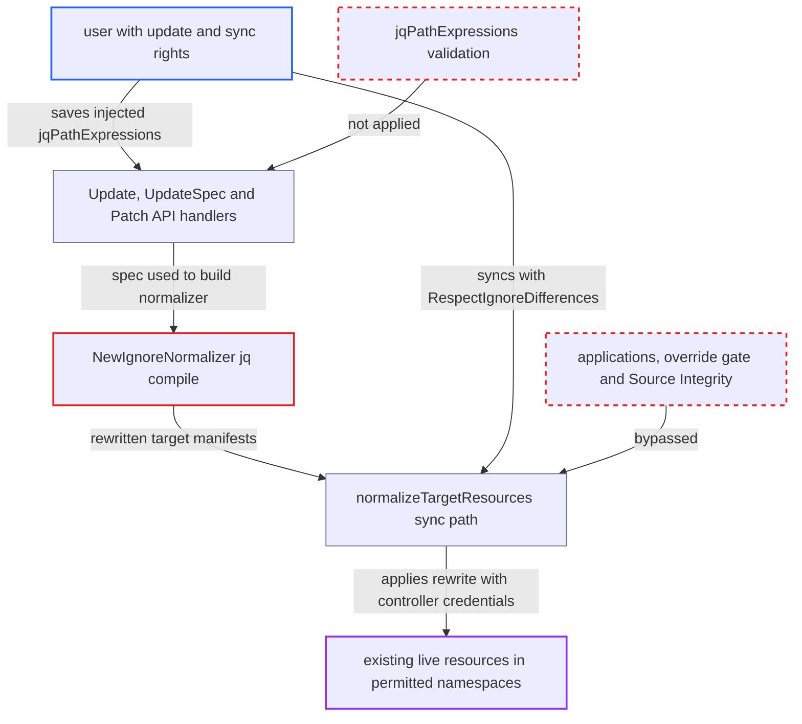

# jqPathExpressions injection lets app editors rewrite synced manifests via RespectIgnoreDifferences

| Field | Value |
|---|---|
| ID | `find_012C2dZtwBq1aTcGrSJUCgSH` |
| Severity | **High** |
| Status | open |
| CWE | CWE-917 — Expression Language Injection |
| Created | 2026-10-27T21:28:59.611803Z |
| Claude Security | https://claude.ai/security/findings/find_012C2dZtwBq1aTcGrSJUCgSH |

## Description

A user who has only `applications, update` and `applications, sync` on one Argo CD application can make the controller deploy manifests that differ from Git. This works for any resource that already exists live. It needs `RespectIgnoreDifferences=true` on the sync. The cause is `NewIgnoreNormalizer`, which builds a jq program from `jqPathExpressions` with `del(%s)` and never checks that the entry is a path.

1. **attacker with `update` and `sync` rights** saves an `ignoreDifferences` entry whose `jqPathExpressions` value closes `del(` and appends a jq pipeline. `Update`, `UpdateSpec` and `Patch` accept any spec with only `applications, update`, and nothing validates the jq expression. ([`server/application/application.go:1063-1077`](https://github.com/cx-benchmark/argo-cd/blob/b7bc418289a96130340ea79964c4491b416c14f2/server/application/application.go#L1063-L1077))
2. **`NewIgnoreNormalizer`** compiles the entry into a jq program with gojq. The entry is placed inside `del(%s)`, so a `)` in it ends the deletion call and the rest is compiled as an arbitrary program. ([`util/argo/normalizers/diff_normalizer.go:159-175`](https://github.com/cx-benchmark/argo-cd/blob/b7bc418289a96130340ea79964c4491b416c14f2/util/argo/normalizers/diff_normalizer.go#L159-L175))
3. **attacker** starts a sync with `RespectIgnoreDifferences=true`. The option can be passed in the sync request or set in `syncPolicy`. ([`controller/sync.go:307-325`](https://github.com/cx-benchmark/argo-cd/blob/b7bc418289a96130340ea79964c4491b416c14f2/controller/sync.go#L307-L325))
4. **`diff.Normalize`** runs the normalizer on every live and target object. The injected program can tell live from target because live objects carry `metadata.uid`, so it can change only the target. ([`util/argo/diff/normalize.go:13-43`](https://github.com/cx-benchmark/argo-cd/blob/b7bc418289a96130340ea79964c4491b416c14f2/util/argo/diff/normalize.go#L13-L43))
5. **`jqNormalizerPatch.Apply`** replaces the object with the program's single output. Any field, or the whole object, can therefore be rewritten, not only deleted. ([`util/argo/normalizers/diff_normalizer.go:72-103`](https://github.com/cx-benchmark/argo-cd/blob/b7bc418289a96130340ea79964c4491b416c14f2/util/argo/normalizers/diff_normalizer.go#L72-L103))
6. **`normalizeTargetResources`** keeps the rewritten target. A program that changes only targets produces an empty live patch, so the changed target becomes the patched target. ([`controller/sync.go:499-578`](https://github.com/cx-benchmark/argo-cd/blob/b7bc418289a96130340ea79964c4491b416c14f2/controller/sync.go#L499-L578))
7. **`restoreNonIgnoredFields`** fails to restore the injected values. It restores a field only when the normalized value equals the original, and an injected value differs, so it is kept as if it were an ignored field. ([`controller/sync.go:654-697`](https://github.com/cx-benchmark/argo-cd/blob/b7bc418289a96130340ea79964c4491b416c14f2/controller/sync.go#L654-L697))
8. **`SyncAppState`** replaces `reconciliationResult.Target` and applies it with the controller's cluster credentials. Only `validateSyncPermissions` still applies, which checks the kind and namespace allow-lists. ([`controller/sync.go:307-325`](https://github.com/cx-benchmark/argo-cd/blob/b7bc418289a96130340ea79964c4491b416c14f2/controller/sync.go#L307-L325))

## Assessment

The attacker is an Argo CD user with `applications, update` and `applications, sync` on one application. They have no `applications, override` right and no Git write access. They set the malicious `jqPathExpressions` entry and then sync with `RespectIgnoreDifferences=true`, either in the sync request or through `syncPolicy`. It works on the default configuration, for plain YAML, Helm and Kustomize sources. It also works while GPG or source-integrity verification passes on the Git commit. The report assumes gojq v0.12.19, which accepts standard jq syntax, so the concatenated string is a valid program.

Impact: The attacker can change any field, or the whole manifest, of every resource that already exists live. The controller applies the result with its own cluster credentials. This bypasses the source-of-truth boundary, the `applications, override` gate and Source Integrity. Only the project's kind and namespace allow-lists still limit it. The report finds no disclosure from, or outage of, the Argo CD control plane itself.

Subsequent-system impact: In the destination namespaces the project permits, rewritten workloads can run arbitrary images and commands, mount any Secret and use any ServiceAccount there. They can also replace existing workloads. This exposes those namespaces' secrets and ServiceAccount privileges. Cluster-wide reach is bounded by the project's kind and namespace rules and by the cluster's admission policy.

## Recommendation

(1) `jqPathExpressions` entries are put into a jq program with `del(%s)` and compiled with no syntactic restriction. An entry can therefore escape the deletion call and become an arbitrary program.

Fix criteria: An entry can only remove fields. Each entry is either validated as a pure path expression before compiling, with anything that is not a path term rejected, including unbalanced parentheses and pipelines. Or the deletion program is built through the gojq AST instead of string formatting. An entry containing `) | ... | del(` is rejected at Application validation or compile time. No normalizer output contains values absent from the input object.

(2) `normalizeTargetResources` trusts the normalizer's output as ignored fields and applies it to the cluster. Any normalizer that adds or changes values, rather than deleting, becomes a way to rewrite manifests.

Fix criteria: The `RespectIgnoreDifferences` pre-patch only copies values that exist in the live object into the target, and only for paths the normalizer removed. A normalized target containing a value found in neither the original target nor the live object is rejected or reverted before `reconciliationResult.Target` is replaced. Sync with an `ignoreDifferences` entry that tries to set a field, and confirm the applied object still matches Git.

## Evidence

**https://github.com/cx-benchmark/argo-cd**

- [`util/argo/normalizers/diff_normalizer.go:159-175`](https://github.com/cx-benchmark/argo-cd/blob/b7bc418289a96130340ea79964c4491b416c14f2/util/argo/normalizers/diff_normalizer.go#L159-L175)
- [`util/argo/normalizers/diff_normalizer.go:72-103`](https://github.com/cx-benchmark/argo-cd/blob/b7bc418289a96130340ea79964c4491b416c14f2/util/argo/normalizers/diff_normalizer.go#L72-L103)
- [`util/argo/diff/normalize.go:13-43`](https://github.com/cx-benchmark/argo-cd/blob/b7bc418289a96130340ea79964c4491b416c14f2/util/argo/diff/normalize.go#L13-L43)
- [`controller/sync.go:307-325`](https://github.com/cx-benchmark/argo-cd/blob/b7bc418289a96130340ea79964c4491b416c14f2/controller/sync.go#L307-L325)
- [`controller/sync.go:499-578`](https://github.com/cx-benchmark/argo-cd/blob/b7bc418289a96130340ea79964c4491b416c14f2/controller/sync.go#L499-L578)
- [`controller/sync.go:654-697`](https://github.com/cx-benchmark/argo-cd/blob/b7bc418289a96130340ea79964c4491b416c14f2/controller/sync.go#L654-L697)
- [`server/application/application.go:2120-2156`](https://github.com/cx-benchmark/argo-cd/blob/b7bc418289a96130340ea79964c4491b416c14f2/server/application/application.go#L2120-L2156)
- [`server/application/application.go:1063-1077`](https://github.com/cx-benchmark/argo-cd/blob/b7bc418289a96130340ea79964c4491b416c14f2/server/application/application.go#L1063-L1077)

