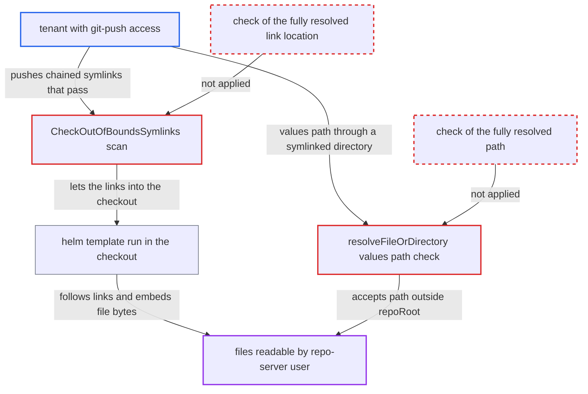

# Lexical out-of-bounds symlink check bypassed by chained symlinks in git checkouts

| Field | Value |
|---|---|
| ID | `find_01LYeVy6XUD4fowoUUag4H1d` |
| Severity | **High** |
| Status | open |
| CWE | CWE-61 — Symlink following |
| Created | 2026-10-27T21:12:27.489568Z |
| Claude Security | https://claude.ai/security/findings/find_01LYeVy6XUD4fowoUUag4H1d |

## Description

A tenant with git-push access to a repo used by a Helm-type Application can read any file the repo-server user can read at a known path. That includes the process environment with the Redis password and the repo-server TLS private key. The check `CheckOutOfBoundsSymlinks` judges link targets by text only and never resolves a link in the middle of a path, so chained symlinks pass it.

1. **attacker with git-push access** commits a chain of symlinks and a Helm chart that reads through it. The root has `a -> .`, `b -> a/..`, `c -> b/..` and `d -> c/..`. The chart has `files/x -> ../../d/proc/self/environ` and a ConfigMap template using `.Files.Get "files/x" | b64enc`.
2. **the function `CheckOutOfBoundsSymlinks`** accepts every link in the checkout. It splits each target and joins the parts with `filepath.Join`, which applies `..` to the textual parent. It never checks whether a part is itself a symlink, so each `a/..` stays at the root on paper while the kernel climbs one level. ([`util/app/path/path.go:93-108`](https://github.com/cx-benchmark/argo-cd/blob/b7bc418289a96130340ea79964c4491b416c14f2/util/app/path/path.go#L93-L108))
3. **the repo-server** treats the scan as the only symlink guard and goes on to generate manifests. The scan of `gitClient.Root()` is on by default (`AllowOutOfBoundsSymlinks=false`). Passing it lets the attacker's links reach every renderer that follows symlinks. ([`reposerver/repository/repository.go:499-513`](https://github.com/cx-benchmark/argo-cd/blob/b7bc418289a96130340ea79964c4491b416c14f2/reposerver/repository/repository.go#L499-L513))
4. **`helm template`** runs inside the checkout and follows the links when it loads chart files. `.Files.Get` then returns the bytes of the real target outside the checkout, such as `/proc/self/environ`. The report assumes Helm `4.3.1` here. ([`reposerver/repository/repository.go:1429-1436`](https://github.com/cx-benchmark/argo-cd/blob/b7bc418289a96130340ea79964c4491b416c14f2/reposerver/repository/repository.go#L1429-L1436))
5. **the repo-server** returns the rendered manifests that contain the file contents. The attacker reads them through the Application manifests/diff API. Helm runs with `cmd.Env = os.Environ()`, so the environment file includes `REDIS_PASSWORD`. ([`util/helm/cmd.go:70-80`](https://github.com/cx-benchmark/argo-cd/blob/b7bc418289a96130340ea79964c4491b416c14f2/util/helm/cmd.go#L70-L80))

## Assessment

The attacker needs git-push access to one source repo used by a Helm-type Application that they can view. The default configuration is enough, and no victim action is needed. After the push, the next automatic refresh checks out the repo and runs the attack. A second route goes through `resolveSymbolicLinkRecursive` and `resolveFileOrDirectory`. They resolve only the final path component and join relative targets lexically. A values-file path through a symlinked directory therefore passes the `repoRoot` prefix check. Referenced sources depend on this function alone. Helm and OCI archives are not affected, because `util/io/files/tar.go` cleans link names and that collapses the chain. Directory, Kustomize and Jsonnet sources are not covered by this finding.

Impact: The attacker can read any file the repo-server user can read at a known path. Examples are `/proc/self/environ` with `REDIS_PASSWORD`, the TLS private key under `/app/config/reposerver/tls`, mounted GPG and TLS material, and system files. Other tenants' checkouts are reachable only if their random path is known, because `/tmp/_argocd-repo` is mode `0300` and cannot be listed. The report finds no write or crash capability on the repo-server.

## Recommendation

(1) `CheckOutOfBoundsSymlinks` checks link targets textually with `filepath.Join`. A target that passes through another symlink and then `..` is judged inside the checkout, although the kernel resolves it outside.

Fix criteria: A symlink in a git checkout is accepted only if its fully resolved location stays inside the repository root, with every intermediate component resolved. Dangling or unresolvable targets are handled conservatively. A repo with `a -> .`, `b -> a/..`, `c -> b/..`, `d -> c/..` and `chart/files/x -> ../../d/etc/passwd` makes manifest generation fail with an out-of-bounds symlink error. The unit tests cover a link whose target passes through another link.

(2) `resolveSymbolicLinkRecursive` and `resolveFileOrDirectory` resolve only the final path component and join relative link targets textually. A values or file-parameter path through a symlinked directory is accepted although it lies outside `repoRoot`. Referenced sources rely on this check alone.

Fix criteria: Values and file-parameter paths are checked against `repoRoot` after every symlink in the whole path is resolved. A textual check is used only when the final component does not exist. `link/values.yaml`, where `link` resolves outside the checkout, is rejected for both primary and referenced sources.

## Evidence

**https://github.com/cx-benchmark/argo-cd**

- [`util/app/path/path.go:93-108`](https://github.com/cx-benchmark/argo-cd/blob/b7bc418289a96130340ea79964c4491b416c14f2/util/app/path/path.go#L93-L108)
- [`reposerver/repository/repository.go:499-513`](https://github.com/cx-benchmark/argo-cd/blob/b7bc418289a96130340ea79964c4491b416c14f2/reposerver/repository/repository.go#L499-L513)
- [`reposerver/repository/repository.go:1429-1436`](https://github.com/cx-benchmark/argo-cd/blob/b7bc418289a96130340ea79964c4491b416c14f2/reposerver/repository/repository.go#L1429-L1436)
- [`util/helm/cmd.go:70-80`](https://github.com/cx-benchmark/argo-cd/blob/b7bc418289a96130340ea79964c4491b416c14f2/util/helm/cmd.go#L70-L80)
- [`util/io/path/resolved.go:25-48`](https://github.com/cx-benchmark/argo-cd/blob/b7bc418289a96130340ea79964c4491b416c14f2/util/io/path/resolved.go#L25-L48)
- [`util/io/files/tar.go:146-147`](https://github.com/cx-benchmark/argo-cd/blob/b7bc418289a96130340ea79964c4491b416c14f2/util/io/files/tar.go#L146-L147)
- [`manifests/base/repo-server/argocd-repo-server-deployment.yaml:26-31`](https://github.com/cx-benchmark/argo-cd/blob/b7bc418289a96130340ea79964c4491b416c14f2/manifests/base/repo-server/argocd-repo-server-deployment.yaml#L26-L31)
- [`reposerver/repository/repository.go:181-213`](https://github.com/cx-benchmark/argo-cd/blob/b7bc418289a96130340ea79964c4491b416c14f2/reposerver/repository/repository.go#L181-L213)

