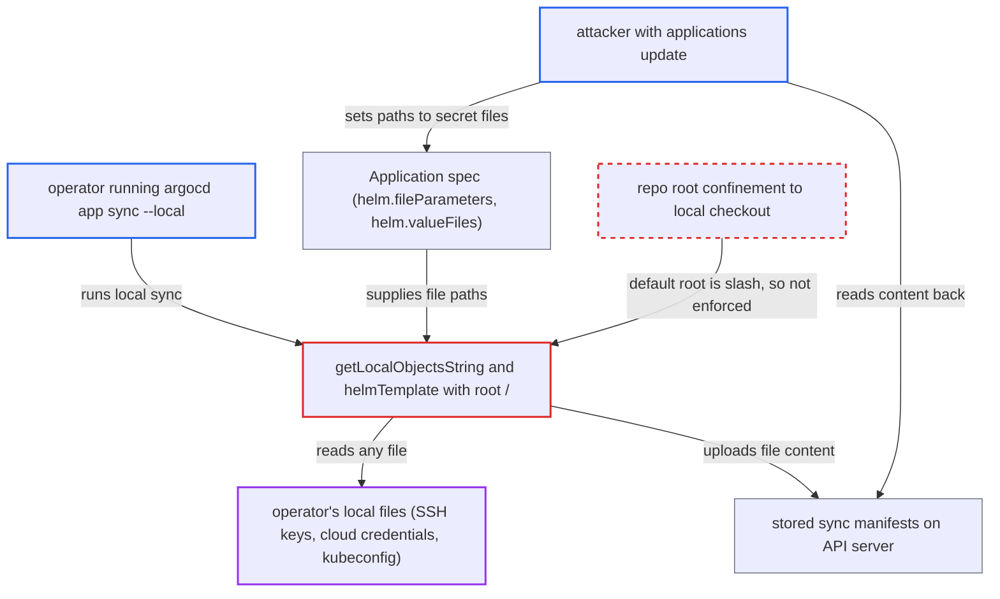

# Local diff/sync renders server-supplied Helm value/file paths with repo root '/', reading and uploading arbitrary local files

| Field | Value |
|---|---|
| ID | `find_01Rnj6mqvJxpGf6cC2wqREKe` |
| Severity | **High** |
| Status | open |
| CWE | CWE-73 — External control of file path |
| Created | 2026-10-27T21:23:57.112754Z |
| Claude Security | https://claude.ai/security/findings/find_01Rnj6mqvJxpGf6cC2wqREKe |

## Description

A user who can edit an Argo CD Application can steal files from an operator's workstation, such as SSH keys, cloud credentials, kubeconfig and Argo CD CLI tokens. It needs the `applications, update` permission on the app, or a compromised API server. The operator must then run `argocd app sync --local` or `argocd app diff --local`. The cause is that `--local-repo-root` defaults to `/`, so the path confinement in local rendering allows every file.

1. **attacker with `applications, update`** sets a Helm file parameter that points at a local secret file. The attacker sets `helm.fileParameters` to something like `{name: image.tag, path: /home/<operator>/.ssh/id_rsa}` in the Application spec.
2. **operator** runs `argocd app sync <app> --local ./chart`. The operator's normal local test run is enough, and `--dry-run` does not prevent the leak; the `--local-repo-root` flag defaults to `/`. ([`cmd/argocd/commands/app.go:2090`](https://github.com/cx-benchmark/argo-cd/blob/b7bc418289a96130340ea79964c4491b416c14f2/cmd/argocd/commands/app.go#L2090))
3. **CLI function `getLocalObjectsString`** renders the local chart using the server's Application spec. It passes the spec's Helm paths and the root `/` to `GenerateManifests`. ([`cmd/argocd/commands/app_diff.go:182-210`](https://github.com/cx-benchmark/argo-cd/blob/b7bc418289a96130340ea79964c4491b416c14f2/cmd/argocd/commands/app_diff.go#L182-L210))
4. **`helmTemplate` with `ResolveValueFilePathOrUrl`** accepts the attacker's path and passes it to `helm template --set-file`. With the root `/`, the check that the path starts with the root is true for every path, so the file is read and its content becomes a Helm value. ([`util/io/path/resolved.go:134-184`](https://github.com/cx-benchmark/argo-cd/blob/b7bc418289a96130340ea79964c4491b416c14f2/util/io/path/resolved.go#L134-L184))
5. **CLI sync command** uploads the rendered manifests, which now contain the file content, as `SyncRequest.Manifests`. The file content appears in the rendered output, for example as the Deployment image string. ([`cmd/argocd/commands/app.go:1953-1996`](https://github.com/cx-benchmark/argo-cd/blob/b7bc418289a96130340ea79964c4491b416c14f2/cmd/argocd/commands/app.go#L1953-L1996))
6. **Argo CD API server** stores the manifests in `operation.sync.manifests` on the Application. This happens also for a dry run, and the manifests are applied to the destination cluster when it is not a dry run. ([`server/application/application.go:2172-2185`](https://github.com/cx-benchmark/argo-cd/blob/b7bc418289a96130340ea79964c4491b416c14f2/server/application/application.go#L2172-L2185))
7. **attacker** reads the stored manifests back. The attacker uses `applications, get`, for example `argocd app get -o yaml`, on `.status.operationState.operation.sync.manifests`, or reads them from the destination cluster after the apply.

## Assessment

The attacker is a tenant with `applications, update` RBAC on an Application, or a compromised API server. They need an operator, such as a team member who tests charts locally, to run `argocd app sync <app> --local ./chart`, with or without `--dry-run`. `argocd app diff --local` has the same unconfined read, but it only prints the content locally. Reading the stolen content back needs `applications, get` on the Application, or access to the destination cluster after a real apply.

Impact: The attacker can read any file the operator's account can read on the workstation and obtain its content. The report names SSH keys, `~/.aws/credentials`, `~/.kube/config` and the Argo CD CLI config with its tokens. The workstation is not changed and stays available.

Subsequent-system impact: Stolen kubeconfig, cloud and SSH credentials give the attacker the operator's access to managed clusters and infrastructure. A leaked Argo CD token gives the operator's Argo CD RBAC.

## Recommendation

(1) `--local-repo-root` defaults to `/` in `app diff` (`app_diff.go:796`) and `app sync` (`app.go:2090`). This makes the repo-root confinement used by `ResolveValueFilePathOrUrl` accept any path, so server-controlled Helm file paths can reach any local file.

Fix criteria: Local manifest generation confines every spec-derived path (value files, file parameters, kustomize and jsonnet includes) to the local checkout. The root defaults to the `--local` directory or its enclosing git top-level, not `/`. Paths that resolve outside it are rejected or need explicit confirmation. Test: an Application spec with `helm.fileParameters` pointing at `/etc/hostname` makes `argocd app sync --local` fail instead of embedding the file.

(2) The CLI treats file paths in the server-provided Application spec as trusted when it drives local tooling through `getLocalObjectsString`. Lower-privileged tenants can write that spec.

Fix criteria: Paths from the remote spec are validated on the client: no absolute paths and no `..` escaping the local root. The user is shown which files outside the chart directory would be read before local rendering proceeds.

## Evidence

**https://github.com/cx-benchmark/argo-cd**

- [`cmd/argocd/commands/app.go:2090`](https://github.com/cx-benchmark/argo-cd/blob/b7bc418289a96130340ea79964c4491b416c14f2/cmd/argocd/commands/app.go#L2090)
- [`cmd/argocd/commands/app_diff.go:182-210`](https://github.com/cx-benchmark/argo-cd/blob/b7bc418289a96130340ea79964c4491b416c14f2/cmd/argocd/commands/app_diff.go#L182-L210)
- [`reposerver/repository/repository.go:1387-1402`](https://github.com/cx-benchmark/argo-cd/blob/b7bc418289a96130340ea79964c4491b416c14f2/reposerver/repository/repository.go#L1387-L1402)
- [`util/io/path/resolved.go:134-184`](https://github.com/cx-benchmark/argo-cd/blob/b7bc418289a96130340ea79964c4491b416c14f2/util/io/path/resolved.go#L134-L184)
- [`cmd/argocd/commands/app.go:1953-1996`](https://github.com/cx-benchmark/argo-cd/blob/b7bc418289a96130340ea79964c4491b416c14f2/cmd/argocd/commands/app.go#L1953-L1996)
- [`server/application/application.go:2172-2185`](https://github.com/cx-benchmark/argo-cd/blob/b7bc418289a96130340ea79964c4491b416c14f2/server/application/application.go#L2172-L2185)

