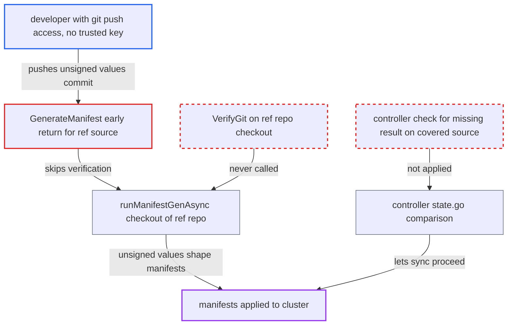

# Multi-source ref (values) repositories skip GPG source-integrity verification

| Field | Value |
|---|---|
| ID | `find_015XpQjSA7yQrLzufeuFdFWb` |
| Severity | **High** |
| Status | open |
| CWE | CWE-347 — Missing signature verification |
| Created | 2026-10-27T21:21:13.647930Z |
| Claude Security | https://claude.ai/security/findings/find_015XpQjSA7yQrLzufeuFdFWb |

## Description

A developer who can push to a git repo used as a values (`ref`) source can get unsigned changes deployed, even in a project that requires signed commits. The attack needs a policy covering that repo and a multi-source app that uses a path-less `ref` source. `GenerateManifest` returns early for such sources, and the controller treats the missing verification result as success.

1. **attacker with git push access** pushes an unsigned commit to the values repo. The repo is used as a path-less `ref` source in a project whose source-integrity policy covers it, and the attacker has no trusted signing key.
2. **repo-server `GenerateManifest`** returns early for the ref-only source. It only resolves the revision and never reaches `runRepoOperation`, so `VerifyGit` is not called and the response has no `SourceIntegrityResult`. ([`reposerver/repository/repository.go:682-690`](https://github.com/cx-benchmark/argo-cd/blob/b7bc418289a96130340ea79964c4491b416c14f2/reposerver/repository/repository.go#L682-L690))
3. **repo-server `runManifestGenAsync`** checks out the referenced repo and feeds its value files to Helm. The checkout at the resolved SHA is only checked for symlinks and is not signature-verified. ([`reposerver/repository/repository.go:897-985`](https://github.com/cx-benchmark/argo-cd/blob/b7bc418289a96130340ea79964c4491b416c14f2/reposerver/repository/repository.go#L897-L985))
4. **repo-server `runRepoOperation`** verifies only the primary source. The only `VerifyGit` call on the manifest path uses the primary source's `gitClient`, and only that result is attached to the response. ([`reposerver/repository/repository.go:540-548`](https://github.com/cx-benchmark/argo-cd/blob/b7bc418289a96130340ea79964c4491b416c14f2/reposerver/repository/repository.go#L540-L548))
5. **application controller** raises no `ComparisonError` for the missing result. It fails only on a non-nil failing result, so the sync gate in `controller/sync.go` lets the sync proceed. ([`controller/state.go:1115-1123`](https://github.com/cx-benchmark/argo-cd/blob/b7bc418289a96130340ea79964c4491b416c14f2/controller/state.go#L1115-L1123))
6. **Argo CD sync** applies the manifests rendered from the unsigned values. Auto-sync or any routine sync applies them, and the application shows no integrity error.

## Assessment

The attacker is a developer with git push access to a repo used as a path-less `ref` (values) source. The project's source-integrity policy must cover that repo, either through `spec.sourceIntegrity.git` or legacy `signatureKeys` migrated to a `*` policy. The app must be a multi-source Application, where another source reads the ref source's files through `$<name>/...` in Helm `valueFiles` or `fileParameters`. A common case is a Helm chart from a Helm repo with values from git. Auto-sync or any routine sync then applies the result.

Impact: Unsigned, attacker-written Helm values decide the manifests Argo CD applies with its cluster credentials, which defeats the signature policy for that app. With typical charts the attacker can pick the image, command, env and service account of the workloads. That gives code execution and access to the app's secrets in its destination. This is bounded by the AppProject's destination and resource-kind limits and by what the chart exposes through values.

## Recommendation

(1) Path-less ref sources return early in `GenerateManifest`. Referenced checkouts used during rendering are never verified, so git content that shapes the manifests escapes the per-repository source-integrity policy.

Fix criteria: Every git repository whose files contribute to manifest generation, including `$ref` repos checked out for value files or file parameters, is verified against the policy matching its URL at the exact commit used. A failure is reported on the response. Test: a multi-source app whose values repo gets an unsigned commit shows a GIT/GPG `ComparisonError` and the sync is refused.

(2) The application controller treats a missing `SourceIntegrityResult` as success, even for a source covered by a policy.

Fix criteria: In the application controller, any source for which `HasCriteria` is true produces a non-nil result, or the comparison fails, as the hydrator already requires. Test: a policy-covered source whose response has no result yields a `ComparisonError`.

## Evidence

**https://github.com/cx-benchmark/argo-cd**

- [`reposerver/repository/repository.go:682-690`](https://github.com/cx-benchmark/argo-cd/blob/b7bc418289a96130340ea79964c4491b416c14f2/reposerver/repository/repository.go#L682-L690)
- [`reposerver/repository/repository.go:897-985`](https://github.com/cx-benchmark/argo-cd/blob/b7bc418289a96130340ea79964c4491b416c14f2/reposerver/repository/repository.go#L897-L985)
- [`reposerver/repository/repository.go:540-548`](https://github.com/cx-benchmark/argo-cd/blob/b7bc418289a96130340ea79964c4491b416c14f2/reposerver/repository/repository.go#L540-L548)
- [`controller/state.go:1115-1123`](https://github.com/cx-benchmark/argo-cd/blob/b7bc418289a96130340ea79964c4491b416c14f2/controller/state.go#L1115-L1123)
- [`controller/hydrator/hydrator.go:583-587`](https://github.com/cx-benchmark/argo-cd/blob/b7bc418289a96130340ea79964c4491b416c14f2/controller/hydrator/hydrator.go#L583-L587)
- [`util/sourceintegrity/source_integrity.go:41-51`](https://github.com/cx-benchmark/argo-cd/blob/b7bc418289a96130340ea79964c4491b416c14f2/util/sourceintegrity/source_integrity.go#L41-L51)

