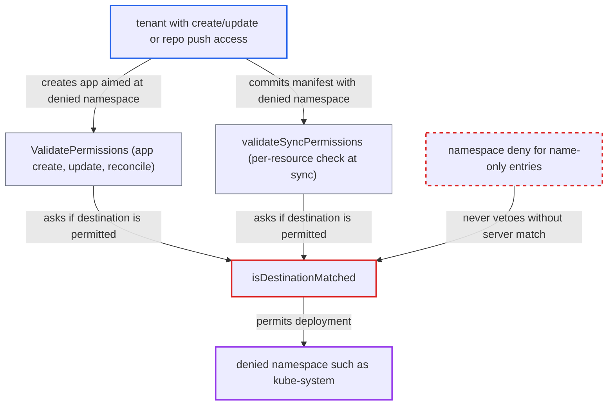

# Namespace deny in name-based AppProject destinations never vetoes, allowing denied namespaces

| Field | Value |
|---|---|
| ID | `find_01E9do6vjX8BFU2PbfFAq4Hj` |
| Severity | **High** |
| Status | open |
| CWE | CWE-863 — Incorrect authorization |
| Created | 2026-10-27T21:20:12.457040Z |
| Claude Security | https://claude.ai/security/findings/find_01E9do6vjX8BFU2PbfFAq4Hj |

## Description

A tenant can deploy resources into a namespace that the project explicitly denies, such as `kube-system` or `argocd`. The tenant needs `applications, create/update` in the project, or push access to one of its source repos. The project must also deny the namespace with a name-only destination entry next to a broader allow entry. The cause is `isDestinationMatched`: its namespace deny only applies when the entry matched the cluster by `server`, so entries that use `name` never veto.

1. **project admin** denies a namespace in a name-only destination entry. The entry looks like `{name:'*', namespace:'!kube-system'}` and sits next to a broader allow such as `{name:'*', namespace:'*'}`. The CLI command `argocd proj add-destination --name` writes name-only entries like this. ([`cmd/argocd/commands/project.go:280-285`](https://github.com/cx-benchmark/argo-cd/blob/b7bc418289a96130340ea79964c4491b416c14f2/cmd/argocd/commands/project.go#L280-L285))
2. **tenant** creates an app aimed at the denied namespace, or commits a manifest with `metadata.namespace: kube-system`. The manifest route also works when the app's own destination namespace is allowed.
3. **`ValidatePermissions` and `validateSyncPermissions`** ask `IsDestinationPermitted` whether the destination is allowed. `ValidatePermissions` runs on app create/update and at controller reconcile. `validateSyncPermissions` checks each resource's `metadata.namespace` at sync. Both depend only on this one check for the namespace. ([`controller/sync.go:753-777`](https://github.com/cx-benchmark/argo-cd/blob/b7bc418289a96130340ea79964c4491b416c14f2/controller/sync.go#L753-L777))
4. **`IsDestinationPermitted`** fills in both `Server` and `Name` from the resolved cluster. A name-only project entry therefore matches through `dstNameMatched` alone, however the Application addresses the cluster. ([`pkg/apis/application/v1alpha1/app_project_types.go:483-488`](https://github.com/cx-benchmark/argo-cd/blob/b7bc418289a96130340ea79964c4491b416c14f2/pkg/apis/application/v1alpha1/app_project_types.go#L483-L488))
5. **`isDestinationMatched`** skips the namespace deny entry. The deny at line 521 requires `dstServerMatched`. For a name-only entry `item.Server` is empty, and `globMatch` of an empty pattern against the cluster's `Server` is always false. The broader allow entry then wins. ([`pkg/apis/application/v1alpha1/app_project_types.go:507-528`](https://github.com/cx-benchmark/argo-cd/blob/b7bc418289a96130340ea79964c4491b416c14f2/pkg/apis/application/v1alpha1/app_project_types.go#L507-L528))
6. **the controller** applies the resources into the denied namespace with its cluster credentials. Neither validation step rejects the destination, so the sync goes ahead. ([`util/argo/argo.go:786-806`](https://github.com/cx-benchmark/argo-cd/blob/b7bc418289a96130340ea79964c4491b416c14f2/util/argo/argo.go#L786-L806))

## Assessment

The attacker is a tenant with `applications, create/update` in a project, or someone with push access to one of the project's source repos. The admin must have denied a namespace with a name-only entry next to a broader allow, for example `[{name:'*',namespace:'*'},{name:'*',namespace:'!kube-system'}]`. The same failure occurs with allow entries `{server:'*', namespace:'*'}` or `{name:'prod', namespace:'*'}`. There are two ways in: create or update an app whose destination is the denied namespace, or commit a manifest with `metadata.namespace: kube-system` into an app whose destination namespace is allowed. The equivalent policy written with `server:` entries is denied correctly.

Impact: The tenant can deploy any namespaced kind the project's resource lists permit into a namespace the project explicitly denies, typically `kube-system` or `argocd`. Pods there can mount privileged ServiceAccounts or Secrets, such as Argo CD's cluster and repo credentials. Synced manifests can also overwrite existing control-plane workloads. The report rates this as serious loss of confidentiality, integrity and availability for that cluster and the Argo CD control plane.

## Recommendation

In `isDestinationMatched`, the namespace deny depends on `dstServerMatched`. A `!namespace` pattern in an entry that names the cluster with `name:` can therefore never reject a destination. This contradicts the documented rule that deny wins.

Fix criteria: A namespace deny entry vetoes whenever the entry's cluster selector (server or name) matches the resolved cluster, whichever field selected it. The policies `[{name:'*',namespace:'*'},{name:'*',namespace:'!kube-system'}]`, `[{server:'*',namespace:'*'},{name:'*',namespace:'!kube-system'}]` and `[{name:'prod',namespace:'*'},{name:'prod',namespace:'!kube-system'}]` all reject `kube-system`. They reject it at app validation and in the per-resource sync check, exactly as their `server:` equivalents do. The existing per-cluster scoping still holds: a deny on cluster A does not affect cluster B.

## Evidence

**https://github.com/cx-benchmark/argo-cd**

- [`pkg/apis/application/v1alpha1/app_project_types.go:507-528`](https://github.com/cx-benchmark/argo-cd/blob/b7bc418289a96130340ea79964c4491b416c14f2/pkg/apis/application/v1alpha1/app_project_types.go#L507-L528)
- [`pkg/apis/application/v1alpha1/app_project_types.go:446-455`](https://github.com/cx-benchmark/argo-cd/blob/b7bc418289a96130340ea79964c4491b416c14f2/pkg/apis/application/v1alpha1/app_project_types.go#L446-L455)
- [`pkg/apis/application/v1alpha1/app_project_types.go:483-488`](https://github.com/cx-benchmark/argo-cd/blob/b7bc418289a96130340ea79964c4491b416c14f2/pkg/apis/application/v1alpha1/app_project_types.go#L483-L488)
- [`util/argo/argo.go:786-806`](https://github.com/cx-benchmark/argo-cd/blob/b7bc418289a96130340ea79964c4491b416c14f2/util/argo/argo.go#L786-L806)
- [`controller/sync.go:753-777`](https://github.com/cx-benchmark/argo-cd/blob/b7bc418289a96130340ea79964c4491b416c14f2/controller/sync.go#L753-L777)
- [`cmd/argocd/commands/project.go:280-285`](https://github.com/cx-benchmark/argo-cd/blob/b7bc418289a96130340ea79964c4491b416c14f2/cmd/argocd/commands/project.go#L280-L285)
- [`docs/operator-manual/project.yaml:17-26`](https://github.com/cx-benchmark/argo-cd/blob/b7bc418289a96130340ea79964c4491b416c14f2/docs/operator-manual/project.yaml#L17-L26)

