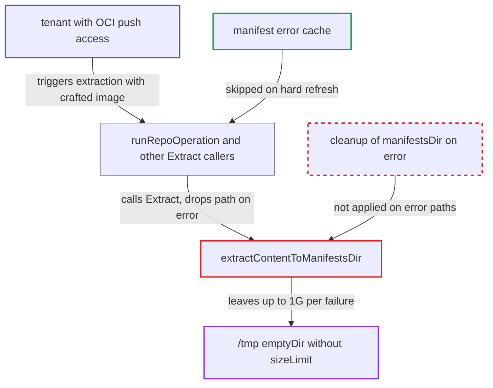

# OCI extraction leaves extracted manifests dir on failure, exhausting repo-server /tmp

| Field | Value |
|---|---|
| ID | `find_0149uVKHu2viqu83oG83bqMc` |
| Severity | **High** |
| Status | open |
| CWE | CWE-459 — Resource leak |
| Created | 2026-10-27T21:42:44.286335Z |
| Claude Security | https://claude.ai/security/findings/find_0149uVKHu2viqu83oG83bqMc |

## Description

A tenant who can push an OCI image used by an Application can fill the repo-server's `/tmp` disk. That stops git checkouts, chart and OCI fetches, and manifest generation for every Application on that replica. Each failed extraction leaves up to 1G behind because `extractContentToManifestsDir` never removes `manifestsDir` on its error paths, and no caller can release it.

1. **attacker** pushes a crafted image to an OCI repository the repo-server reads. The image has one gzip content layer of about 1 GiB of zeros, a few MB compressed, followed by a side layer that will fail the oras `file.Store` push. The layer pre-checks accept it because they only cap the layer count at 10 and count the tar layer types. ([`util/oci/client.go:285-315`](https://github.com/cx-benchmark/argo-cd/blob/b7bc418289a96130340ea79964c4491b416c14f2/util/oci/client.go#L285-L315))
2. **repo-server** runs the extraction on a reconcile or a hard refresh. `runRepoOperation`, used by `GenerateManifest` and `GetAppDetails`, calls `Extract`, as do `GetOciFiles` and `GetOciDirectories`. ([`reposerver/repository/repository.go:415-426`](https://github.com/cx-benchmark/argo-cd/blob/b7bc418289a96130340ea79964c4491b416c14f2/reposerver/repository/repository.go#L415-L426))
3. **content layer `Push`** untars the layer and moves every file into `manifestsDir`. This finishes before `oras.Copy` reports the later failure, because the content layer was already started and `files.Untgz` does not check the context. The size is bounded only by `--oci-manifest-max-extracted-size`, default `1G`. ([`util/oci/client.go:626-697`](https://github.com/cx-benchmark/argo-cd/blob/b7bc418289a96130340ea79964c4491b416c14f2/util/oci/client.go#L626-L697))
4. **`oras.Copy`** fails on the side layer. The push fails for a blob with no `org.opencontainers.image.title` annotation that is over 4 MiB, for a title such as `../x`, or for two layers with the same title. ([`util/oci/client.go:576-601`](https://github.com/cx-benchmark/argo-cd/blob/b7bc418289a96130340ea79964c4491b416c14f2/util/oci/client.go#L576-L601))
5. **`extractContentToManifestsDir`** returns the error and leaves `manifestsDir` in place. Its `defer`s remove only the oras working dir `tempDir` and the per-layer `srcDir`, not `manifestsDir`. ([`util/oci/client.go:576-601`](https://github.com/cx-benchmark/argo-cd/blob/b7bc418289a96130340ea79964c4491b416c14f2/util/oci/client.go#L576-L601))
6. **`extract`** passes the error and the path up with a `nil` closer. Every caller drops the path when it gets an error, so nothing releases the directory. ([`util/oci/client.go:335-337`](https://github.com/cx-benchmark/argo-cd/blob/b7bc418289a96130340ea79964c4491b416c14f2/util/oci/client.go#L335-L337))
7. **attacker** repeats the attempt with hard refreshes. A hard refresh skips the manifest error cache, which would otherwise pause generation for 60 minutes after 3 failures. `GetAppDetails`, `GetOciFiles` and `GetOciDirectories` have no error cache. ([`reposerver/repository/repository.go:396-399`](https://github.com/cx-benchmark/argo-cd/blob/b7bc418289a96130340ea79964c4491b416c14f2/reposerver/repository/repository.go#L396-L399))
8. **repo-server `/tmp`** fills up until writes fail. `/tmp` is an `emptyDir: {}` with no `sizeLimit`, and nothing sweeps it. ([`manifests/base/repo-server/argocd-repo-server-deployment.yaml:401-402`](https://github.com/cx-benchmark/argo-cd/blob/b7bc418289a96130340ea79964c4491b416c14f2/manifests/base/repo-server/argocd-repo-server-deployment.yaml#L401-L402))

## Assessment

The attacker is a tenant with push access to an OCI repository that an Application, or an ApplicationSet OCI generator, uses as a source. A user allowed to create an Application pointing at their own registry can do the same. Every controller reconcile runs the extraction. A hard refresh also runs it and needs only `applications, get`. The size of each leak is capped by `--oci-manifest-max-extracted-size` (default `1G`), and `--disable-oci-manifest-max-extracted-size` removes that cap. The cached image tar stays in place, so each retry extracts from local disk without downloading again. The report assumes oras-go v2.7.0, whose source was not in the checkout.

Impact: The attacker can fill the repo-server's `/tmp` and keep it full, and nothing limits how much builds up. Git checkouts, chart and OCI fetches, and manifest generation for all Applications on that replica then fail with ENOSPC until the pod is evicted or deleted, and the attacker can repeat. Nothing is disclosed or modified.

## Recommendation

(1) `extractContentToManifestsDir` and `extract` in `util/oci/client.go` return a populated temporary `manifestsDir` on failure without removing it. They also return a `nil` closer, so no caller can release it.

Fix criteria: After any error following the creation of `manifestsDir`, the directory and its contents are removed before the error is returned. Alternatively, a non-nil closer that removes it is always returned and every caller also closes it on error. Test: extract an image whose side layer fails the oras `file.Store` push after the content layer was moved in, and confirm no new directory remains under `/tmp` after `Extract` returns the error.

(2) Nothing bounds the repo-server's scratch space independently of single code paths. The shipped `/tmp` emptyDir has no `sizeLimit`, and the service does not sweep stale temp directories at startup.

Fix criteria: Scratch usage has a fixed ceiling, for example a `sizeLimit` on the `tmp` emptyDir in the shipped manifests, a startup sweep of unreferenced temp directories, or both. Test: repeat a failing extraction many times and confirm disk usage levels off.

## Evidence

**https://github.com/cx-benchmark/argo-cd**

- [`util/oci/client.go:576-601`](https://github.com/cx-benchmark/argo-cd/blob/b7bc418289a96130340ea79964c4491b416c14f2/util/oci/client.go#L576-L601)
- [`util/oci/client.go:335-337`](https://github.com/cx-benchmark/argo-cd/blob/b7bc418289a96130340ea79964c4491b416c14f2/util/oci/client.go#L335-L337)
- [`util/oci/client.go:626-697`](https://github.com/cx-benchmark/argo-cd/blob/b7bc418289a96130340ea79964c4491b416c14f2/util/oci/client.go#L626-L697)
- [`util/oci/client.go:285-315`](https://github.com/cx-benchmark/argo-cd/blob/b7bc418289a96130340ea79964c4491b416c14f2/util/oci/client.go#L285-L315)
- [`reposerver/repository/repository.go:415-426`](https://github.com/cx-benchmark/argo-cd/blob/b7bc418289a96130340ea79964c4491b416c14f2/reposerver/repository/repository.go#L415-L426)
- [`reposerver/repository/repository.go:396-399`](https://github.com/cx-benchmark/argo-cd/blob/b7bc418289a96130340ea79964c4491b416c14f2/reposerver/repository/repository.go#L396-L399)
- [`reposerver/repository/repository.go:181-214`](https://github.com/cx-benchmark/argo-cd/blob/b7bc418289a96130340ea79964c4491b416c14f2/reposerver/repository/repository.go#L181-L214)
- [`cmd/argocd-repo-server/commands/argocd_repo_server.go:273-274`](https://github.com/cx-benchmark/argo-cd/blob/b7bc418289a96130340ea79964c4491b416c14f2/cmd/argocd-repo-server/commands/argocd_repo_server.go#L273-L274)
- [`manifests/base/repo-server/argocd-repo-server-deployment.yaml:401-402`](https://github.com/cx-benchmark/argo-cd/blob/b7bc418289a96130340ea79964c4491b416c14f2/manifests/base/repo-server/argocd-repo-server-deployment.yaml#L401-L402)

