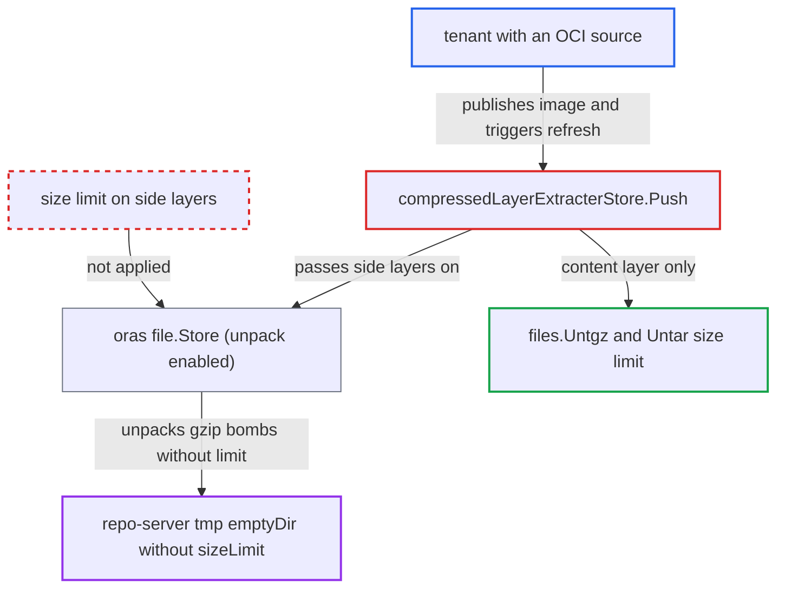

# OCI side layers with oras unpack annotation are decompressed without the extraction size limit

| Field | Value |
|---|---|
| ID | `find_01WW2q74vpnQucAfwsnm7pjU` |
| Severity | **High** |
| Status | open |
| CWE | CWE-409 — Decompression bomb |
| Created | 2026-10-27T21:28:21.424040Z |
| Claude Security | https://claude.ai/security/findings/find_01WW2q74vpnQucAfwsnm7pjU |

## Description

A tenant who can push an OCI image used as an Application source can fill the repo-server's temporary disk with decompressed data. Manifest generation then fails on that replica, and the pod may be evicted. The configured extraction size limit does not cover extra layers that carry an unpack annotation, because `compressedLayerExtracterStore.Push` hands them to the oras `file.Store`, which decompresses them without a limit.

1. **attacker** publishes an OCI image with one small valid content layer and gzip-bomb side layers. Each side layer has a media type outside the content suffixes and carries the annotations `org.opencontainers.image.title` and `io.deis.oras.content.unpack: "true"`. ([`util/oci/client.go:285-314`](https://github.com/cx-benchmark/argo-cd/blob/b7bc418289a96130340ea79964c4491b416c14f2/util/oci/client.go#L285-L314))
2. **repo-server** generates manifests for the `oci://` source by calling `ociClient.Extract`. This runs on every cache miss, or on a hard refresh the attacker can trigger. ([`reposerver/repository/repository.go:415-426`](https://github.com/cx-benchmark/argo-cd/blob/b7bc418289a96130340ea79964c4491b416c14f2/reposerver/repository/repository.go#L415-L426))
3. **`extractContentToManifestsDir`** runs `oras.Copy` from the cached image into the extracting store. `Push` is called for every descriptor with its manifest annotations, and the working directory is a temp dir under `os.TempDir()`. ([`util/oci/client.go:576-601`](https://github.com/cx-benchmark/argo-cd/blob/b7bc418289a96130340ea79964c4491b416c14f2/util/oci/client.go#L576-L601))
4. **`compressedLayerExtracterStore.Push`** sends the side layers to the embedded oras `file.Store` instead of the size-limited extraction. For non-Helm images this happens to every layer whose media type does not end in `tar`, `tar+gzip` or `tar.gzip`. For Helm-typed images it happens to every layer except the Helm chart content layer. ([`util/oci/client.go:697`](https://github.com/cx-benchmark/argo-cd/blob/b7bc418289a96130340ea79964c4491b416c14f2/util/oci/client.go#L697))
5. **oras `file.Store`** saves each annotated side layer, then gunzips and untars it into the temp dir. The store was created with `file.New(tempDir)` and no options, so `SkipUnpack` is false and the attacker's unpack annotation is honoured with no limit on decompressed bytes. ([`util/oci/client.go:611-618`](https://github.com/cx-benchmark/argo-cd/blob/b7bc418289a96130340ea79964c4491b416c14f2/util/oci/client.go#L611-L618))
6. **repo-server `/tmp`** fills up with decompressed data. The `tmp` `emptyDir: {}` has no `sizeLimit`, so it is backed by node ephemeral storage, and gzip expands about 1000:1. ([`manifests/base/repo-server/argocd-repo-server-deployment.yaml:401-402`](https://github.com/cx-benchmark/argo-cd/blob/b7bc418289a96130340ea79964c4491b416c14f2/manifests/base/repo-server/argocd-repo-server-deployment.yaml#L401-L402))

## Assessment

The attacker is a tenant who can push to an OCI repository used as an Application source. Alternatively, the attacker holds `applications, create` in a project whose `sourceRepos` permits their registry. The shipped `default` project allows `*`. No victim action is needed. The bomb runs when manifests are generated for the source, or on a hard refresh the attacker triggers. The attacker can repeat this with hard refreshes or new tags.

Impact: The attacker can fill the repo-server's `/tmp` (node ephemeral storage), so every manifest generation on that replica fails with ENOSPC. Node disk pressure can also get the pod evicted. Only availability is affected, and nothing is disclosed or modified.

## Recommendation

Layers other than the single content layer are handed to the oras `file.Store`. Its default unpack behaviour acts on the attacker-supplied `io.deis.oras.content.unpack` annotation and decompresses gzip-tar data without the configured `--oci-manifest-max-extracted-size` limit.

Fix criteria: No OCI layer is decompressed outside the size-limited `files.Untgz`/`files.Untar` path. Non-content layers are discarded or stored without unpacking. Test: an image with a valid content layer plus a side layer annotated with a title and `io.deis.oras.content.unpack: "true"`, holding a gzip bomb larger than the limit, never yields more than the configured limit of decompressed bytes on disk.

## Evidence

**https://github.com/cx-benchmark/argo-cd**

- [`util/oci/client.go:626-630`](https://github.com/cx-benchmark/argo-cd/blob/b7bc418289a96130340ea79964c4491b416c14f2/util/oci/client.go#L626-L630)
- [`util/oci/client.go:697`](https://github.com/cx-benchmark/argo-cd/blob/b7bc418289a96130340ea79964c4491b416c14f2/util/oci/client.go#L697)
- [`util/oci/client.go:611-618`](https://github.com/cx-benchmark/argo-cd/blob/b7bc418289a96130340ea79964c4491b416c14f2/util/oci/client.go#L611-L618)
- [`util/oci/client.go:285-314`](https://github.com/cx-benchmark/argo-cd/blob/b7bc418289a96130340ea79964c4491b416c14f2/util/oci/client.go#L285-L314)
- [`util/io/files/tar.go:77-92`](https://github.com/cx-benchmark/argo-cd/blob/b7bc418289a96130340ea79964c4491b416c14f2/util/io/files/tar.go#L77-L92)
- [`util/oci/client.go:576-601`](https://github.com/cx-benchmark/argo-cd/blob/b7bc418289a96130340ea79964c4491b416c14f2/util/oci/client.go#L576-L601)
- [`reposerver/repository/repository.go:415-426`](https://github.com/cx-benchmark/argo-cd/blob/b7bc418289a96130340ea79964c4491b416c14f2/reposerver/repository/repository.go#L415-L426)
- [`manifests/base/repo-server/argocd-repo-server-deployment.yaml:401-402`](https://github.com/cx-benchmark/argo-cd/blob/b7bc418289a96130340ea79964c4491b416c14f2/manifests/base/repo-server/argocd-repo-server-deployment.yaml#L401-L402)
- [`cmd/argocd-repo-server/commands/argocd_repo_server.go:273-274`](https://github.com/cx-benchmark/argo-cd/blob/b7bc418289a96130340ea79964c4491b416c14f2/cmd/argocd-repo-server/commands/argocd_repo_server.go#L273-L274)

