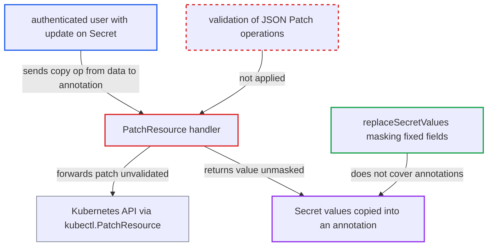

# PatchResource Secret redaction bypassed by JSON Patch copy of data into annotations

| Field | Value |
|---|---|
| ID | `find_01NMTMgFSMq6e9s3nEvfTeLb` |
| Severity | **High** |
| Status | open |
| CWE | CWE-212 — Improper removal of sensitive information |
| Created | 2026-10-27T21:18:07.158961Z |
| Claude Security | https://claude.ai/security/findings/find_01NMTMgFSMq6e9s3nEvfTeLb |

## Description

A user who may patch a Secret in an Argo CD app, but who should not be able to read its values, can read every value in clear. They send a JSON Patch that copies a value from `data` into an annotation, and the response returns it unmasked. This works because `PatchResource` passes the patch on unvalidated, and `replaceSecretValues` masks only fixed field locations.

1. **attacker** reads the Secret's key names through `GetResource`. Key names are not masked, so the attacker learns every key to copy. ([`server/application/application.go:1536-1560`](https://github.com/cx-benchmark/argo-cd/blob/b7bc418289a96130340ea79964c4491b416c14f2/server/application/application.go#L1536-L1560))
2. **attacker** sends a JSON Patch request to `PatchResource` with a `copy` op. The request uses `patchType=application/json-patch+json` and copies `/data/<key>` to `/metadata/annotations/<x>`; the CLI documents this patch type as supported. ([`cmd/argocd/commands/app_resources.go:310`](https://github.com/cx-benchmark/argo-cd/blob/b7bc418289a96130340ea79964c4491b416c14f2/cmd/argocd/commands/app_resources.go#L310))
3. **the handler `PatchResource`** checks only the fine-grained `update` permission and forwards `patchType` and `patch` unvalidated. There is no check that the caller may read Secret values, and nothing restricts which JSON Patch operations are allowed. ([`server/application/application.go:1501-1534`](https://github.com/cx-benchmark/argo-cd/blob/b7bc418289a96130340ea79964c4491b416c14f2/server/application/application.go#L1501-L1534))
4. **`kubectl.PatchResource`** sends the patch to the Kubernetes API with the server's credentials. The API server applies the copy. The annotations map already exists because Argo CD-tracked Secrets carry the `argocd.argoproj.io/tracking-id` annotation by default. ([`gitops-engine/pkg/utils/kube/ctl.go:233-254`](https://github.com/cx-benchmark/argo-cd/blob/b7bc418289a96130340ea79964c4491b416c14f2/gitops-engine/pkg/utils/kube/ctl.go#L233-L254))
5. **`replaceSecretValues`** masks the patched object through `diff.HideSecretData`. It masks only `data` keys, the annotations in `resource.sensitive.mask.annotations`, and `kubectl.kubernetes.io/last-applied-configuration`, so the new annotation is left in clear. ([`gitops-engine/pkg/diff/diff.go:937-1059`](https://github.com/cx-benchmark/argo-cd/blob/b7bc418289a96130340ea79964c4491b416c14f2/gitops-engine/pkg/diff/diff.go#L937-L1059))
6. **the handler `PatchResource`** returns the patched Secret with the base64 value in the annotation. The same value stays readable later through `GetResource` and `ManagedResources` by anyone with `get` on the app. ([`server/application/application.go:1574-1615`](https://github.com/cx-benchmark/argo-cd/blob/b7bc418289a96130340ea79964c4491b416c14f2/server/application/application.go#L1574-L1615))

## Assessment

The attacker is an authenticated Argo CD user with `applications, update/*/Secret/*/*` or `update/*` on an app whose tree contains a Secret. This is the limited-RBAC tenant or developer case. The attacker needs no read access to Secret values and no victim action. The impact is greatest when an admin grants these fine-grained update permissions without read access to Secret values. A `test` op on `/data/<key>` is a second, weaker route. Its success or failure tells the attacker whether a guessed full value is right.

Impact: The attacker reads the full base64 value of every key of each Secret they may patch. These include controller-generated or externally synced credentials such as TLS keys and database passwords, which Argo CD otherwise always redacts. The only change made is an annotation the attacker was already allowed to add, and the report rates no integrity or availability harm.

## Recommendation

`PatchResource` lets the caller choose JSON Patch semantics on core Secrets, but the response is redacted only at fixed field locations. Secret bytes that a patch moves into other fields escape redaction, which breaks the guarantee that the API never returns Secret values.

Fix criteria: After any patch to a core Secret, neither the `PatchResource` response nor later `GetResource` or `ManagedResources` output contains bytes taken from `data` or `stringData`, unless the caller may read them. One way is to reject JSON Patch `copy`, `move` and `test` ops that read from `/data` or `/stringData` on Secrets, or to return no object body. The copy-to-annotation patch is refused or yields no clear value. A `test` op on `/data` reveals no match or mismatch.

## Evidence

**https://github.com/cx-benchmark/argo-cd**

- [`server/application/application.go:1574-1615`](https://github.com/cx-benchmark/argo-cd/blob/b7bc418289a96130340ea79964c4491b416c14f2/server/application/application.go#L1574-L1615)
- [`gitops-engine/pkg/diff/diff.go:937-1059`](https://github.com/cx-benchmark/argo-cd/blob/b7bc418289a96130340ea79964c4491b416c14f2/gitops-engine/pkg/diff/diff.go#L937-L1059)
- [`server/application/application.go:1562-1571`](https://github.com/cx-benchmark/argo-cd/blob/b7bc418289a96130340ea79964c4491b416c14f2/server/application/application.go#L1562-L1571)
- [`gitops-engine/pkg/utils/kube/ctl.go:233-254`](https://github.com/cx-benchmark/argo-cd/blob/b7bc418289a96130340ea79964c4491b416c14f2/gitops-engine/pkg/utils/kube/ctl.go#L233-L254)
- [`server/application/application.go:1501-1534`](https://github.com/cx-benchmark/argo-cd/blob/b7bc418289a96130340ea79964c4491b416c14f2/server/application/application.go#L1501-L1534)
- [`server/application/application.go:1536-1560`](https://github.com/cx-benchmark/argo-cd/blob/b7bc418289a96130340ea79964c4491b416c14f2/server/application/application.go#L1536-L1560)
- [`cmd/argocd/commands/app_resources.go:310`](https://github.com/cx-benchmark/argo-cd/blob/b7bc418289a96130340ea79964c4491b416c14f2/cmd/argocd/commands/app_resources.go#L310)

