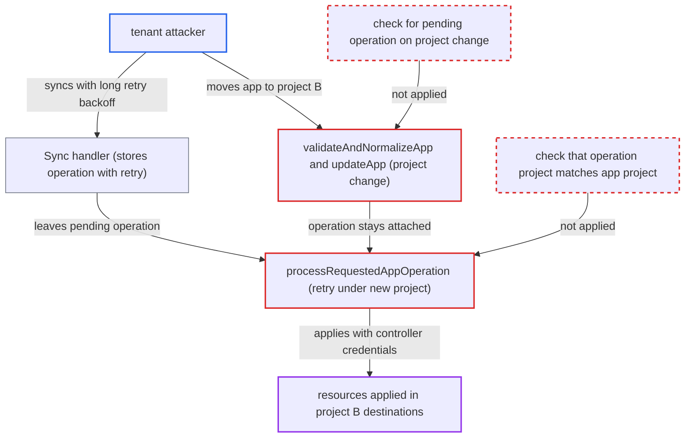

# Pending sync operation survives project change and runs under new project's destinations

| Field | Value |
|---|---|
| ID | `find_014P6kUgCwkEexWwQgChjNjv` |
| Severity | **High** |
| Status | open |
| CWE | CWE-863 — Authorization bypass |
| Created | 2026-10-27T22:03:39.464201Z |
| Claude Security | https://claude.ai/security/findings/find_014P6kUgCwkEexWwQgChjNjv |

## Description

A tenant user can make Argo CD's controller apply resources into another project's namespaces that the tenant was never authorized to sync to. The attacker needs `update` and `sync` on the app in project A, and `create` on the app name in project B. The cause is that a project change via `UpdateSpec`, `Patch` or `Update` leaves a pending sync operation attached. The controller then runs that operation under project B.

1. **attacker** calls `Sync` on app X in project A with a retry strategy. The request uses local manifests or A's source, with resources aimed at B's namespace, and `retryStrategy{limit:1, backoff:{duration:"10m", maxDuration:"10m"}}`. `Sync` checks `sync`, `override` and `sourceIntegrity` against project A and stores the operation. ([`server/application/application.go:2116-2195`](https://github.com/cx-benchmark/argo-cd/blob/b7bc418289a96130340ea79964c4491b416c14f2/server/application/application.go#L2116-L2195))
2. **controller** fails the first attempt and keeps the operation pending. The permission check rejects B's namespace under A, so the operation is marked failed and the request-supplied retry is scheduled. The phase goes back to `Running` and `.operation` is kept. ([`gitops-engine/pkg/sync/sync_context.go:1120-1123`](https://github.com/cx-benchmark/argo-cd/blob/b7bc418289a96130340ea79964c4491b416c14f2/gitops-engine/pkg/sync/sync_context.go#L1120-L1123))
3. **attacker** moves app X to project B with `UpdateSpec` or `Patch`. The guard only needs `create` on `B/X` and `update` on `A/X`. It validates the new spec against B and ignores `currApp.Operation` and `status.operationState`. ([`server/application/application.go:1363-1378`](https://github.com/cx-benchmark/argo-cd/blob/b7bc418289a96130340ea79964c4491b416c14f2/server/application/application.go#L1363-L1378))
4. **`updateApp`** saves the new spec and leaves the pending operation in place. It copies only spec, labels, annotations and finalizers, so the operation authorized under A stays attached to the app. ([`server/application/application.go:1030-1043`](https://github.com/cx-benchmark/argo-cd/blob/b7bc418289a96130340ea79964c4491b416c14f2/server/application/application.go#L1030-L1043))
5. **controller** resumes the operation when the retry is due and loads the app's current project. `processRequestedAppOperation` clears `SyncResult`, keeps the original operation, and `getAppProj` now returns project B, which it passes to `SyncAppState`. ([`controller/appcontroller.go:1668-1733`](https://github.com/cx-benchmark/argo-cd/blob/b7bc418289a96130340ea79964c4491b416c14f2/controller/appcontroller.go#L1668-L1733))
6. **`SyncAppState`** builds the sync from the stored operation's sources and `Manifests`. `newSyncOperationResult` takes the sources from the operation, not the current spec. Nothing checks them against B's `sourceRepos`, and the `override` right is not re-checked. ([`controller/sync.go:137-214`](https://github.com/cx-benchmark/argo-cd/blob/b7bc418289a96130340ea79964c4491b416c14f2/controller/sync.go#L137-L214))
7. **`validateSyncPermissions`** accepts the resources because B permits those kinds and destinations. It checks only B's resource lists and destinations, so the resources that failed under A are applied with the controller's credentials. ([`controller/sync.go:753-777`](https://github.com/cx-benchmark/argo-cd/blob/b7bc418289a96130340ea79964c4491b416c14f2/controller/sync.go#L753-L777))

## Assessment

The attacker is an authenticated tenant with limited RBAC. They hold `update`, `sync` and optionally `override` on `A/X`, plus `create` on `B/X`, and nothing else in B. No race is needed, because the request sets the backoff. `NextRetryAt` caps the wait at 3 minutes by default, but the request may set `backoff.maxDuration` to any value. A long-running hook also keeps the operation `Running`. `Rollback` builds its operation the same way but takes no retry from the request, so it needs a long hook or wave to stay pending. The move can go through `UpdateSpec` or `Patch`, which need only `create` on `B/X` and `update` on `A/X`. `Update` additionally checks `update` in B.

Impact: An operation that B's RBAC never authorized runs under B. It can carry arbitrary local manifests or a repo that only A admits, outside B's `sourceRepos`, and without `sync` or `override` in B. B's source-integrity rules do not apply to A's repo URL. Argo CD's own secrets are not disclosed and its service stays up. This also defeats the purpose of `Create`, which strips `.operation` so operations are authorized only through `Sync`.

Subsequent-system impact: The controller applies the attacker's resources with its own cluster credentials into every namespace B's destinations permit. Any namespaced kind is allowed unless B sets a whitelist. Workloads there can mount that namespace's Secrets, replace or modify B's existing objects, and degrade B's services. Reach is limited to B's destinations and permitted kinds.

## Recommendation

(1) `validateAndNormalizeApp` and `updateApp` let `spec.project` change while `.operation` is set or `status.operationState` is not completed. An operation authorized under the old project then carries into the new one.

Fix criteria: A project change via Update, `UpdateSpec` or `Patch` is refused, or clears or terminates the operation, whenever `.operation != nil` or the operation state is not completed. Verify by starting a sync with a retry backoff or a long-running hook and moving the app to another project. The request must be rejected, or the operation must end without applying anything under the new project.

(2) The controller resumes or retries an operation using the project of the current spec. It does not check that this is the project the operation was authorized under.

Fix criteria: The operation state records the project at initialization. The controller fails the operation without running it when `app.Spec.Project` differs on resume or retry. Verify that an operation initialized under project A, for an app that now reports project B, ends with an error and applies no resources.

## Evidence

**https://github.com/cx-benchmark/argo-cd**

- [`server/application/application.go:1363-1378`](https://github.com/cx-benchmark/argo-cd/blob/b7bc418289a96130340ea79964c4491b416c14f2/server/application/application.go#L1363-L1378)
- [`server/application/application.go:1030-1043`](https://github.com/cx-benchmark/argo-cd/blob/b7bc418289a96130340ea79964c4491b416c14f2/server/application/application.go#L1030-L1043)
- [`server/application/application.go:2116-2195`](https://github.com/cx-benchmark/argo-cd/blob/b7bc418289a96130340ea79964c4491b416c14f2/server/application/application.go#L2116-L2195)
- [`controller/appcontroller.go:1668-1733`](https://github.com/cx-benchmark/argo-cd/blob/b7bc418289a96130340ea79964c4491b416c14f2/controller/appcontroller.go#L1668-L1733)
- [`controller/sync.go:137-214`](https://github.com/cx-benchmark/argo-cd/blob/b7bc418289a96130340ea79964c4491b416c14f2/controller/sync.go#L137-L214)
- [`controller/sync.go:753-777`](https://github.com/cx-benchmark/argo-cd/blob/b7bc418289a96130340ea79964c4491b416c14f2/controller/sync.go#L753-L777)
- [`pkg/apis/application/v1alpha1/types.go:1578-1606`](https://github.com/cx-benchmark/argo-cd/blob/b7bc418289a96130340ea79964c4491b416c14f2/pkg/apis/application/v1alpha1/types.go#L1578-L1606)
- [`gitops-engine/pkg/sync/sync_context.go:1120-1123`](https://github.com/cx-benchmark/argo-cd/blob/b7bc418289a96130340ea79964c4491b416c14f2/gitops-engine/pkg/sync/sync_context.go#L1120-L1123)
- [`server/application/application.go:385-391`](https://github.com/cx-benchmark/argo-cd/blob/b7bc418289a96130340ea79964c4491b416c14f2/server/application/application.go#L385-L391)

