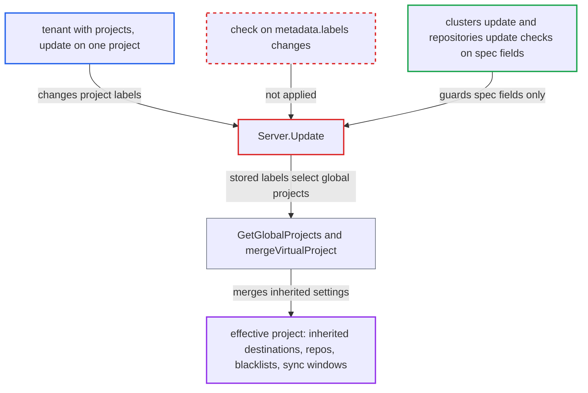

# Project labels editable with only projects/update control global-project inheritance of restrictions

| Field | Value |
|---|---|
| ID | `find_018vUfWZrVn7ru591XAGSYmZ` |
| Severity | **High** |
| Status | open |
| CWE | CWE-863 — Improper Authorization |
| Created | 2026-10-27T21:09:23.871375Z |
| Claude Security | https://claude.ai/security/findings/find_018vUfWZrVn7ru591XAGSYmZ |

## Description

A tenant who may only update their own Argo CD project can widen that project's limits, or lift limits the administrator imposed. This works when `globalProjects` is configured in `argocd-cm`. `Server.Update` saves the caller's `metadata.labels` without checking them, and those labels decide which global projects the project inherits from.

1. **tenant** sends a project update that changes `metadata.labels`. The tenant holds `projects, update, A` but not `clusters, update` or `repositories, update`, and sends `PUT /api/v1/projects/A` with a label that matches, or stops matching, a global project's selector. ([`server/project/project.go:389-465`](https://github.com/cx-benchmark/argo-cd/blob/b7bc418289a96130340ea79964c4491b416c14f2/server/project/project.go#L389-L465))
2. **the handler `Server.Update`** stores the whole `q.Project` including labels. It checks new destinations, new source repos and resource white/blacklist changes, but it never checks label changes. ([`server/project/project.go:389-465`](https://github.com/cx-benchmark/argo-cd/blob/b7bc418289a96130340ea79964c4491b416c14f2/server/project/project.go#L389-L465))
3. **the function `GetGlobalProjects`** picks the global projects by matching the project's own labels against each `labelSelector`. Labels therefore act as an authorization input, and the changed labels change which global projects the project inherits from. ([`util/argo/argo.go:1224-1266`](https://github.com/cx-benchmark/argo-cd/blob/b7bc418289a96130340ea79964c4491b416c14f2/util/argo/argo.go#L1224-L1266))
4. **the function `mergeVirtualProject`** merges the chosen global projects into the project's effective settings. It appends `sourceRepos`, `destinations`, `destinationServiceAccounts`, resource whitelists and blacklists, and `syncWindows`, so the project gains broader access or loses restrictions. ([`util/argo/argo.go:1278-1297`](https://github.com/cx-benchmark/argo-cd/blob/b7bc418289a96130340ea79964c4491b416c14f2/util/argo/argo.go#L1278-L1297))
5. **the controller and application server** enforce the merged project through `GetAppProjectByName` and `GetAppProject`. Applications in the project are validated and synced against the merged project, so they can use the inherited destinations and repos or are no longer bound by the global blacklists and sync windows. ([`util/argo/argo.go:855-895`](https://github.com/cx-benchmark/argo-cd/blob/b7bc418289a96130340ea79964c4491b416c14f2/util/argo/argo.go#L855-L895))

## Assessment

The attacker is a tenant whose RBAC grants `projects, update, A`, and normally `applications, *, A/*`, but not `clusters, update` or `repositories, update` on the target resources. The installation must have configured `globalProjects`. The tenant adds a label that matches a global project with broader `destinations`, `sourceRepos` or `clusterResourceWhitelist`. Or the tenant removes a label, or adds one for `NotIn` and `DoesNotExist` selectors, so the project stops matching a global project that imposes `namespaceResourceBlacklist`, `clusterResourceBlacklist` or `syncWindows`. `Create` is not affected in a meaningful way, because `projects, create` already allows any spec and the upsert branch copies only `Spec`.

Impact: The tenant gets the same widening that the spec-field guards in `Server.Update` exist to prevent. Repos and clusters granted to the global project become usable from the tenant's project, including private repos read with Argo CD's stored credentials. Administrator-imposed resource blacklists and sync windows can be dropped. The configured global projects bound the impact, and control-plane availability is not affected.

Subsequent-system impact: Through inherited destinations, the tenant's manifests are applied with the controller's cluster credentials to clusters and namespaces they were never granted. With an inherited cluster whitelist, or with blacklists that no longer apply, they can create resource kinds such as RBAC objects there. That can lead to control of the target cluster's workloads and secrets.

## Recommendation

`Server.Update` accepts arbitrary `metadata.labels` from a caller with only `projects, update`. Those labels decide global-project inheritance of destinations, repos, resource lists and sync windows.

Fix criteria: A caller without the permissions needed to set the inherited fields directly cannot change which global projects `GetGlobalProjects` returns for a project. A test shows that a `projects, update`-only caller who adds or removes a selector-matching label is refused, or that the effective virtual project is unchanged. Admins can still manage the labels.

## Evidence

**https://github.com/cx-benchmark/argo-cd**

- [`server/project/project.go:389-465`](https://github.com/cx-benchmark/argo-cd/blob/b7bc418289a96130340ea79964c4491b416c14f2/server/project/project.go#L389-L465)
- [`util/argo/argo.go:1224-1266`](https://github.com/cx-benchmark/argo-cd/blob/b7bc418289a96130340ea79964c4491b416c14f2/util/argo/argo.go#L1224-L1266)
- [`util/argo/argo.go:1278-1297`](https://github.com/cx-benchmark/argo-cd/blob/b7bc418289a96130340ea79964c4491b416c14f2/util/argo/argo.go#L1278-L1297)
- [`util/argo/argo.go:855-895`](https://github.com/cx-benchmark/argo-cd/blob/b7bc418289a96130340ea79964c4491b416c14f2/util/argo/argo.go#L855-L895)

