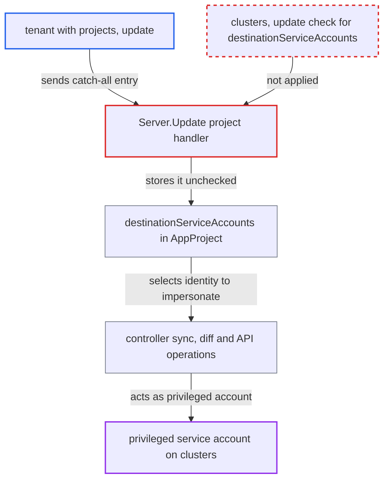

# Project Update lets projects-update holders change sync impersonation service accounts without cluster authorization

| Field | Value |
|---|---|
| ID | `find_01744tmaEkqa84Sb3qwztqNG` |
| Severity | **High** |
| Status | open |
| CWE | CWE-863 — Incorrect Authorization |
| Created | 2026-10-27T21:11:49.308983Z |
| Claude Security | https://claude.ai/security/findings/find_01744tmaEkqa84Sb3qwztqNG |

## Description

A tenant who can edit a project but lacks cluster rights can make Argo CD sync their applications with a far more privileged Kubernetes identity. This only applies when `application.sync.impersonation.enabled` is set in `argocd-cm`. The cause is `Server.Update`, which never checks changes to `destinationServiceAccounts` against `clusters, update`. Argo CD's own project allowlists still apply.

1. **tenant with `projects, update`** sends a project update with a new first `destinationServiceAccounts` entry. The entry is a catch-all with `server` and `namespace` set to `*` and `defaultServiceAccount` set to `argocd:argocd-application-controller`, in a `PUT /api/v1/projects/A` request.
2. **the handler `Server.Update`** saves the project without checking the service-account field. It requires `clusters, update` only for changed destination servers and for white/blacklist changes, then writes `q.Project` whole at line 465. ([`server/project/project.go:389-465`](https://github.com/cx-benchmark/argo-cd/blob/b7bc418289a96130340ea79964c4491b416c14f2/server/project/project.go#L389-L465))
3. **`ValidateProject`** accepts the new entry. It checks only characters, glob syntax and uniqueness, not which service account or namespace is named. ([`pkg/apis/application/v1alpha1/app_project_types.go:290-319`](https://github.com/cx-benchmark/argo-cd/blob/b7bc418289a96130340ea79964c4491b416c14f2/pkg/apis/application/v1alpha1/app_project_types.go#L290-L319))
4. **`DeriveServiceAccountToImpersonate`** picks the tenant's entry as the first match. The first entry whose `server` and `namespace` globs match wins, and a `<ns>:<name>` value can name a service account in any namespace. The project's own entries also come before inherited global ones. ([`util/settings/impersonation.go:19-50`](https://github.com/cx-benchmark/argo-cd/blob/b7bc418289a96130340ea79964c4491b416c14f2/util/settings/impersonation.go#L19-L50))
5. **the application controller** syncs, diffs and runs hooks as the chosen service account. With impersonation enabled, sync sets `Impersonate` to the derived account. The controller's `*/*` ClusterRole allows impersonating it. ([`controller/sync.go:338-386`](https://github.com/cx-benchmark/argo-cd/blob/b7bc418289a96130340ea79964c4491b416c14f2/controller/sync.go#L338-L386))

## Assessment

The attacker is a tenant holding `projects, update` on project A, for example to manage project roles, but not `clusters, update`. They also need sync rights, or auto-sync, on an application in A. The administrator must have enabled `application.sync.impersonation.enabled` and mapped A to a restricted service account. The tenant can name `argocd:argocd-application-controller` or `kube-system:argocd-manager`, because the shipped controller ClusterRole and the `argocd-manager` rules are `*/*`. Where enforcement is off, the tenant can instead remove the entries, and the controller then falls back to its own credential. The swapped identity is used for sync and hooks, server-side diff, app deletion and API resource operations.

Impact: The tenant undoes the least-privilege sync identity the administrator set up. Argo CD then applies their manifests, hooks and resource actions with the controller's Kubernetes privileges. Argo CD's own project checks on destinations and resource kinds still apply.

Subsequent-system impact: On destination clusters the tenant's resources are applied as a privileged service account instead of the restricted one. Within the project's permitted namespaces and kinds, they can create RoleBindings, read Secrets through workloads they deploy, and change resources the restricted account was denied. If the project has broad destinations, as the docs example with `destinations: '*'` does, this can reach other tenants' namespaces.

## Recommendation

`Server.Update` does not treat `spec.destinationServiceAccounts` as a cluster-affecting field. A caller with only `projects, update` can therefore choose the Kubernetes identity Argo CD impersonates.

Fix criteria: A caller without `clusters, update` on the affected clusters is refused when an update adds, removes, reorders or changes any `destinationServiceAccounts` entry compared with the stored project. Entries with glob `server` patterns are checked against every cluster they can match. The `PUT /api/v1/projects/A` request from the attack returns permission denied and the derived service account is unchanged. An authorized admin can still edit the field.

## Evidence

**https://github.com/cx-benchmark/argo-cd**

- [`server/project/project.go:389-465`](https://github.com/cx-benchmark/argo-cd/blob/b7bc418289a96130340ea79964c4491b416c14f2/server/project/project.go#L389-L465)
- [`util/settings/impersonation.go:19-50`](https://github.com/cx-benchmark/argo-cd/blob/b7bc418289a96130340ea79964c4491b416c14f2/util/settings/impersonation.go#L19-L50)
- [`controller/sync.go:338-386`](https://github.com/cx-benchmark/argo-cd/blob/b7bc418289a96130340ea79964c4491b416c14f2/controller/sync.go#L338-L386)
- [`controller/sync.go:96-130`](https://github.com/cx-benchmark/argo-cd/blob/b7bc418289a96130340ea79964c4491b416c14f2/controller/sync.go#L96-L130)
- [`server/application/application.go:1417-1460`](https://github.com/cx-benchmark/argo-cd/blob/b7bc418289a96130340ea79964c4491b416c14f2/server/application/application.go#L1417-L1460)
- [`util/argo/argo.go:1294`](https://github.com/cx-benchmark/argo-cd/blob/b7bc418289a96130340ea79964c4491b416c14f2/util/argo/argo.go#L1294)
- [`pkg/apis/application/v1alpha1/app_project_types.go:290-319`](https://github.com/cx-benchmark/argo-cd/blob/b7bc418289a96130340ea79964c4491b416c14f2/pkg/apis/application/v1alpha1/app_project_types.go#L290-L319)
- [`manifests/cluster-rbac/application-controller/argocd-application-controller-clusterrole.yaml:9-18`](https://github.com/cx-benchmark/argo-cd/blob/b7bc418289a96130340ea79964c4491b416c14f2/manifests/cluster-rbac/application-controller/argocd-application-controller-clusterrole.yaml#L9-L18)
- [`util/clusterauth/clusterauth.go:30-40`](https://github.com/cx-benchmark/argo-cd/blob/b7bc418289a96130340ea79964c4491b416c14f2/util/clusterauth/clusterauth.go#L30-L40)

