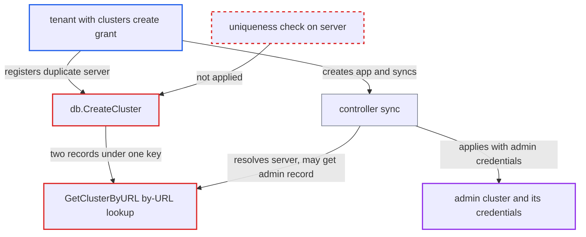

# Project-scoped cluster duplicating an admin cluster's server URL lets tenant deploy with admin credentials

| Field | Value |
|---|---|
| ID | `find_01E7YCLaqwPpxA8CaNsvnVzx` |
| Severity | **High** |
| Status | open |
| CWE | CWE-694 — Duplicate resource identifier |
| Created | 2026-10-27T21:26:00.343949Z |
| Claude Security | https://claude.ai/security/findings/find_01E7YCLaqwPpxA8CaNsvnVzx |

## Description

A tenant who may register clusters in their own project can deploy to a cluster the admin registered, in any namespace, using the admin's stored credentials. The tenant needs the `clusters, create, <proj>/*` grant plus permission to create and sync applications in that project. The cause is that `db.CreateCluster` never checks whether another record already holds the same `server`. Lookups by server URL, such as `GetClusterByURL`, then pick one of the duplicates.

1. **tenant** registers a project-scoped cluster with the admin cluster's server URL. The `POST /api/v1/clusters` call carries `project: <proj>` and `{tlsClientConfig:{insecure:true}}`, and the grant `clusters, create, <proj>/*` allows it. ([`server/cluster/cluster.go:144-160`](https://github.com/cx-benchmark/argo-cd/blob/b7bc418289a96130340ea79964c4491b416c14f2/server/cluster/cluster.go#L144-L160))
2. **API `Create`** probes the server with the tenant's own config and calls `db.CreateCluster`. The `GetServerVersion` probe passes anonymously or with the tenant's own token, and nothing checks for an existing record with that server. ([`server/cluster/cluster.go:144-160`](https://github.com/cx-benchmark/argo-cd/blob/b7bc418289a96130340ea79964c4491b416c14f2/server/cluster/cluster.go#L144-L160))
3. **`db.CreateCluster`** accepts the duplicate record. It rejects only a Secret-name collision. A custom-named admin Secret never collides, and for an API/CLI-added admin cluster `URIToSecretName` hashes the raw URI, so `https://prod.example.com/` gets a new name while `clusterToSecret` stores the same trimmed `server`. ([`util/db/cluster.go:107-140`](https://github.com/cx-benchmark/argo-cd/blob/b7bc418289a96130340ea79964c4491b416c14f2/util/db/cluster.go#L107-L140))
4. **`GetAppProjectByName`** adds the admin's server to the tenant project's destinations. For the project-scoped record it appends `{server: <admin server>, namespace: "*"}`, and `IsDestinationPermitted` compares only the server, not which record is meant. ([`util/argo/argo.go:868-878`](https://github.com/cx-benchmark/argo-cd/blob/b7bc418289a96130340ea79964c4491b416c14f2/util/argo/argo.go#L868-L878))
5. **tenant** creates an Application in the project targeting that server and a namespace such as `kube-system`, then syncs it. The destination check passes because the server is now a permitted destination of the project. ([`pkg/apis/application/v1alpha1/app_project_types.go:483-515`](https://github.com/cx-benchmark/argo-cd/blob/b7bc418289a96130340ea79964c4491b416c14f2/pkg/apis/application/v1alpha1/app_project_types.go#L483-L515))
6. **`GetClusterByURL`** returns `items[0]` of the records sharing the server. It does not detect duplicates, and the report assumes the order of duplicates is unspecified and changes between calls, so the tenant retries the sync until the admin record is picked. ([`util/settings/cluster_informer.go:123-140`](https://github.com/cx-benchmark/argo-cd/blob/b7bc418289a96130340ea79964c4491b416c14f2/util/settings/cluster_informer.go#L123-L140))
7. **the controller sync** applies the tenant's manifests with the admin record's `RawRestConfig()`/`RESTConfig()`. The manifests land in any namespace of the admin cluster with the admin's stored credentials. ([`controller/sync.go:244-264`](https://github.com/cx-benchmark/argo-cd/blob/b7bc418289a96130340ea79964c4491b416c14f2/controller/sync.go#L244-L264))

## Assessment

The attacker is a tenant with the documented self-service grant `clusters, create, <proj>/*` and also `applications, create/sync` in `<proj>`. There are two ways to get a duplicate record. First, the admin cluster is declared as a Secret with a custom name, such as the documented `mycluster-secret` style, so even the exact URL is accepted. Second, the admin cluster was added via API/CLI, so the tenant adds the same URL with a trailing slash (`https://prod.example.com/`) and gets a different Secret name but the same stored `server`. Because the pick between duplicates is unspecified, the tenant may need to retry the sync until the admin record is used.

Impact: The tenant's project gains a wildcard destination on a cluster the admin never granted, and Argo CD applies the tenant's manifests there with the admin's stored credentials. Only the project's resource-kind allow and deny lists limit what can be applied. Other projects' apps on that server can resolve to the tenant's credential-less record and fail to sync. No Argo CD secret is disclosed directly.

Subsequent-system impact: The admin-registered target cluster is a separate system. The tenant's manifests are applied there in any namespace, for example `kube-system`, with the admin's stored credentials, which are typically cluster-admin. Workloads or RoleBindings in privileged namespaces let the tenant read secrets on that cluster, modify it and disrupt it.

## Recommendation

(1) `db.CreateCluster`, the API `Create` and update-to-create accept a record whose server is already held by another record. The only guard is the Secret-name check, which is computed from the un-normalised URI while the stored and indexed server is normalised.

Fix criteria: Server URLs are normalised the same way for the Secret name, storage and indexing. Creating or updating to a server already held by any other cluster record, global or in another project, is refused. A user with only `clusters, create, my-project/*` gets an error for both `https://prod.example.com` and `https://prod.example.com/` when an admin record for that server exists under any Secret name.

(2) Server-keyed lookups such as `GetClusterByURL` and the controller cache silently pick one of several records sharing a server. A project-scoped record can make a server a permitted destination while another record's credentials are used for the sync.

Fix criteria: A server shared by several records causes an error instead of an arbitrary pick. The credentials used for an Application come from a record its project is entitled to. With a pre-existing duplicate, `db.GetCluster` fails, and a tenant Application cannot be synced with the admin record's credentials.

## Evidence

**https://github.com/cx-benchmark/argo-cd**

- [`util/db/cluster.go:107-140`](https://github.com/cx-benchmark/argo-cd/blob/b7bc418289a96130340ea79964c4491b416c14f2/util/db/cluster.go#L107-L140)
- [`util/db/secrets.go:179-202`](https://github.com/cx-benchmark/argo-cd/blob/b7bc418289a96130340ea79964c4491b416c14f2/util/db/secrets.go#L179-L202)
- [`util/db/cluster.go:379-382`](https://github.com/cx-benchmark/argo-cd/blob/b7bc418289a96130340ea79964c4491b416c14f2/util/db/cluster.go#L379-L382)
- [`server/cluster/cluster.go:144-160`](https://github.com/cx-benchmark/argo-cd/blob/b7bc418289a96130340ea79964c4491b416c14f2/server/cluster/cluster.go#L144-L160)
- [`util/settings/cluster_informer.go:123-140`](https://github.com/cx-benchmark/argo-cd/blob/b7bc418289a96130340ea79964c4491b416c14f2/util/settings/cluster_informer.go#L123-L140)
- [`util/argo/argo.go:868-878`](https://github.com/cx-benchmark/argo-cd/blob/b7bc418289a96130340ea79964c4491b416c14f2/util/argo/argo.go#L868-L878)
- [`pkg/apis/application/v1alpha1/app_project_types.go:483-515`](https://github.com/cx-benchmark/argo-cd/blob/b7bc418289a96130340ea79964c4491b416c14f2/pkg/apis/application/v1alpha1/app_project_types.go#L483-L515)
- [`util/argo/argo.go:1209-1222`](https://github.com/cx-benchmark/argo-cd/blob/b7bc418289a96130340ea79964c4491b416c14f2/util/argo/argo.go#L1209-L1222)
- [`controller/sync.go:244-264`](https://github.com/cx-benchmark/argo-cd/blob/b7bc418289a96130340ea79964c4491b416c14f2/controller/sync.go#L244-L264)
- [`controller/cache/cache.go:504-519`](https://github.com/cx-benchmark/argo-cd/blob/b7bc418289a96130340ea79964c4491b416c14f2/controller/cache/cache.go#L504-L519)
- [`docs/user-guide/projects.md:378-399`](https://github.com/cx-benchmark/argo-cd/blob/b7bc418289a96130340ea79964c4491b416c14f2/docs/user-guide/projects.md#L378-L399)

