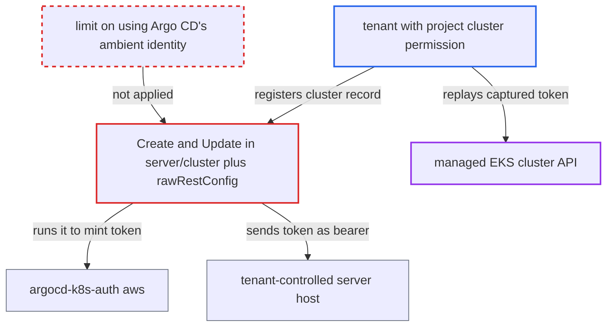

# Project-scoped cluster registration relays Argo CD's own AWS/cloud identity token to tenant-chosen server

| Field | Value |
|---|---|
| ID | `find_017tP4U5wyeNTm9foQWEHzBi` |
| Severity | **High** |
| Status | open |
| CWE | CWE-522 — Insufficiently protected credentials |
| Created | 2026-10-27T21:15:53.229093Z |
| Claude Security | https://claude.ai/security/findings/find_017tP4U5wyeNTm9foQWEHzBi |

## Description

A tenant with project-scoped cluster permission can make Argo CD send its own cloud identity token to a server the tenant controls. In the documented EKS setup, replaying that token gives cluster-admin on any managed EKS cluster. It needs `clusters, create` or `update` on `<project>/*`. `rawRestConfig` lets the cluster record choose both the identity and the destination host, and the API handlers use it at once.

1. **tenant** sends a cluster record naming their own server and Argo CD's AWS identity. The record has `server: https://attacker.example`, a `project`, and `config.awsAuthConfig` with a victim EKS `clusterName` and the `roleARN` of that cluster's Argo CD role. ([`server/cluster/cluster.go:144-157`](https://github.com/cx-benchmark/argo-cd/blob/b7bc418289a96130340ea79964c4491b416c14f2/server/cluster/cluster.go#L144-L157))
2. **the handler `Create` in `server/cluster/cluster.go`** accepts the record after one permission check and uses it straight away. It checks only `clusters, create` on `<project>/<server>`, then calls `RESTConfig()` and `GetServerVersion` before validating or storing anything. `Update` does the same. ([`server/cluster/cluster.go:144-157`](https://github.com/cx-benchmark/argo-cd/blob/b7bc418289a96130340ea79964c4491b416c14f2/server/cluster/cluster.go#L144-L157))
3. **`Cluster.rawRestConfig()`** builds an exec provider that runs `argocd-k8s-auth aws` with the record's values. `Host`, the TLS settings (including `Insecure`), `--cluster-name`, `--role-arn` and `--profile` all come from the caller-supplied record, and nothing ties them to the caller's privileges. ([`pkg/apis/application/v1alpha1/types.go:4314-4339`](https://github.com/cx-benchmark/argo-cd/blob/b7bc418289a96130340ea79964c4491b416c14f2/pkg/apis/application/v1alpha1/types.go#L4314-L4339))
4. **`argocd-k8s-auth aws`** mints an EKS bearer token from the pod's own AWS credentials. It optionally assumes the record's `roleARN` first. The token is valid for 15 minutes and is bound only to the cluster name, not to the endpoint that receives it. ([`cmd/argocd-k8s-auth/commands/aws.go:104-126`](https://github.com/cx-benchmark/argo-cd/blob/b7bc418289a96130340ea79964c4491b416c14f2/cmd/argocd-k8s-auth/commands/aws.go#L104-L126))
5. **`GetServerVersion`** sends the token in an `Authorization: Bearer` header to the tenant's host. The discovery call `ServerVersion()` is a plain HTTP GET to the host named in the record, so the tenant's listener receives the token. ([`gitops-engine/pkg/utils/kube/ctl.go:359-366`](https://github.com/cx-benchmark/argo-cd/blob/b7bc418289a96130340ea79964c4491b416c14f2/gitops-engine/pkg/utils/kube/ctl.go#L359-L366))
6. **tenant** replays the captured token against the real EKS API endpoint. In the documented setup the role behind the token is mapped to `AmazonEKSClusterAdminPolicy`, so the token acts as cluster-admin on that cluster. ([`docs/operator-manual/declarative-setup.md:750-880`](https://github.com/cx-benchmark/argo-cd/blob/b7bc418289a96130340ea79964c4491b416c14f2/docs/operator-manual/declarative-setup.md#L750-L880))

## Assessment

The attacker is an authenticated tenant whose project role holds `clusters, create` (or `update`) on `<proj>/*`, which is the documented self-service setup. Any holder of `projects, update` can also add that permission. The attacker runs an HTTPS listener and calls `POST /api/v1/clusters`. The attack needs Argo CD pods that hold an AWS identity trusted by the target clusters, as in the documented EKS setup. The attacker also needs network reach to the target EKS API endpoint. A second route is the application controller. Once the record is stored and an Application in the project targets the cluster, the controller builds its cluster cache from `RESTConfig()` and sends its own identity token to the same host (`controller/cache/cache.go:540`). A third route uses `execProviderConfig` naming `argocd-k8s-auth gcp` or `azure`. It relays Argo CD's GCP or Azure workload-identity tokens the same way, even where exec commands are limited to `argocd-k8s-auth`. Users with `clusters, get` can see `awsAuthConfig` through `Sanitized()`, which helps pick targets, but it is not needed because cluster names and role ARNs are not secrets.

Impact: The attacker obtains a live token for Argo CD's cloud identity, or for any role it may assume, for any EKS cluster name they choose. Argo CD's own data and service are not modified by this step.

Subsequent-system impact: Replayed against a managed EKS cluster, the token authenticates as Argo CD's cluster role, which the documented setup maps to `AmazonEKSClusterAdminPolicy`. The tenant can read secrets and create or delete arbitrary workloads on clusters outside their project's destinations. GCP tokens carry `cloud-platform` scope for Argo CD's service account.

## Recommendation

`rawRestConfig` lets a cluster record select Argo CD's own cloud identity (`awsAuthConfig`, or `execProviderConfig` naming `argocd-k8s-auth aws|gcp|azure`) and also the server and TLS settings the token is sent to. `server/cluster` `Create` and `Update` accept such records from project-scoped, non-admin callers and test them at once.

Fix criteria: A cluster record created or updated through the API by a caller without global cluster-admin privilege cannot make Argo CD mint tokens from its own workload identity, and only credentials the caller supplies are used. Where ambient identity is allowed, it is sent only to endpoints the operator has authorized for that identity, with TLS verification enforced. A project-role token with `clusters, create, <proj>/*` cannot register or update a cluster with `awsAuthConfig` or an `argocd-k8s-auth` exec provider. No `argocd-k8s-auth` run and no outbound request to the supplied `server` happens for such a request.

## Evidence

**https://github.com/cx-benchmark/argo-cd**

- [`pkg/apis/application/v1alpha1/types.go:4314-4339`](https://github.com/cx-benchmark/argo-cd/blob/b7bc418289a96130340ea79964c4491b416c14f2/pkg/apis/application/v1alpha1/types.go#L4314-L4339)
- [`server/cluster/cluster.go:144-157`](https://github.com/cx-benchmark/argo-cd/blob/b7bc418289a96130340ea79964c4491b416c14f2/server/cluster/cluster.go#L144-L157)
- [`server/cluster/cluster.go:297-329`](https://github.com/cx-benchmark/argo-cd/blob/b7bc418289a96130340ea79964c4491b416c14f2/server/cluster/cluster.go#L297-L329)
- [`cmd/argocd-k8s-auth/commands/aws.go:104-126`](https://github.com/cx-benchmark/argo-cd/blob/b7bc418289a96130340ea79964c4491b416c14f2/cmd/argocd-k8s-auth/commands/aws.go#L104-L126)
- [`gitops-engine/pkg/utils/kube/ctl.go:359-366`](https://github.com/cx-benchmark/argo-cd/blob/b7bc418289a96130340ea79964c4491b416c14f2/gitops-engine/pkg/utils/kube/ctl.go#L359-L366)
- [`util/rbac/rbac.go:114-121`](https://github.com/cx-benchmark/argo-cd/blob/b7bc418289a96130340ea79964c4491b416c14f2/util/rbac/rbac.go#L114-L121)
- [`docs/operator-manual/declarative-setup.md:750-880`](https://github.com/cx-benchmark/argo-cd/blob/b7bc418289a96130340ea79964c4491b416c14f2/docs/operator-manual/declarative-setup.md#L750-L880)
- [`docs/user-guide/projects.md:376-400`](https://github.com/cx-benchmark/argo-cd/blob/b7bc418289a96130340ea79964c4491b416c14f2/docs/user-guide/projects.md#L376-L400)
- [`controller/cache/cache.go:540-543`](https://github.com/cx-benchmark/argo-cd/blob/b7bc418289a96130340ea79964c4491b416c14f2/controller/cache/cache.go#L540-L543)
- [`pkg/apis/application/v1alpha1/types.go:2373-2389`](https://github.com/cx-benchmark/argo-cd/blob/b7bc418289a96130340ea79964c4491b416c14f2/pkg/apis/application/v1alpha1/types.go#L2373-L2389)
- [`cmd/argocd-k8s-auth/commands/gcp.go:24-40`](https://github.com/cx-benchmark/argo-cd/blob/b7bc418289a96130340ea79964c4491b416c14f2/cmd/argocd-k8s-auth/commands/gcp.go#L24-L40)

