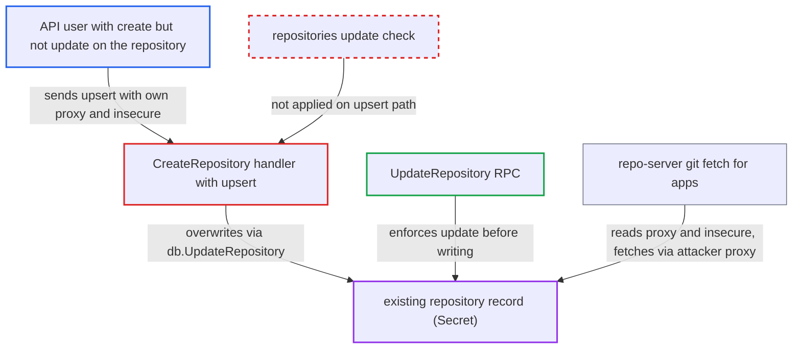

# Repository create with upsert overwrites existing record without 'update' RBAC check

| Field | Value |
|---|---|
| ID | `find_01Q3FwKE9KTCXvwbpsZNv7ia` |
| Severity | **High** |
| Status | open |
| CWE | CWE-862 — Missing authorization |
| Created | 2026-10-27T21:42:38.588620Z |
| Claude Security | https://claude.ai/security/findings/find_01Q3FwKE9KTCXvwbpsZNv7ia |

## Description

A user who can only create repository records in Argo CD can overwrite an existing repository record they have no right to change. They can swap its proxy, TLS settings and credentials, so apps using that repository may fetch manifests through the attacker's proxy. The attacker needs `repositories, create` on the target but not `update`, and sends `upsert=true`. `CreateRepository` checks only `create` and then calls `s.db.UpdateRepository` without any `repositories, update` check.

1. **attacker** sends a create request with upsert enabled for an existing repository. The request is `POST /api/v1/repositories?upsert=true` (or `argocd repo add --upsert`). It uses the existing record's URL and project, sets `proxy` to the attacker's host and sets `insecure=true`.
2. **the handler `CreateRepository`** checks only the create permission. The only RBAC check is `repositories, create` on `createRBACObject(q.Repo.Project, q.Repo.Repo)`, and the attacker holds that grant. ([`server/repository/repository.go:441`](https://github.com/cx-benchmark/argo-cd/blob/b7bc418289a96130340ea79964c4491b416c14f2/server/repository/repository.go#L441))
3. **`db.CreateRepository`** reports that the record already exists. It returns `AlreadyExists` when a record with the same normalized URL and the same project is stored, and that is the record the attacker named. ([`util/db/repository.go:58-70`](https://github.com/cx-benchmark/argo-cd/blob/b7bc418289a96130340ea79964c4491b416c14f2/util/db/repository.go#L58-L70))
4. **the handler `CreateRepository`** calls `s.db.UpdateRepository` directly. Because `q.Upsert` is set, the handler overwrites the existing record without checking `repositories, update`. The dedicated `UpdateRepository` RPC does make that check. ([`server/repository/repository.go:481-483`](https://github.com/cx-benchmark/argo-cd/blob/b7bc418289a96130340ea79964c4491b416c14f2/server/repository/repository.go#L481-L483))
5. **`secretsRepositoryBackend.UpdateRepository`** rewrites the stored Secret with the caller's values. `updateSecretString` overwrites every key already present, even with an empty value. Credentials, `insecure`, `proxy`, `noProxy` and `type` are all replaced, and neither this backend nor `db.UpdateRepository` checks authorization. ([`util/db/repository_secrets.go:134-151`](https://github.com/cx-benchmark/argo-cd/blob/b7bc418289a96130340ea79964c4491b416c14f2/util/db/repository_secrets.go#L134-L151))
6. **repo-server** fetches the repository through the attacker's proxy without TLS verification. With `insecure` set, git runs with `GIT_SSL_NO_VERIFY=true` and the record's proxy settings, so the attacker's proxy can serve arbitrary content for the URL. ([`util/git/client.go:2259-2277`](https://github.com/cx-benchmark/argo-cd/blob/b7bc418289a96130340ea79964c4491b416c14f2/util/git/client.go#L2259-L2277))

## Assessment

The attacker is an authenticated Argo CD API user, such as a tenant with limited RBAC. They hold `repositories, create` on `<proj>/<url>` or on a global `<url>`. They hold neither `update` nor `delete` on an existing record there, and that record must already exist. A caller who also has `delete` can already delete and re-create the record, so gains nothing. A caller with project-scoped `create` can already shadow a global record for their own project by creating a project-scoped one. The new gap is overwriting a record that `create` alone cannot touch: an existing project-scoped record in the project, or an existing global record that every project without its own record for that URL uses. The example in `docs/user-guide/projects.md` also grants `delete` on `my-project/*`, so that exact configuration gains nothing. A second route is `CreateWriteRepository`, which has the same gap with `write-repositories, create`. It needs the non-default hydrator enabled, and the new spec must pass `testRepo`. For project-scoped records `testRepo` is skipped in `CreateRepository`, so nothing checks the new settings.

Impact: The attacker replaces the credentials, TLS and host-key verification, proxy and type of a repository record they may only create. Apps using that URL then fetch through the attacker's proxy with TLS verification off, so the attacker chooses the manifests Argo CD renders for them. Bad credentials can also break reconciliation for apps using that URL. Stored secrets are overwritten, not read.

Subsequent-system impact: The application-controller applies the manifests served through the attacker's proxy to the project's destination clusters, using Argo CD's cluster credentials. The attacker can deploy or prune workloads there, including pods that read secrets in the permitted namespaces. The project's destination and resource allowlists limit this. For manually synced apps, someone must also trigger a sync.

## Recommendation

(1) `CreateRepository` overwrites an existing record on the upsert path by calling `s.db.UpdateRepository` after checking only `repositories, create`. A caller without `repositories, update` on the existing `<project>/<url>` record can therefore replace it.

Fix criteria: Before an existing repository record is overwritten on the upsert path, the caller must hold `repositories, update` on that record's `<project>/<url>`. This can be done by routing through the server's `UpdateRepository` or by enforcing the same check. Test: a principal with only `repositories, create, p/*` sending `upsert=true` for an existing `p/<url>` record gets PermissionDenied and the Secret is unchanged. A principal with `update` still succeeds.

(2) `CreateWriteRepository` has the same gap for write repositories. Its upsert calls `s.db.UpdateWriteRepository` after checking only `write-repositories, create`.

Fix criteria: The upsert overwrite of an existing write-repository record requires `write-repositories, update` on the existing record. Test: a principal with only `write-repositories, create` cannot change an existing write repository via `upsert=true`.

## Evidence

**https://github.com/cx-benchmark/argo-cd**

- [`server/repository/repository.go:481-483`](https://github.com/cx-benchmark/argo-cd/blob/b7bc418289a96130340ea79964c4491b416c14f2/server/repository/repository.go#L481-L483)
- [`server/repository/repository.go:441`](https://github.com/cx-benchmark/argo-cd/blob/b7bc418289a96130340ea79964c4491b416c14f2/server/repository/repository.go#L441)
- [`server/repository/repository.go:527-528`](https://github.com/cx-benchmark/argo-cd/blob/b7bc418289a96130340ea79964c4491b416c14f2/server/repository/repository.go#L527-L528)
- [`server/repository/repository.go:556-565`](https://github.com/cx-benchmark/argo-cd/blob/b7bc418289a96130340ea79964c4491b416c14f2/server/repository/repository.go#L556-L565)
- [`util/db/repository.go:207-216`](https://github.com/cx-benchmark/argo-cd/blob/b7bc418289a96130340ea79964c4491b416c14f2/util/db/repository.go#L207-L216)
- [`util/db/repository_secrets.go:134-151`](https://github.com/cx-benchmark/argo-cd/blob/b7bc418289a96130340ea79964c4491b416c14f2/util/db/repository_secrets.go#L134-L151)
- [`util/db/secrets.go:79-83`](https://github.com/cx-benchmark/argo-cd/blob/b7bc418289a96130340ea79964c4491b416c14f2/util/db/secrets.go#L79-L83)
- [`util/db/repository.go:58-70`](https://github.com/cx-benchmark/argo-cd/blob/b7bc418289a96130340ea79964c4491b416c14f2/util/db/repository.go#L58-L70)
- [`util/db/repository_secrets.go:568-602`](https://github.com/cx-benchmark/argo-cd/blob/b7bc418289a96130340ea79964c4491b416c14f2/util/db/repository_secrets.go#L568-L602)
- [`controller/state.go:501`](https://github.com/cx-benchmark/argo-cd/blob/b7bc418289a96130340ea79964c4491b416c14f2/controller/state.go#L501)
- [`reposerver/repository/repository.go:3033`](https://github.com/cx-benchmark/argo-cd/blob/b7bc418289a96130340ea79964c4491b416c14f2/reposerver/repository/repository.go#L3033)
- [`util/git/client.go:2259-2277`](https://github.com/cx-benchmark/argo-cd/blob/b7bc418289a96130340ea79964c4491b416c14f2/util/git/client.go#L2259-L2277)
- [`server/cluster/cluster.go:170-174`](https://github.com/cx-benchmark/argo-cd/blob/b7bc418289a96130340ea79964c4491b416c14f2/server/cluster/cluster.go#L170-L174)
- [`server/repocreds/repocreds.go:111-115`](https://github.com/cx-benchmark/argo-cd/blob/b7bc418289a96130340ea79964c4491b416c14f2/server/repocreds/repocreds.go#L111-L115)
- [`docs/user-guide/projects.md:385-397`](https://github.com/cx-benchmark/argo-cd/blob/b7bc418289a96130340ea79964c4491b416c14f2/docs/user-guide/projects.md#L385-L397)

