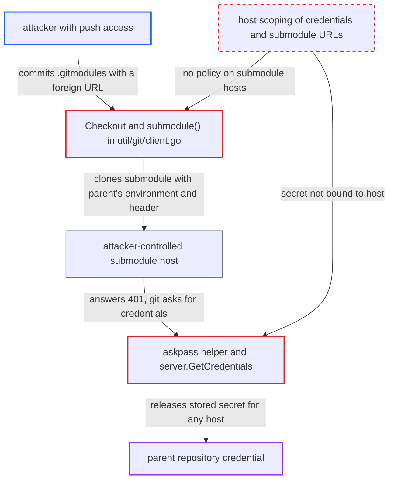

# Repository credentials forwarded to attacker-chosen submodule hosts via unscoped askpass

| Field | Value |
|---|---|
| ID | `find_01Hajxwnjjj5oHXEY1eNcPMU` |
| Severity | **High** |
| Status | open |
| CWE | CWE-522 — Credential exposure |
| Created | 2026-10-27T21:28:59.546380Z |
| Claude Security | https://claude.ai/security/findings/find_01Hajxwnjjj5oHXEY1eNcPMU |

## Description

Anyone who can push to a repository that Argo CD fetches with stored HTTPS credentials can steal the credential for that repository. It works in the default configuration, because submodule support is on by default. `.gitmodules` can point at any host, and the repo-server offers the parent's credential to that host. The weak spots are `nativeGitClient.Checkout` and `submodule()`, and the askpass helper and `server.GetCredentials`, which never tie a secret to a host.

1. **attacker with push access** commits a `.gitmodules` file and a gitlink to the repository. The submodule `url` is `https://attacker.example/x.git` (or an `http://` URL), a host the attacker controls.
2. **`nativeGitClient.Checkout`** calls `submodule()` after checking out the revision. This happens whenever the revision contains `.gitmodules` and submodule support is enabled, which is the default. No check restricts the submodule URLs to the parent host. ([`util/git/client.go:834-838`](https://github.com/cx-benchmark/argo-cd/blob/b7bc418289a96130340ea79964c4491b416c14f2/util/git/client.go#L834-L838))
3. **`submodule()`** runs `git submodule sync --recursive` and `git submodule update --init --recursive` through `runCredentialedCmd`. The git process gets the parent repository's `creds.Environ()`, so each submodule clone inherits `GIT_ASKPASS`, the live nonce and the socket path. ([`util/git/client.go:806-811`](https://github.com/cx-benchmark/argo-cd/blob/b7bc418289a96130340ea79964c4491b416c14f2/util/git/client.go#L806-L811))
4. **`credentialedGitArgs`** adds a global `--config-env http.extraHeader=...` for forced-basic, bearer and Azure credentials. Git passes this setting on to submodule clones through `GIT_CONFIG_PARAMETERS`. The Authorization header is therefore sent on the first request to the attacker's host. ([`util/git/client.go:2176-2185`](https://github.com/cx-benchmark/argo-cd/blob/b7bc418289a96130340ea79964c4491b416c14f2/util/git/client.go#L2176-L2185))
5. **git clone of the submodule** contacts the attacker's host, which answers 401 for ordinary username/password, PAT, GitHub App and Google credentials. Git then falls back to `GIT_ASKPASS` and runs the helper with a prompt such as `Username for 'https://attacker.example':`.
6. **the askpass helper** answers any prompt that starts with `Username` or `Password`. It ignores the host named in the prompt. ([`cmd/argocd-git-ask-pass/commands/argocd_git_ask_pass.go:39-46`](https://github.com/cx-benchmark/argo-cd/blob/b7bc418289a96130340ea79964c4491b416c14f2/cmd/argocd-git-ask-pass/commands/argocd_git_ask_pass.go#L39-L46))
7. **`server.GetCredentials`** returns the stored secret for any valid nonce. The request carries no host and the server checks only the nonce, so git sends the parent repository's secret to the attacker's host. ([`util/askpass/server.go:53-61`](https://github.com/cx-benchmark/argo-cd/blob/b7bc418289a96130340ea79964c4491b416c14f2/util/askpass/server.go#L53-L61))

## Assessment

The attacker needs git-push access to one source repository that Argo CD fetches with stored HTTPS credentials. A tenant whose app source matches a credential template also qualifies. Submodule support must be on, and it is by default (`ARGOCD_GIT_MODULES_ENABLED` defaults to `true`). No victim action is needed. The attack runs on the next refresh, when the repo-server fetches and checks out the revision. Bearer, forced-basic and Azure credentials leak through the `http.extraHeader` header on the first request. Azure workload identity and service principal credentials always set it. Other credential types leak through the askpass fallback after the attacker's host answers 401. The report assumes git `2.53.0` (shipped in the `Dockerfile`) passes `-c`/`--config-env` settings and environment to submodule clones and consults `GIT_ASKPASS` before the disabled terminal prompt, as git has done since 2.13. The docs say submodules are fetched with the parent's credentials, which implies same-host submodules. They do not say the credential is offered to any host that repository content names.

Impact: The attacker receives, in plaintext on their own server, whatever credential Argo CD holds for the parent repository. That can be a PAT or password, a credential-template secret shared by many repositories, a GitHub App installation token, an Azure DevOps token, or a Google OAuth token with `cloud-platform` scope. With a shared credential, the attacker can read other tenants' private sources that Argo CD's project boundary would block. Argo CD's own data and service are not changed or disrupted.

Subsequent-system impact: The stolen secret is a credential for an external system, and the attacker uses it directly against that service outside Argo CD. They can read every repository or resource the credential reaches. They can also write where the operator granted write access to it. The report establishes no availability impact.

## Recommendation

(1) The askpass store ties a credential to a nonce, meaning one git invocation, but not to the repository host it was issued for. Any git subprocess started during that invocation, such as a submodule clone, can redeem it for an unrelated host.

Fix criteria: The askpass service releases a credential only for the protocol and host (optionally a path prefix) of the repository it was configured for. The helper passes the URL from git's prompt, or runs as a `credential.helper` that receives protocol and host. The server refuses mismatches. Test: a repository whose `.gitmodules` points at a foreign host gets no credential, and the auth header is not sent to that host.

(2) Submodule URLs come from untrusted repository content. They are fetched with the parent's credentials, and the forced Authorization header travels through `GIT_CONFIG_PARAMETERS` to every submodule host, with no policy on which hosts are allowed.

Fix criteria: Before `git submodule update`, submodule URLs are checked against the parent repository host or an admin allowlist. The header is scoped with `http.<parent-url>.extraHeader` instead of a global `http.extraHeader`. Test: a `.gitmodules` entry for another host is skipped or fails, and no credential is transmitted to that host.

## Evidence

**https://github.com/cx-benchmark/argo-cd**

- [`util/git/client.go:806-811`](https://github.com/cx-benchmark/argo-cd/blob/b7bc418289a96130340ea79964c4491b416c14f2/util/git/client.go#L806-L811)
- [`util/git/client.go:834-838`](https://github.com/cx-benchmark/argo-cd/blob/b7bc418289a96130340ea79964c4491b416c14f2/util/git/client.go#L834-L838)
- [`util/askpass/server.go:53-61`](https://github.com/cx-benchmark/argo-cd/blob/b7bc418289a96130340ea79964c4491b416c14f2/util/askpass/server.go#L53-L61)
- [`cmd/argocd-git-ask-pass/commands/argocd_git_ask_pass.go:39-46`](https://github.com/cx-benchmark/argo-cd/blob/b7bc418289a96130340ea79964c4491b416c14f2/cmd/argocd-git-ask-pass/commands/argocd_git_ask_pass.go#L39-L46)
- [`util/git/client.go:2176-2185`](https://github.com/cx-benchmark/argo-cd/blob/b7bc418289a96130340ea79964c4491b416c14f2/util/git/client.go#L2176-L2185)
- [`util/git/client.go:2211-2222`](https://github.com/cx-benchmark/argo-cd/blob/b7bc418289a96130340ea79964c4491b416c14f2/util/git/client.go#L2211-L2222)
- [`util/git/creds.go:326-333`](https://github.com/cx-benchmark/argo-cd/blob/b7bc418289a96130340ea79964c4491b416c14f2/util/git/creds.go#L326-L333)
- [`cmd/argocd-repo-server/commands/argocd_repo_server.go:50`](https://github.com/cx-benchmark/argo-cd/blob/b7bc418289a96130340ea79964c4491b416c14f2/cmd/argocd-repo-server/commands/argocd_repo_server.go#L50)

